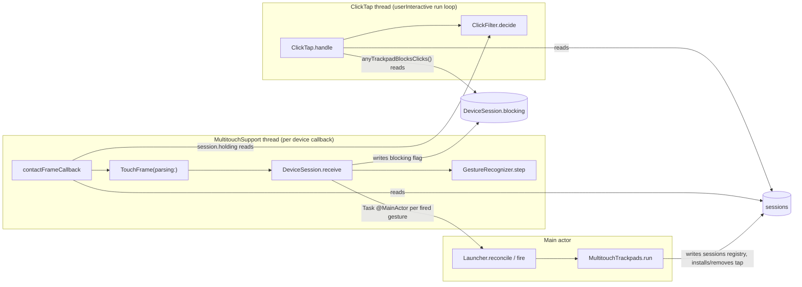
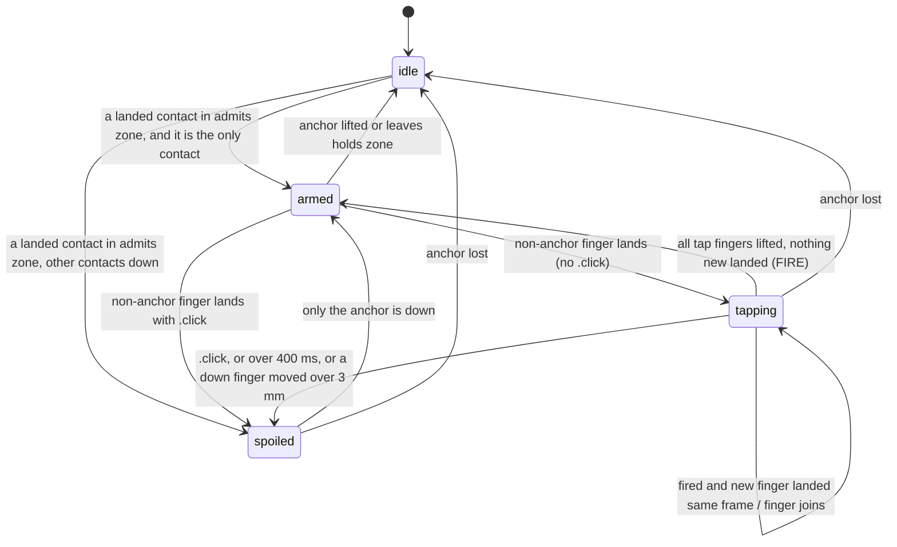

# How Trackpad Launcher works: the frame path, click blocking, and how the model owns and renders settings

I checked the explorers' claims against the code: `GestureRecognizer.step`, `DeviceSession`, `contactFrameCallback`, `TouchFrame.Press`, `ClickFilter`, `ClickTap.handle`, `MultitouchTrackpads.run`, `Launcher`, `LauncherView`, `MenuBarShell.refit` and `LauncherPanel.fitToContent`. The explorers agree with each other and with the code. The only differences are line numbers off by one, which I've normalised below. In the text, file names are short. The absolute paths are in "Where things live".

## Overview

Trackpad Launcher is a menu-bar app. While a thumb rests in a top corner of the trackpad (the "anchor": top-left in right-hand mode, top-right in left-hand mode; orchestrator's correction of the explainer's "bottom corner"), tapping 1 to 4 other fingers anywhere opens the app assigned to that finger count. Three threads cooperate:

- **The MultitouchSupport frame thread.** It turns raw contact frames into a pure per-trackpad `GestureRecognizer`.
- **The `ClickTap` thread.** It runs a CGEvent tap that withholds the physical click a firm tap would otherwise send to apps.
- **The main actor.** It hosts `Launcher`, an `@Observable` model that owns every decision. It also turns a fired gesture into a haptic pulse, `bringToFront`, a launch animation and closing the window.

The design is strictly layered:

- **`LauncherCore`** is pure Swift. It may only import Foundation and Observation, and has no timers, no clocks and no `nonisolated(unsafe)`. It holds the recognizer, the click filter, the model and the port protocols.
- **`LauncherPlatform`** holds the adapters that touch private frameworks, CGEvent taps and NSWorkspace.
- **`LauncherUI`** is the SwiftUI and AppKit shell that renders the model.

Tests run the real model, the real recognizer and the real click filter over in-memory adapters, driven by scripted touch timelines.

## Key concepts

**Frame types (`Touch.swift`)**
- `TouchFrame` holds a `FrameTime`, the contacts currently touching (`Touch` with id, `SurfacePoint`, and phase `.landing` or `.down`), and an optional `Press`.
- `Press` is either `.click` (apps received this press, which cancels a tap) or `.blocked` (the filter is withholding it, so it is part of the tap).

**`GestureRecognizer` (`GestureRecognizer.swift`)**
- A pure per-trackpad state machine with four states: `idle`, `armed(Anchor)`, `tapping(Anchor, Tap)` and `spoiled(Anchor)`.
- `step(_:)` returns `Recognition { fired: Gesture?, blocksClicks: Bool }`.
- It has no clock. Every time rule is checked only when a frame arrives.

**`GestureRules` (`GestureRules.swift`)** holds all the constants:

| Constant | Value |
|---|---|
| Corner admit zone | 20% of width × 25% of height |
| Hold margin (`anchorReleaseMarginMM`) | 2 mm |
| `maxTapDuration` | 400 ms |
| `dragThresholdMM` | 3 mm |
| `clickBlockingWindow` | 3 s |

**`AnchorCorner` (`Surface.swift`)**
- `admits` is the zone in plain fractions and decides where a thumb may land.
- `holds` is the same zone grown by 2 mm and decides where an existing anchor may stay.
- On a MacBook 14" pad: admit is x < 24.96 mm and y < 19.2 mm; hold is x < 26.96 mm.

**`Gesture` (`Gesture.swift`)**
- Int-backed, `.one` to `.four`, `Codable` and `CodingKeyRepresentable`, so it is also the persistence key.
- `init?(fingerCount:)` returns nil outside 1...4. That nil is the only thing that silences a five-finger tap.

**Click-blocking types**
- `ClickFilter` (`ClickFilter.swift`) is a pure press filter with no clock and no device. It maps `PointerEvent` (`.press`, `.release`, `.drag`, `.pressure`) to `PointerVerdict` (`.pass`, `.drop`, `.passAsMove`).
- It summarises its current state as `Holding`: `.nothing`, `.withheld` or `.passed`.

**`DeviceSession` and `sessions` (`FrameStream.swift`)**
- `DeviceSession` is one running trackpad: `Mutex<GestureRecognizer>`, a `blocking: Mutex<Bool>` flag, the `ClickTap?` from the same `run`, and a `deliver` closure.
- `sessions` is a global `Mutex<[UInt: DeviceSession]>` keyed by the device ref's bit pattern. It is the only state shared with the frame thread.

**Ports (`Ports.swift`)** are `@MainActor` protocols:
- `TrackpadHardware` (`onEvent`, `connected()`, `run(_:handMode:blockClicks:)`, `playFeedback(on:)`)
- `SystemActions`, `TrackpadPreferences`, `AccessibilityPermission` and `AppScanner`
- `TrackpadEvent`, which has exactly two cases: `.gesture(GestureEvent)` and `.trackpadsChanged`.

**`Launcher` (`Launcher.swift`)** is the model.
- Stored state: `settings`, `window` (`closed`, `open` or `heldOpen`), `connected`, `preferenceValues`, `installedApps` and `rows`.
- `activity` is derived, never stored.
- `fire` is the only path that turns a gesture into effects.
- `reconcile` is the one convergent operation that (re)starts the hardware.

## How it works

### 1. Threads and who writes what



Every field has exactly one writer. The `nonisolated(unsafe)` ban in `SourcePolicyTests` is filed under the rule "one writer per field".

| Field | Writer | Readers |
|---|---|---|
| `sessions` | main (`run`) | frame callback, tap thread |
| `DeviceSession.recognizer` | that device's frame callback only (the Mutex is "the compiler's proof" and is never contended) | none |
| `DeviceSession.blocking` | that device's frame callback | tap thread |
| `ClickTap.filter` | tap thread | frame threads (via `holding`) |
| `ClickTap.port` | main | tap thread (at start, and to re-enable) |
| `ClickTap.runLoop` | tap thread, once | main (to stop) |
| `MultitouchTrackpads.clickTap`, `actuators`, `startedDevices` | main | none |

Lock discipline: no path holds two locks at once.
- `anyTrackpadBlocksClicks()` copies the sessions out of the registry lock before reading each flag.
- `ClickTap.handle` reads the flags before taking its filter lock.

### 2. Starting devices: `reconcile` → `run`

Launch, hot-plug, wake, trackpad-preference changes, Accessibility trust changes and `setHandMode` all go through `Launcher.reconcile()`. It does this:

1. Re-reads `connected()`, `preferences.current()` and `access.isGranted()`.
2. Calls `hardware.run(active ? connected : [], handMode:, blockClicks: active && granted)`.

`MultitouchTrackpads.run` (`MultitouchTrackpads.swift` ~L64-101) is ordered so that teardown is safe:

1. Empty `sessions` first. A frame already in flight then finds no session and is dropped.
2. Remove the click tap.
3. Unregister and stop the old devices, and close their actuators.
4. Re-list the devices and filter them to the wanted IDs.
5. If `blockClicks && !devices.isEmpty`, call `ClickTap.install()`. This returns nil without Accessibility.
6. For each device:
   - build a `DeviceSession` with a fresh `GestureRecognizer(handMode:surface:)`;
   - set its `deliver` closure to `Task { @MainActor in self?.onEvent?(.gesture(event)) }`;
   - open its actuator;
   - insert it into `sessions` before calling `registerContactFrameCallback` and `start`.

Consequence: every `reconcile` resets every recognizer. The next frame is a "first frame" again.

### 3. A frame, from the hardware to `Recognition`

`contactFrameCallback` (`FrameStream.swift` L48-53) runs on the framework's thread:

1. Looks up the session.
2. Samples the press: `TouchFrame.Press(holding: session.holding, buttonDown: anyMouseButtonDown())`. That costs the filter lock plus three `CGEventSource.buttonState` calls per frame.
3. Parses the frame and calls `session.receive`.

Parsing (`TouchFrameParsing.swift`) reinterprets the buffer as 96-byte `MTTouchMirror` records. The stride is pinned by `mirrorMatchesTheFrameworksTouchStride`.
- Only state 3 (becomes `.landing`) and state 4 (becomes `.down`) are kept. A lifted finger is simply absent from the next frame.
- y is flipped: `1 - normalizedY`.
- Velocity, angle, and the framework's own frame counter are never read.

`DeviceSession.receive` does three things: steps the recognizer, writes `blocking = recognition.blocksClicks`, and calls `deliver` only if `fired` is non-nil.

### 4. The recognizer's state machine



Each `step` (L26-85) runs in this order.

**1. Per-frame sets.**
- `before` is the previous frame's ids.
- `lifted` is the ids that vanished, plus any `.landing` touch whose id was already down. A reused id counts as a lift followed by a landing.
- `landed` is every `.landing` touch plus anything new since the last frame. On the very first frame, every contact counts as landed.

**2. Anchor check, before the switch (L35-38).** If the anchor lifted or left `holds`, the state becomes `.idle`, and the `.idle` branch runs in the same frame. This is why no state survives the thumb. Every non-idle case carries an `Anchor`, so losing it wipes any tap in progress. The test `thumbLiftingInTheSameFrameAsTheLastFingerFiresNothing` pins this.

**3. `.idle`.** Only a landed contact inside `admits` can become the anchor.
- Contacts that are already down are never adopted. A thumb sliding into the corner, or a former anchor rolling back, does not anchor.
- `landedAt` is nil only when the first frame shows the thumb already `.down`. That means it was resting before a reconcile, its landing time is unknown, and it opens no blocking window.
- The new state is `.armed` if the anchor is alone, otherwise `.spoiled`.

**4. `.armed`.** Landed non-anchor fingers start a `Tap`. A `.click` press on that same frame spoils it instead. A `.blocked` press is ignored.

**5. `.tapping`.** First, lifted ids are removed from `tap.down`. Then the tap is spoiled if any of these hold:
- the press is `.click`;
- more than 400 ms have passed since `tap.start` (strict);
- any finger still down is more than 3 mm from its own landing origin. This is absolute per-finger displacement, measured in mm via `surface.distanceMM`.

Otherwise:
- If `tap.down` is empty, it fires `Gesture(fingerCount: tap.touched.count)`. The count is distinct ids, not a peak, so a bounced finger counts once.
- If not, newly landed fingers join via `tap.land`.

The timeout check comes before the fire check, so a final lift after 400 ms spoils rather than fires. With five fingers, `Gesture(fingerCount: 5)` is nil, so nothing fires, but the state still returns to `.armed`. The tap is silent, not spoiled.

**6. `.spoiled`.** It recovers to `.armed` only on a frame where the anchor is the only contact down.

**7. `blocksClicks` (L78-83).** True when all of these hold:
- an anchor exists;
- its `landedAt` is non-nil;
- `now - landedAt < 3 s`;
- some other contact is down.

It doesn't depend on armed, tapping or spoiled, and it drops to false on the very frame the anchor is lost.

Because time is frame-driven, the 400 ms and 3 s rules only take effect when a frame arrives (`expiryIsSeenOnAFrameWhereNothingButTheClockMoved`). The pad sends no frames when nothing touches it, which is why a `.landing` on the first frame is trusted as "landed now".

### 5. A fired gesture becomes an app in front

`deliver` posts one unstructured `Task { @MainActor }` per fired gesture. The hop to main lives in the hardware adapter on purpose (001 dev log), so the in-memory adapter can deliver synchronously.

`Launcher.start`'s `onEvent` switch sends the event to `fire` (L131-142), which does this:

1. Guards three things: `activity.isActive`, an assignment for that gesture, and `catalog.locate` finding the app. `locate` reads the disk on main.
2. Calls `hardware.playFeedback(on:)`, which is `actuatorActuate(..., 6, 0, 0, 0)` ("Chosen by feel: 3 weak, 4 medium, 6 strong").
3. Calls `system.bringToFront(app)`, which is `NSWorkspace.openApplication` with `activates = true`.
4. Calls `system.playLaunchAnimation(for: app)`. This comes after bring-to-front so the animation's cost lands on the icon, not the app. A test pins the ordering.
5. Sets `window = .closed`, which closes even a `.heldOpen` window.

`fire` re-checks `activity.isActive`. That matters because a session fetched just before `run` cleared the registry can still deliver one stale gesture.

### 6. Click blocking on the same frame path

The tap and the recognizer never call each other. They exchange two summaries, each sampled by the other thread:

- The frame thread writes `blocking`. The tap thread reads it, merged across trackpads, through `anyTrackpadBlocksClicks()`.
- The tap thread maintains `ClickFilter.holding`. The frame thread reads it into `TouchFrame.Press`.

```mermaid
sequenceDiagram
  participant F as Frame thread
  participant T as ClickTap thread
  participant A as Apps
  F->>F: frame k: step, write blocking=true (thumb anchored <3s, finger down)
  Note over T: mouseDown #N arrives
  T->>T: anyTrackpadBlocksClicks() reads flags left by frame k
  T->>T: filter.decide(.press(N), blocking: true) → held[0]=.withheld, .drop
  T--xA: (dropped)
  F->>F: frame k+1: Press(holding: .withheld) = .blocked → tap continues
  Note over T: drags → .passAsMove; pressure → .drop
  Note over T: mouseUp #N
  T->>T: decide(.release(N)) → held[0]==.withheld(N) → .drop, clear slot
  F->>F: last finger lifts → fired
```

Press precedence (`TouchFrame.Press.init?(holding:buttonDown:)`, pinned by `PressSamplingTests`):

| `holding` | Button down | Button up |
|---|---|---|
| `.withheld` | `.blocked` | `.blocked` |
| `.nothing` | nil | nil |
| `.passed` | `.click` | nil |
| nil (no filter) | `.click` | nil |

The `.nothing` row means a press the tap hasn't processed yet is invisible to the recognizer. `.passed` with the button up reads nil, which heals a release the tap missed.

The press decision always uses the flags left by the previous frame. A press that beats its landing frame to the tap is passed, then sampled as a `.click`, which cancels the tap (`aPressReachingTheTapBeforeTheLandingFrameIsAClickThatCancelsTheTap`).

`ClickFilter.decide` blocks or passes a press whole:
- **`.press`** records `.withheld` or `.passed`, based on the flag at press time.
- **`.release`** ignores the flag. It drops only if that button's slot holds `.withheld` with the exact same `PressID`, then always clears the slot.
- **`.drag`** of a withheld button becomes `.passAsMove`: the event type is rewritten to `.mouseMoved` in place.
- **`.pressure`** is dropped while any button is withheld.

`handle` also deals with the system disabling the tap. On `tapDisabledByTimeout` or `ByUserInput` it calls `forgetHeldPresses()` and re-enables.

`ClickTap.install` makes the app's only CGEvent tap:
- `cgSessionEventTap`, `headInsertEventTap`, `.defaultTap`.
- The mask covers buttons, drags and raw type 34 (pressure). It does not cover scroll, keyboard or plain moves.
- It runs on a dedicated "ClickTap" thread that retains the tap until `CFRunLoopRun` returns. `userInfo` is unretained.

Blocking cannot tell a mouse from a trackpad, so mouse clicks during a gesture are blocked too. This is documented in `docs/domain-model.md:69` and plan 002 R6.

### 7. The model owns settings; rows and effects are derived

**Construction has no effects.** `Launcher.init` reads synchronously:
- `catalog.installedApps()`, a full enumeration plus Spotlight, on main;
- `store.load()`, where nil means first launch;
- `rows = makeRows()`.

It doesn't save, run, prepare or wire anything. The test `creatingTheLauncherPreparesNothingAndStartingItPreparesTheAssignedApps` pins this.

**`start()` does the wiring.**
1. Wires `hardware.onEvent`, `scanner.onScan`, `preferences.onChange` and `access.onChange`.
2. Calls `reconcile()`.
3. On first launch only: registers the login item, prompts if not trusted, saves, and sets `window` to `.heldOpen` or `.open`.
4. Calls `resolveRows()`.

**Settings** (`Settings.swift`):
- `handMode` plus `assignments: [Gesture: AssignedApp]`, where a missing key means unassigned.
- Synthesized `Codable`, stored as one binary plist under the UserDefaults key `"settings"`.
- Not versioned. Any decode error silently becomes `Settings()`.

**Intents.**
- `setAssignment(_:for:)` mutates `assignments`, saves, then calls `resolveRows()`.
- `resolveRows()` recomputes `rows` from `Gesture.allCases × catalog.locate`. It then calls `system.prepareLaunchAnimations(for:)` with the present apps, deduplicated by URL, so the icon bitmap is ready before the gesture.
- `setHandMode` saves and calls `reconcile()`, which builds fresh recognizers with the new corner. It does not call `resolveRows`.

`rows` is stored, not computed. It is refreshed only by `init`, `start`, `setAssignment` and `openWindow`. It is not refreshed on a scan, a `reconcile` or a hand-mode change.

### 8. The window: rendering and sizing

**`MenuBarShell`** (`MenuBarShell.swift`) runs four `Observations` loops over the model:

| Observed | Reaction |
|---|---|
| `activity.isActive` | status icon |
| `(activity, isAccessibilityGranted)` | `refit()` |
| `installedApps` | re-render the 16 pt icons off main |
| `isWindowOpen` | `show()` / `hide()` |

Nothing observes `rows` or `handMode` to trigger a refit.

**The panel.** `LauncherPanel` hosts `LauncherView` in a glass effect view. `LauncherView` is a fixed 266 pt wide column (`.frame(width: 266).fixedSize(...)`) containing, in order:
- `ForEach(launcher.rows)` of `GestureRowView`, each an illustration plus an `AppPicker`;
- the hand-mode toggle;
- a divider;
- `HintText` or `SettingsNotice`;
- the Accessibility notice;
- Quit.

**Sizing.**
- `refit()` anchors under the status item: `midX`, `topEdge = statusFrame.minY - 6`. Before the status item is laid out, it uses the top-right of the visible frame.
- It then calls `LauncherPanel.fitToContent`, which takes `hosting.fittingSize` as is. Only x is clamped to the screen. The bottom can fall below `visible.minY`, despite the doc comment saying the panel is clamped.

**`AppPicker`** is an `NSPopUpButton` with a `Coordinator: NSMenuDelegate`.
- `menuNeedsUpdate` builds the menu from `installedApps.pickerMenu(checking:)`: recent apps, a divider, the others, "Other…" and "None".
- While closed, the button shows just the current item.
- A choice becomes an `AppChoice` passed to `launcher.setAssignment`.
- "Other…" goes through `LauncherActions.chooseOtherApp(gesture)`: close the window, `NSApp.activate()`, `NSOpenPanel`, then reopen.

Illustrations are loaded as `"gesture-\(fingerCount)"` SVGs from `Bundle.main`. Under `swift test`, and for any missing resource, they draw nothing.

### 9. Test seams

**`World` (`World.swift`)** is the real `Launcher` over:
- `InMemoryTrackpads`;
- `InMemoryTrackpadPreferences`;
- `RecordingSystemActions`, which records `broughtToFront`, `launchAnimations`, `preparedLaunchAnimations` and `loginItemRegistrations`, and offers the hooks `onPlayLaunchAnimation` and `onRegisterLoginItem`;
- `InMemoryAccessibilityPermission`;
- `InMemoryAppScanner`, with `holdScans` and `deliverHeldScan`;
- a temp-dir `AppCatalog` with fake `Registry` and `LaunchRecord`;
- a throwaway `UserDefaults` suite `tl-test-<UUID>`.

`relaunch()` rebuilds the `Launcher` on the same suite.

**`InMemoryTrackpads` (`InMemoryAdapters.swift`)** uses the real recognizer and a real `ClickFilter`, and is synchronous.
- `run` resets the recognizers and flags, and arms a filter iff `blockClicks && !trackpads.isEmpty`.
- `touch(_:on:)` works per frame:
  1. On a button-state edge, it mints a `PressID` and calls `decide`, using the previous frame's merged `blocking`. It appends the verdict to `pressVerdicts`.
  2. It re-samples the press via the same `Press(holding:buttonDown:)`.
  3. It steps the recognizer and stores the flag.
  4. If a gesture fired, it calls `onEvent` synchronously.
- It never feeds drags or pressure.
- `inject(_:)` delivers a gesture regardless of `running`, which models the stale-session race.

**`TouchScript` (`TouchScript.swift`)** is a timeline builder.
- Frames are 10 ms apart. The thumb has id 100. Finger ids are 1, 2, … placed at (62 + 8i, 45) mm.
- Methods: `thumb`, `tap(fingers:atMM:stagger:hold:dragMM:click:)`, `rollThumb`, `liftThumb`, `wait`, `frames`.
- The `click:` ranges produce `.click` presses.

**`HandFrames` and `fired(_:)` (`Fixtures.swift`)**
- `HandFrames` builds frames by hand.
- `fired(_:handMode:surface:)` runs a fresh recognizer and returns the non-nil `fired` values.
- Surfaces: `macBook14` (124.8 × 76.8 mm) and `magicTrackpad` (160 × 115 mm).

**The source-policy gate (`SourcePolicyTests.swift`)** is a raw substring scan of `LauncherKit/Sources` and `TrackpadLauncher/`. Comments count; tests and `plans/` are not scanned.
- **Core imports:** Foundation and Observation only.
- **Banned tokens include:**
  - `Timer`, `asyncAfter`, `Task.sleep`, `makeTimerSource`, `displayLink`, `DisplayLink`;
  - `scrollWheel` and `ScrollWheel` (filed under the rule "R6 never scrolling");
  - `.post(tap:`, `CGEventPost`, `postToPid`;
  - keyboard event names;
  - `nonisolated(unsafe)`.
- **Confined:** `tapCreate`/`CGEventTapCreate` may appear only in `ClickTap.swift`; `AXIsProcessTrusted` and `notify_register` only in `SystemAccessibilityPermission.swift`.
- **Self-check:** no confined token may overlap a banned one (case-sensitive), and the kept list is pinned.
- **Precedent:** to allow a banned token, remove it from `banned` and add a `Confined(token:onlyIn:rule:)`. That is how plan 002 moved `tapCreate` (`plans/002-gesture-click-blocking/plan.md:1078-1090`).

## Where things live

All under `/Users/dominykasgrubys/code/trackpad-launcher/.claude/worktrees/006-five-finger-tap-and-corner-swipe/`:

**Core** (`LauncherKit/Sources/LauncherCore/`)
- `GestureRecognizer.swift`, `GestureRules.swift`, `Surface.swift`, `Touch.swift`, `Gesture.swift`: recognition.
- `ClickFilter.swift`: the pure press filter.
- `Launcher.swift`, `Settings.swift`, `Apps.swift`, `Activity.swift`, `Ports.swift`: the model, persistence and ports.

**Platform** (`LauncherKit/Sources/LauncherPlatform/`)
- `MultitouchSupport.swift`: dlopen/dlsym of the private framework.
- `MultitouchTrackpads.swift`: `run`, `playFeedback`, hot-plug.
- `FrameStream.swift`: `DeviceSession`, `sessions`, the callback.
- `TouchFrameParsing.swift`: the MTTouch mirror.
- `ClickTap.swift`: the event tap, its thread, `PointerEvent` parsing and `apply(to:)`.
- `WorkspaceActions.swift`, `LaunchOverlay.swift`: effects.

**UI** (`LauncherKit/Sources/LauncherUI/`)
- `MenuBarShell.swift`: observation loops, `refit`.
- `LauncherPanel.swift`: `fitToContent`.
- `LauncherView.swift`: rows, illustration, `HintText`.
- `AppPicker.swift`, `LauncherActions.swift`, `AppIcons.swift`.

**Tests**
- `LauncherKit/Tests/LauncherCoreTests/`: `World.swift`, `InMemoryAdapters.swift`, `TouchScript.swift`, `Fixtures.swift`, `GestureRecognizerTests.swift`, `ClickBlockingTests.swift`, `ClickBlockingRecognizerTests.swift`, `PersistenceTests.swift`, `SourcePolicyTests.swift`.
- `LauncherKit/Tests/LauncherPlatformTests/`: `PointerEventTests.swift`, `TouchFrameParsingTests.swift`.

**Composition root:** `TrackpadLauncher/TrackpadLauncherApp.swift`.

**Docs that state today's rules:** `docs/architecture.md` (L18, L20-21, L25) and `docs/domain-model.md:69`.

## Gotchas

- **Every `reconcile` resets the recognizers.** A hand-mode toggle, a hot-plug, wake or a trust change mid-gesture starts from scratch. A thumb that is already resting anchors with `landedAt == nil`, so it never blocks clicks (`aReconcileUnderARestingThumbDoesNotRestartTheWindow`).
- **The registry clear is not airtight.** A session fetched just before `run` can still deliver. `fire`'s guard is the backstop.
- **Ordering of hops to main is not guaranteed in code.** Each gesture is its own `Task { @MainActor }`, and `.trackpadsChanged` arrives synchronously and can interleave. The orchestrator's probe (`plans/006-five-finger-tap-and-corner-swipe/.temp/architect/grounding/probes/task-order-probe/output.txt`) saw 25,000 hops from one thread arrive in order. That is evidence, not a contract.
- **A press decides on the previous frame's flag**, and the recognizer learns of it only by sampling. The tap never pushes to the recognizer.
- **`run` empties `sessions` before removing the tap.** A press landing in between passes, and a withheld press's release may reach apps as a stray mouse-up.
- **The real and fake adapters arm the tap slightly differently.** The real one checks that found devices are non-empty after filtering; the fake checks `!trackpads.isEmpty`.
- **Settings decode is all-or-nothing.** Adding a non-optional field with synthesized `Codable` makes every existing user's record fail to decode, which silently resets their assignments and hand mode. Explorer 3's probe confirmed it: `keyNotFound` becomes `Settings()`. A hand-written `init(from:)` with `decodeIfPresent` works; the same tolerant pattern exists in `LaunchTuning.init(from:)`.
- **The window does not resize when rows change.** `refit` isn't triggered by `rows`, and only x is clamped.
- **`blocksClicks` and `fired` are recomputed fresh every frame.** Nothing persists between frames except the recognizer `state` and `previouslyDown`.

**Open questions the explorers flagged:**
- whether MultitouchSupport uses one callback thread or one per device;
- the real frame rate, and whether frames keep arriving while contacts are perfectly still;
- the meaning of `actuatorActuate`'s trailing zeros;
- a possible race between the tap thread starting and `remove()`;
- what an old build does with a `5` key in `assignments` on downgrade.

## Where the planned changes land

This lists the locations only. It doesn't choose an approach.

**A fifth tap gesture**
- `Gesture.swift` L4-8: the cases, and the doc comments "four" and "nil outside 1...4". Adding `case five` alone makes five-finger taps fire, because the recognizer already passes `tap.touched.count` through at L64.
- `Launcher.makeRows` and `resolveRows`: these iterate `Gesture.allCases`, so a fifth row appears automatically.
- `LauncherView.swift`:
  - `GestureIllustration` (L81) needs a `gesture-5.svg` in `assets/` (bundled by `project.yml:22-24`);
  - `HintText` (L125) hard-codes "1, 2, 3 or 4";
  - the doc comment says "Four gesture rows".
- Persistence: `Settings.assignments` is keyed by `Gesture`. An old record keyed 1..4 decodes into the 5-case enum. Downgrade behaviour is unverified.
- Tests: `fiveFingerTapFiresNothing`, `fiveFingersInARollingTapFireNothing`, `thumbThenNFingerTapFiresThatGestureOnce` (1...4), `ClickBlockingTests.aFirmTapOpensItsAppAndTheWholePressNeverReachesApps` (1...4 with 4 apps), and `PersistenceTests` `count: 4` (L26, L52).
- `docs/domain-model.md`: it says "four".

**A two-finger sideways swipe that survives the thumb lifting**
- `GestureRecognizer.swift`:
  - L35-38: the unconditional anchor check that returns to `.idle`;
  - L114-126: `State`, where every non-idle case carries an `Anchor`;
  - L42-49: `.idle` adopts only landed contacts in `admits`;
  - L55-72: the 400 ms timeout, the 3 mm drag and `.click` all spoil, and a swipe breaks the drag rule by definition;
  - L73-76: `.spoiled` recovers only when the anchor is alone.
- `GestureRules.swift`: `maxTapDuration` (L12) and `dragThresholdMM` (L14).
- `Recognition` (L4-16): it has only `fired` and `blocksClicks`, with no continuous output.
- No timer may be added; the source policy bans them.
- Tests pinning today's behaviour:
  - `thumbLiftingBeforeTheFingersFiresNothing`
  - `thumbLiftingInTheSameFrameAsTheLastFingerFiresNothing`
  - `onlyTheTapMadeWhileTheThumbIsAnchoredFires`
  - `twoFingersHeldFiveHundredMillisecondsFireNothing`
  - `tapMustEndWithinFourHundredMillisecondsOfItsFirstLanding`
  - `noTapBeginsWhileAnOverlongTapsFingersAreStillDown`
  - `draggingFingersIsNotATapAndTheNextTapStillFires`
  - `fingerMovementPastThreeMillimetresIsADrag`
- Existing helpers: the recognizer already holds `surface`, so `SurfaceSize.distanceMM` gives mm in the core. No midpoint helper exists.

**Keeping clicks blocked for the whole swipe**
- `GestureRecognizer.swift` L78-83: `blocksClicks` comes from `state.anchor` plus the 3 s `clickBlockingWindow` measured from `landedAt`, and turns false the moment the anchor is lost.
- `DeviceSession.blocking` and `anyTrackpadBlocksClicks()` (`FrameStream.swift`) carry only that one bool.
- Tests: `liftingTheThumbEndsBlockingAtOnce` and `aThumbSlidingOutOfTheCornerStopsBlocking`.

**Swipe state reaching the main actor (per frame, about 100 Hz, in order)**
- `DeviceSession.receive` (it delivers only on `fired`), and the `deliver` closure type (`FrameStream.swift` L15, L19).
- The per-event `Task { @MainActor }` in `MultitouchTrackpads.run`.
- `TrackpadEvent` (`Ports.swift` L3-7) and its exhaustive switch in `Launcher.start` (L60-65); `GestureEvent`.
- `InMemoryTrackpads.touch` and `inject`.
- Constraints:
  - `docs/architecture.md:21` says "No code of ours runs per frame";
  - `Launcher` observation is per-property;
  - each real frame already costs three `buttonState` calls plus the filter lock;
  - transient UI state today lives in adapters (`LaunchOverlay.playingPanels`, `flights`).

**Scroll suppression through the same event tap**
- `ClickTap.swift`:
  - `PointerEvent.tapTypes` (~L89) has no type 22;
  - `PointerEvent.init?` returns nil, meaning pass, for anything unparsed;
  - `PointerVerdict.apply(to:)` can only pass, drop or rewrite the type, not fields;
  - the header comments at L6 and L88 say no scroll.
- `ClickFilter.swift`: `PointerEvent` ("Everything the click tap is ever told about"), the exhaustive `decide`, the three-case `PointerVerdict`, and `forgetHeldPresses`, which resets only `held`.
- `SourcePolicyTests.swift`: `scrollWheel`/`ScrollWheel` are banned (L49-50). Confining one while keeping the other passes the case-sensitive overlap check. Field names like `.scrollWheelEvent…` contain the token.
- `PointerEventTests.swift`:
  - `maskCoversPressesTheirReleasesDragsAndPressureOnly` pins bits [1,2,3,4,6,7,25,26,27,34];
  - `ignoresEverythingElse` asserts `.scrollWheel` parses to nil.
- The fake has no scroll input, and `pressVerdicts` would not capture scroll verdicts.
- Specs and docs: plan 002 R6 (`plan.md:126-137`) and R9 (`plan.md:181`), `docs/architecture.md:20,25`, `docs/domain-model.md:69`. Plan 006 R12-R15 amend these.
- Probe data from explorer 2:
  - scroll fields: `scrollWheel` = 22, ScrollPhase 99, MomentumPhase 123, PointDeltaAxis1/2 = 96/97, IsContinuous 88;
  - phases: `mayBegin` arrives ~17 ms before `began`; momentum follows ~7 ms after `ended`, lasts about 1 s and carries `phase=0`;
  - timing: events are 4-12 ms apart, so a slow callback risks `tapDisabledByTimeout`.

**A switcher list edited in the launcher window**
- Model and persistence:
  - `Settings.swift` uses synthesized Codable, so a new field needs tolerant decoding (see Gotchas);
  - `Launcher.setAssignment`, `rows`, `makeRows` and `resolveRows` are keyed to `assignments: [Gesture: AssignedApp]`. A list stored elsewhere would not get `prepareLaunchAnimations` unless extended.
- Icons: `MenuBarShell.iconTargets` pre-renders only installed apps plus rows' present apps.
- Picker:
  - `AppPicker` and its `Coordinator` hold a single `RowApp`;
  - `InstalledApps.pickerMenu(checking:)` always appends "Other…" and "None" and checks exactly one app;
  - `PickerItem.app` has no disabled flag;
  - `LauncherActions.chooseOtherApp` is typed `(Gesture) -> Void`.
- Layout:
  - `LauncherView` is fixed at 266 pt;
  - `refit()` isn't triggered by changes to `rows` or any new list;
  - `LauncherPanel.fitToContent` clamps only x, so a taller window can run off the bottom of the screen.
  - A SwiftUI `ScrollView` does not trip the `scrollWheel` ban.
- Tests: `RecentAppsTests.menu(_:checking:)` projects the picker menu to strings. `World` and `RecordingSystemActions` are the seams for new intents and effects.
