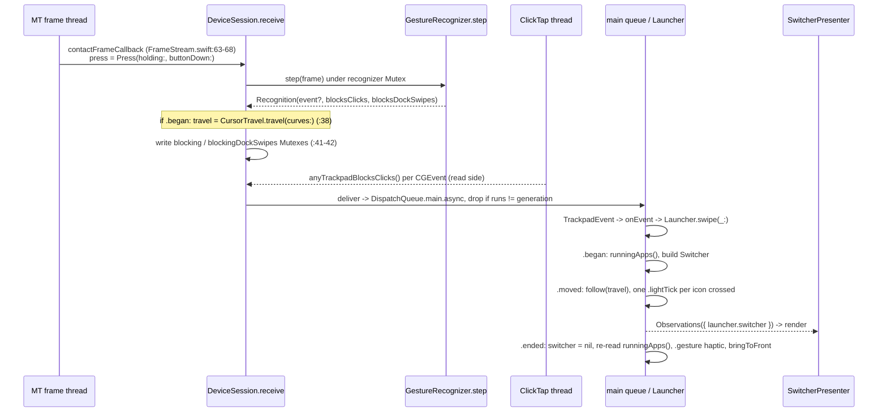

# How the swipe works, end to end, and where a window swipe would meet it

Path abbreviations used throughout (all under the worktree root):
`Core/` = `LauncherKit/Sources/LauncherCore/`, `Platform/` = `LauncherKit/Sources/LauncherPlatform/`,
`UI/` = `LauncherKit/Sources/LauncherUI/`, `Tests/` = `LauncherKit/Tests/LauncherCoreTests/`,
`PTests/` = `LauncherKit/Tests/LauncherPlatformTests/`.

## Overview

The swipe is two fingers sliding sideways while the thumb rests in the anchor corner. It shows a row of running apps (the
*switcher*), moves a highlight as the fingers travel, gives a light haptic tick on each icon crossed, and on lift brings
the selected app to the front with the gesture haptic. For as long as the swipe lasts, trackpad clicks, scrolling and
the system's Dock/Spaces swipes are blocked.

The work is split across three threads and four modules, and the split is deliberate. A pure, per-trackpad state
machine (`GestureRecognizer`, in `LauncherCore`) runs on MultitouchSupport's frame thread. It produces two kinds of
output from every frame. **Events** (begin / moved / ended / cancelled) hop to the main actor, where the single
`@Observable` model (`Launcher`) turns them into effects through ports. **Blocking flags** stay off the main actor: a
CGEvent tap on its own thread reads them through Mutexes. The shell (`LauncherUI`) only observes `launcher.switcher` and
draws it. A window swipe would touch all four modules and both thread crossings, which is why this document traces the
whole path.

## Key concepts

- **`GestureRecognizer`** (`Core/GestureRecognizer.swift:39-413`): a `Sendable` value-type state machine for one
  trackpad. `step(_ TouchFrame) -> Recognition` (`:54`). The behaviour flags `swipes` and `swaps` are fixed at `init`
  (`:43-50`). Only `travel` is mutable afterwards (`:52`).
- **`Recognition`** (`:4-34`): one frame's output. An optional `Event` (`.fired(Gesture)`, `.swipe(SwipePhase)`,
  `.swap(startsSeries:)`, `:6-11`) plus `blocksClicks` and `blocksDockSwipes`.
- **`State`** (`:379-402`): `idle`, `armed`, `tapping`, `resting`, `spoiled`, `rest` (fingers first, which is the
  swap's home) and `swiping(Swipe)`. `.spoiled(anchor)` is terminal until every non-thumb contact lifts.
- **`SwipePhase` / `SwipeEvent`** (`Core/Gesture.swift:25-46`): `.began`, `.moved(travelMM:)`, `.ended`, `.cancelled`,
  tagged with a `TrackpadID`. They carry no axis or direction.
- **Step millimetres**: the travel unit. 12 make one icon (`GestureRules.switcherStepMM`, `Core/GestureRules.swift:27`).
  With the shipped cursor travel, 100 cursor points make one icon (`SwipeTravel.shippedPointsPerIcon`,
  `Core/PointerCurve.swift:140`).
- **`SwipeTravel`** (`Core/PointerCurve.swift:133-151`): `.linear` (travel = `dxMM`, used by every test) or
  `.cursor(PointerCurve, pointsPerIcon:)`, which reproduces macOS pointer acceleration. **Both return only the x
  component.**
- **`TrackpadEvent`** and the ports (`Core/Ports.swift`). `TrackpadEvent.init(_:on:)` (`:11-17`) is "the one mapping"
  from `Recognition.Event` to the port's enum, and both hardware adapters use it.
- **`Launcher`** (`Core/Launcher.swift`): the `@MainActor @Observable` model. `switcher: Switcher?` (`:12`) is the only
  swipe state anyone else sees.
- **`Switcher`** (`Core/Switcher.swift:6-71`): a value type. Its row of `AppEntry`s is fixed at begin, and selection,
  position and rubber-band stretch are derived from travel.
- **`DeviceSession`** (`Platform/FrameStream.swift:8-56`): one running trackpad on the platform side. It holds the
  recognizer in a `Mutex`, the device's pointer curves, the two blocking-flag Mutexes, the click tap and the `deliver`
  closure.
- **`ClickTap`** (`Platform/ClickTap.swift:12-89`): the single CGEvent session tap. It runs the pure `ClickFilter`,
  `ScrollFilter` and `DockSwipeFilter` (`Core/`) on its own thread.

## How it works

### Module and thread map

```
                    LauncherCore (Foundation + Observation only)
   +-----------------------------------------------------------------------+
   | GestureRecognizer   Switcher   Launcher (@MainActor @Observable)      |
   | ClickFilter / ScrollFilter / DockSwipeFilter   Ports   Settings        |
   +-----------------------------------------------------------------------+
        ^ depends on                ^ depends on              ^ depends on
   LauncherPlatform            LauncherUI (MainActor default)   tests
   (real adapters)             (cannot see LauncherPlatform)    (in-memory adapters, World)
        ^                           ^
        +------------ app target (composition root) -----------+

 Threads:  [MT frame thread] --events--> [main actor] --observes--> [UI]
                 |  flags (Mutex)
                 v
           [ClickTap thread]
```

Module dependencies are set in `LauncherKit/Package.swift:12-22`. `LauncherUI` depends on Core only. That is why
`SwitcherPresenter.screen(under:)` (`UI/SwitcherPresenter.swift:165`) duplicates `LaunchFlight.display(for:)` instead of
importing it.

### One swipe, frame to haptic



**1. Frames in (platform, frame thread).** `MultitouchTrackpads.run` (`Platform/MultitouchTrackpads.swift:66-113`) does
the following for each wanted device:
- builds a `DeviceSession` with a fresh `GestureRecognizer(... travel: .linear)` (`:90`);
- reads the device's acceleration curves once with `CursorTravel.curves(of:)` (`:91`);
- registers `contactFrameCallback`.

The callback (`Platform/FrameStream.swift:63-68`) looks the session up in the global `sessions` Mutex (`:61`). A frame
for a torn-down device finds nothing and is dropped. It then samples the press as
`TouchFrame.Press(holding: session.holding, buttonDown: anyMouseButtonDown())`, parses the `MTTouch` array into a domain
`TouchFrame` (`Platform/TouchFrameParsing.swift:40-55`, which flips y so that 0 is the top) and calls
`DeviceSession.receive`.

**2. Recognition (core, still on the frame thread).** `step` (`Core/GestureRecognizer.swift:54-189`) first does four
things on every frame:
- removes edge contacts (`:55`), so they never land, join or cancel anything;
- computes the landed, lifted and reused ids;
- updates the `ContactBook` of landing points and times;
- runs the anchor check (`:73-76`). If the anchored thumb lifted or left the grown corner, armed, tapping, resting and
  spoiled states drop to `.rest` or `.idle`. `.swiping` is exempt because its `anchor` is nil (`:391-396`).

The swipe's path through the switch:

- `.idle` -> `.armed(anchor)` when a landing is admitted by the corner and nothing else is down.
- `.armed` -> `.tapping` when another finger lands (unless `press == .click`).
- `.tapping` (`:92-110`). **`let pair = swipes ? Pair(tap, joining:) : nil` (`:95`)** is where the swipe setting
  gates everything. A `Pair` exists only for exactly two fingers, both still down, with nobody joining this frame. The
  checks then run in order:
  1. a click spoils;
  2. otherwise, if `drag(...)` (`:339-351`, the farthest single finger from its own landing point, strictly past 3 mm)
     returns a move, `beginOrSpoil` decides;
  3. otherwise, past 400 ms, the state becomes `.resting(anchor, pair)` when a pair exists, else `.spoiled`;
  4. otherwise, if every finger lifted, a tap fires.
- `.resting` (`:111-118`): a click, a pair finger lifting or any landing spoils; a drag past 3 mm goes to `beginOrSpoil`.
- **`beginOrSpoil` (`:243-249`) is the single place a slide's direction is decided.**
  `guard let pair, move.isSideways else { return (.spoiled(anchor), nil) }` (`:246`). `Move.isSideways` is
  `abs(dxMM) > abs(dyMM)` (`:335`), strict, so a tie is not sideways. On success it starts `.swiping(Swipe(...))` with
  the fingers' **current** positions, `travelMM = 0` and `thumb = anchor`, and emits `.swipe(.began)`. Today a vertical
  first drag therefore spoils, and stays spoiled until the hand lifts.
- `.swiping` (`:125-168`), in this order:
  1. thumb bookkeeping (`:126-133`): the thumb plays no part and is only remembered for afterwards;
  2. `after` (`:135`): the state to fall to, `.spoiled` with a remembered thumb, else rest/idle;
  3. lifted fingers leave the swipe. Joiners are landings outside the corner (`:139`);
  4. **cancel** (`:140-142`) on `press == .click` or `fingers + joiners > 2`;
  5. **end** (`:143-146`) when both fingers have lifted;
  6. otherwise **move** (`:147-167`). The mean dx/dy of the fingers present on both frames, in mm, goes through
     `self.travel.travel(dxMM:dyMM:interval:)` and is added to `swipe.travelMM`. `.moved(travelMM:)` (absolute, not a
     delta) is emitted only when the value changed.
- **Blocking flags** (`:170-187`). `if case .swiping = state` makes both flags true (`:172-174`); a swap series does the
  same. Otherwise they follow the thumb rules: Dock swipes are blocked while a thumb is anchored and another contact is
  down; clicks are blocked only within 3 s of the thumb's real landing.

**3. Back in `DeviceSession.receive`** (`Platform/FrameStream.swift:33-46`). Still inside the recognizer's lock, **if
`recognition.swipe == .began` it replaces `recognizer.travel` with `CursorTravel.travel(curves:)` (`:38`)**. That reads
the tracking speed fresh from `com.apple.trackpad.scaling` and the DEBUG tuner's override
(`Platform/CursorTravel.swift:14-17, 37-43`). Travel is 0 on the begin frame, so the next frame is the first to use it.
`receive` then writes the two blocking Mutexes (`:41-42`) and, if there is an event, calls
`deliver(TrackpadEvent(event, on: trackpad))` (`:43-45`).

**4. The hop to the main actor.** The `deliver` closure (`Platform/MultitouchTrackpads.swift:93-102`) does
`DispatchQueue.main.async { MainActor.assumeIsolated { guard self.runs == generation ... ; self.onEvent?(event) } }`.
The main queue is FIFO from one frame thread, so events keep frame order. `generation` was captured at `run` (`:82`),
and `runs` is bumped before anything else in `run` (`:67`), so a replaced session's late events are dropped ("a stale
swipe start could never be ended").

**5. The model** (`Core/Launcher.swift`). `start()` installs `onEvent` (`:68-75`) and routes `.swipe` to
`swipe(_:)` (`:205-235`):
- `.began` (`:207-213`). `guard switcher == nil, activity.isActive`, so a second trackpad's begin is ignored. It then
  reads `system.runningApps()` once and builds
  `Switcher(frontmost:running:leavingOut: settings.assignedBundleIDs, trackpad:)`. The init is failable and returns nil
  when there is nothing besides the frontmost app (`Core/Switcher.swift:22-28`). In that case nothing shows, but the
  recognizer is still `.swiping` and still blocking.
- `.moved` (`:214-219`). Guard on the same trackpad, then `open.follow(travel)` (which converts the absolute reported
  travel to per-frame deltas and applies the hard stops and the 3 mm rubber band, `Core/Switcher.swift:43-53`), one
  observable write, then **one `.lightTick` per icon crossed** (`:219`).
- `.ended` (`:220-231`). `switcher = nil` first. Lifting on the frontmost app is silent (`selectsFrontmost`). Otherwise
  it **re-reads `runningApps()`** and stays silent if the target quit. Then the `.gesture` haptic,
  `system.bringToFront(app)` (`Platform/WorkspaceActions.swift:15-19`: `NSWorkspace.openApplication(at: url)`, keyed by
  URL, never by window) and `window = .closed`. Never the launch animation.
- `.cancelled` (`:232-233`) clears `switcher` and does nothing else.

**6. The shell.** `SwitcherPresenter` (`UI/SwitcherPresenter.swift`) iterates
`Observations({ launcher.switcher })` (`:29-31`), which coalesces to the latest value per main-actor turn. `render`
(`:117-131`) works like this:
- nil hides the panel with a 150 ms fade;
- a new or changed row calls `open`. That picks the screen under the pointer, builds a `SwitcherRowLayout` (horizontal,
  width-only, `Core/SwitcherRowLayout.swift`), fetches icons synchronously from the 80 pt `AppIcons` cache and calls
  `orderFrontRegardless`;
- every render calls `panel.show(position:selected:name:)`, which places the highlight at the continuous `position` with
  actions disabled and animates the icon scale;
- a rubber-band spring runs when `stretch` changes.

`SwitcherPanel` (`UI/SwitcherPanel.swift:26-57`) is borderless, non-activating, `ignoresMouseEvents`, `.screenSaver`
level, on every Space, with `canBecomeKey/Main` false, and centred on the full `screen.frame` (`:94-96`). The presenter
holds nothing the model holds.

### Blocking: the other output

The model pushes exactly one bit to the tap: `blockClicks` in `hardware.run`. It is computed in `reconcile` as
`active && granted` (`Core/Launcher.swift:182`). `run` installs a fresh `ClickTap` only if `blockClicks` is set and
there are devices (`Platform/MultitouchTrackpads.swift:85`). Without Accessibility, `tapCreate` returns nil and nothing
is filtered.

Per CGEvent, `ClickTap.handle` (`Platform/ClickTap.swift:63-87`) on the tap thread reads `anyTrackpadBlocksClicks()`
once, before taking any filter lock (`:75`; `Platform/FrameStream.swift:77-85` copies sessions out of their lock first).
It then routes:
- pointer events to `ClickFilter`, where a press is dropped if blocking was on at the press and its release follows it;
- scroll events to `ScrollFilter`, which drops a gesture first seen while blocking and "stills" one that meets blocking
  mid-way, never relaxing inside a gesture;
- Dock swipes to `DockSwipeFilter`, judged once on the opening phase against `anyTrackpadBlocksDockSwipes()`.

"Held open for the whole swipe" has **no timer**. It is simply that `state == .swiping` makes the flags true on every
frame.

The feedback the other way, "a click reached apps, so cancel", is **not a message either**. On each frame, the frame
thread reads `ClickTap.holding` and the global button state. `TouchFrame.Press(holding:buttonDown:)`
(`Core/Touch.swift:72-82`) maps a passed press with the button still down (or any press when there is no tap) to
`.click`, and the recognizer cancels on `.click` (`Core/GestureRecognizer.swift:140`).

### Settings and permissions

`Settings` (`Core/Settings.swift:7-33`) is one Codable record saved as a binary plist under the key `"settings"` in
`UserDefaults.standard`. Every field decodes with `decodeIfPresent ?? default` (`:23-32`), so a key added later
defaults to on after an upgrade. `setSwipe(on:)` (`Core/Launcher.swift:128-133`) saves at once and calls `reconcile()`.

`reconcile(restart:)` (`:172-189`) re-reads the following:
- `hardware.connected()`;
- `preferences.current()`;
- `access.isGranted()` (which also sets `isAccessibilityGranted`, the flag that drives the window's hint).

It then builds a `Run` value from `trackpads`, `handMode`, `blockClicks`, `swipes` and `swaps` (`:158-164`). If the
`Run` is unchanged and `restart` is false, it returns (`:184`); otherwise it sets `switcher = nil` (`:187`) and calls
`hardware.run(...)` (`:188`). That call builds new recognizers, so any swipe in progress ends. The settings toggles bind
straight to the `Launcher` setters (`UI/SwitcherSection.swift:18-23, 32-37`).

The Accessibility port (`Core/Ports.swift:66-73`; real adapter `Platform/SystemAccessibilityPermission.swift`) is a
pushed `onChange` with no payload, driven by the `com.apple.tcc.access.changed` Darwin notification. On top of it sit a
fresh `isGranted()` and `prompt()`. The prompt is only ever called on first launch (`Core/Launcher.swift:81-89`). The
window's "Grant access…" button only opens a System Settings URL (`UI/LauncherActions.swift:5-16`, `openSettings` in
`UI/MenuBarShell.swift:147`).

## Load-bearing invariants

**Fixed at swipe begin**
- The recognizer's `swipes` and `swaps` flags are fixed for the recognizer's whole life. Changing them means a new
  `run`, which ends any swipe in progress.
- The `travel` mode, and with it the tracking speed, is chosen on the `.began` frame (`Platform/FrameStream.swift:38`).
  It is never reset to `.linear` afterwards; the next begin overwrites it.
- `Swipe.fingers` start at the begin-frame positions with `travelMM = 0`. **The 3 mm that start a swipe do not count
  towards the selection.** This is pinned by `Tests/SwipeTravelAndExitTests.swift:20-41`.
- The switcher's `row` is `let`: it is read once from `runningApps()` at begin. `runningApps()` is read again only at
  `.ended`.
- The direction decision is made once. A non-sideways first drag spoils, and spoiled is terminal until the non-thumb
  fingers lift (`Tests/SwipeRecognizerTests.swift:38-42`).

**What hops to the main actor, and in what order**
- Only events hop. Blocking flags never leave the frame/tap threads.
- Events arrive in frame order per trackpad: `.began`, then `.moved`* (only on change), then exactly one of
  `.ended`/`.cancelled`.
- Events from a replaced session are dropped by the `runs == generation` check.
- The model reads the system synchronously inside the handler: `runningApps()` at `.began` and again at `.ended`.

**Mutex discipline (frame and tap threads)**
- Each `DeviceSession` Mutex has one writer: the device's frame callback (`Platform/FrameStream.swift:5-16`).
- `sessions` is written only by `run` on the main actor.
- No two locks are held at once. `nonisolated(unsafe)` is banned.

**What the source policy forbids** (`Tests/SourcePolicyTests.swift`)
- The scan is a plain, case-sensitive substring match per line across `LauncherKit/Sources` and `TrackpadLauncher/`,
  **comments included** (`:179-186`).
- Banned (`:13-54`):
  - logging;
  - networking;
  - own-file writes (`.write(to:`, `createFile(atPath`, `FileHandle(forWriting`);
  - `Timer`, `asyncAfter`, `Task.sleep`, `makeTimerSource` and display links;
  - Input Monitoring / post-event access APIs;
  - keyboard tokens;
  - event posting;
  - `ScrollWheel`;
  - `nonisolated(unsafe)`.
- Confined to one file each (`:64-76`):
  - `AXIsProcessTrusted` and `notify_register`, to `SystemAccessibilityPermission.swift`;
  - `tapCreate`, `CGEventTapCreate` and `scrollWheel`, to `ClickTap.swift`;
  - the two private LaunchServices functions, to `LaunchServicesOrder.swift`.
- `Confined.onlyIn` is a single file name.
- `LauncherCore` may import only Foundation and Observation (`:136-142`), so no CG, AX, AppKit or ScreenCaptureKit type
  can appear in a domain type.

**The two-adapter rule** (`docs/architecture.md:14`)
- Every port has exactly one real adapter in `LauncherPlatform` and one in-memory adapter in
  `Tests/InMemoryAdapters.swift`.
- Framework types (`NSRunningApplication`, `NSImage`, `CFTypeRef`, ...) never cross a port (`:13`).
- Concrete local-substitutable types such as `AppCatalog` and `SettingsStore` are not ports, unless they deliver
  asynchronously. Then they sit behind a port so model tests stay synchronous; `AppScanner` and its `InMemoryAppScanner`
  with `holdScans()`/`deliverHeldScan()` are the precedent.
- The five current ports are `TrackpadHardware`, `TrackpadPreferences`, `SystemActions`, `AccessibilityPermission` and
  `AppScanner`, and each has both adapters.

**No timers, no polling** (`docs/architecture.md`, Concurrency). Every input is a push. Animation is Core Animation only.

## Where the tests sit

- **Recognizer units.** `TouchScript` (`Tests/TouchScript.swift`) works in millimetres from the top-left, y down, one
  frame every 10 ms. The thumb is id 100. `slide(byMM:)` already takes `(x, y)` (`:146-154`), but
  `tap(dragMM:)`/`thumbTap(dragMM:)` drag along x only (`:87-89, 117-119`). `HandFrames` (`Tests/Fixtures.swift:82-96`)
  covers hand-built interleavings. The drivers `fired`/`phases`/`swaps`/`perFrame` (`Tests/Fixtures.swift:21-67`) each
  build a fresh recognizer with `travel: .linear`. Tests can observe only `Recognition`, because the nested types are
  private.
- **Model plus recognizer plus filter integration.** `World` (`Tests/World.swift`) wires the real `Launcher` over
  in-memory adapters, fake bundles in a temp folder and a throwaway `UserDefaults` suite. `World.init` does not call
  `start()`; `switcherWorld` (`:203-212`) does.
  - `InMemoryTrackpads` (`Tests/InMemoryAdapters.swift:5-119`) runs the **real** recognizer, `ClickFilter` and
    `ScrollFilter` and delivers events synchronously through the same `TrackpadEvent.init`.
  - `World.play` replays only frames newer than those already delivered, so a hand can be played in pieces.
  - `World.swipe(_:)` slides x only (`:235-241`).
  - "On screen" in `Tests/SwitcherOnScreenTests.swift` means `launcher.switcher`'s value, plus the recorded haptics and
    `broughtToFront`.
- **Pure values.** `Tests/SwitcherTests.swift` and `Tests/SwitcherRowLayoutTests.swift`.
- **Persistence.** `Tests/PersistenceTests.swift` holds a frozen pre-swap `savedSettings` record (never regenerate it)
  and `everySettingsFieldSurvivesTheStore`.
- **Platform adapters.** `PTests/` hits real cfprefs, real Darwin notifications (`SystemAccessibilityPermissionTests`,
  using an injected `trusted` closure) and the real LaunchServices order. Nothing installs the tap, prompts, activates an
  app or reads real TCC.
- **Not tested by code.** There is no `LauncherUI` test target (`LauncherKit/Package.swift:20-21`), so the presenter,
  panel, icons and SwiftUI views are checked by hand. The `.cursor` travel path through the recognizer is never
  exercised either: `Tests/PointerCurveTests.swift` unit-tests the curve with `dyMM: 0`.

## Where things live

| Concern | File |
|---|---|
| Recognizer, `Recognition`, blocking flags | `Core/GestureRecognizer.swift` |
| Fixed numbers | `Core/GestureRules.swift` |
| Swipe event types | `Core/Gesture.swift` |
| Travel and the pointer curve | `Core/PointerCurve.swift`, `Platform/CursorTravel.swift`, `Platform/LaunchTuning.swift` |
| Ports and `TrackpadEvent` | `Core/Ports.swift` |
| Model | `Core/Launcher.swift` |
| Switcher value, row geometry | `Core/Switcher.swift`, `Core/SwitcherRowLayout.swift` |
| Settings | `Core/Settings.swift` |
| Window copy | `Core/Copy.swift` |
| Click, scroll and Dock filters | `Core/ClickFilter.swift`, `Core/ScrollFilter.swift`, `Core/DockSwipeFilter.swift` |
| Frame thread, sessions | `Platform/FrameStream.swift`, `Platform/MultitouchTrackpads.swift`, `Platform/TouchFrameParsing.swift` |
| Event tap | `Platform/ClickTap.swift` |
| Accessibility | `Platform/SystemAccessibilityPermission.swift` |
| Running apps, bring to front | `Platform/WorkspaceActions.swift`, `Platform/RunningAppsReader.swift`, `Platform/RunningApp.swift`, `Platform/LaunchServicesOrder.swift` |
| Switcher on screen | `UI/SwitcherPresenter.swift`, `UI/SwitcherPanel.swift`, `UI/AppIcons.swift`, `UI/GlassClip.swift` |
| Launcher window | `UI/MenuBarShell.swift`, `UI/LauncherPanel.swift`, `UI/LauncherView.swift`, `UI/SwitcherSection.swift`, `UI/LauncherActions.swift` |
| Composition root | `TrackpadLauncher/TrackpadLauncherApp.swift` |
| Bundle config | `project.yml`, `Config/*.xcconfig` |
| Test adapters, fixtures, policy | `Tests/InMemoryAdapters.swift`, `Tests/World.swift`, `Tests/TouchScript.swift`, `Tests/Fixtures.swift`, `Tests/SourcePolicyTests.swift` |

## Gotchas

- **Stale doc comments.** `SwipePhase` (`Core/Gesture.swift:26-34`) has three that no longer match the code:
  - `.ended` says "the first of the two fingers lifted", but the code ends only when **both** have lifted
    (`Core/GestureRecognizer.swift:143`).
  - `.moved` says "trackpad millimetres", but with the shipped `.cursor` travel the value is step millimetres.
  - `.cancelled` says "a finger landed outside the corner", but only a third finger while both are down cancels.

  `Switcher.travelMM`'s doc (`Core/Switcher.swift:13`) repeats the millimetre wording. Trust the code and the tests.
- **The plan's R9 premise does not match the code.** R9 says the 3 mm that start the window swipe count "as in the app
  switcher". The app switcher's travel actually starts at 0 on the begin frame (`Core/GestureRecognizer.swift:247`,
  pinned by `Tests/SwipeTravelAndExitTests.swift:20-41`). Landing points do exist in `ContactBook.origin`. Two explorers
  flagged this independently. The code cannot say whether the plan means to change the swipe too.
- **Travel is x-only today.** `PointerCurve.cursorPoints` (`Core/PointerCurve.swift:93-100`) computes velocity from
  `hypot(dx, dy)` but returns `dx * multiplier / velocity`. A diagonal slide therefore accelerates x travel more than a
  pure sideways slide with the same dx. Nobody verified whether the IOHID reproduction holds for y by symmetry.
- **A nil `switcher` does not mean "no swipe".** The recognizer can be `.swiping`, and blocking, while the model shows
  nothing (`Tests/SwitcherOnScreenTests.swift:341-360`).
- **Only `.began` checks `activity`.** The later phases rely on `reconcile` having cleared `switcher`.
- **Toggling any reconciling setting ends a swipe** (swipe, swap or hand mode). A TCC or preference broadcast that
  changes nothing does not (`Core/Launcher.swift:184`).
- **`runs` is bumped before the `framework` guard** (`Platform/MultitouchTrackpads.swift:67-68`), so even a failed load
  invalidates older deliveries.
- **`InMemoryTrackpads` does not mirror Dock-swipe blocking.** It records `blocksClicks` only (`:87`).
- **The architecture text overstates AX confinement.** `docs/architecture.md:25` says "the Accessibility APIs … are
  each confined to one adapter file", but only `AXIsProcessTrusted` is confined. The `AXUIElement*` family is neither
  banned nor confined.
- **`notify_register` is confined to `SystemAccessibilityPermission.swift`.** A second permission adapter that listens
  for the same TCC broadcast in another file would fail the scan. The broadcast "names no app and no service". Nobody
  verified whether it fires for Screen Recording.
- **`AppEntry` and `RunningApps` carry no pid.** `LaunchServicesOrder` reads `pid` and discards it, and `RunningApp`
  ignores `processIdentifier`.
- **Substring hazards in the source scan.** Any identifier containing `Timer`, `print(`, `dump(`, `KeyDown` or
  `scrollWheel` fails the build, comments included.
- **The panel's first-window cost is paid elsewhere.** `SwitcherPanel` uses `defer: true`; the process-wide
  first-window cost is actually paid by `LaunchOverlay.init`'s warm-up panel (`Platform/LaunchOverlay.swift:17-21`).
- **`CGWindowListCreateImage` is obsoleted in macOS 15** (SDK `CGWindow.h:271-274`) and so unavailable at the macOS 26
  deployment target. `CGWindowListCopyWindowInfo` and `CGPreflight/RequestScreenCaptureAccess` are available, and
  ScreenCaptureKit is in the SDK.

## Where the window swipe meets this

These are the places the explorers named that a window swipe would have to change or add to. They are listed without a
design.

**Recognizer (frame thread)**
1. Direction decision: `beginOrSpoil` at `Core/GestureRecognizer.swift:243-249`, the guard at `:246`. It is reached
   from `.tapping` (`:98-99`) and `.resting` (`:116-117`). `Move.isSideways` is at `:335` (strict, so a tie spoils).
2. Setting gate: `let pair = swipes ? Pair(...) : nil` (`:95`) and `pair.map { .resting(anchor, $0) } ?? .spoiled`
   (`:101`) tie the pair and the `.resting` state to the swipe setting. R16's "swipe off, window swipe on" passes
   through both lines. See also the constructor (`:43-50`) and the stored flags (`:406-407`).
3. State: `State.swiping(Swipe)` (`:388`) and its handling (`:125-168`), covering thumb memory, rejoin, cancel, end and
   movement, are what R15 asks a window swipe to match. `State.anchor` (`:391-396`) exempts swiping from the anchor
   check.
4. Vertical travel: the accumulation at `:157-165` computes `dyMM` but feeds the single scalar `Swipe.travelMM`
   (`:325`). `SwipeTravel.travel` (`Core/PointerCurve.swift:142-150`) and `PointerCurve.cursorPoints` (`:93-100`) return
   x only.
5. Travel origin (R9): the begin positions at `:247` and `travelMM = 0`, versus the landing points in `ContactBook`
   (`:256-282`).
6. Blocking: `if case .swiping = state` (`:172`) is what holds both flags true for a whole swipe.
7. Event: `Recognition.Event` (`:6-11`) and the accessor `Recognition.swipe` (`:25`), plus `SwipePhase` / `SwipeEvent`
   (`Core/Gesture.swift:25-46`), which have no direction.
8. Per-begin travel hook: `if recognition.swipe == .began` at `Platform/FrameStream.swift:38`.

**Port and event plumbing**
9. `TrackpadEvent` and its exhaustive mapping (`Core/Ports.swift:3-17`), and the exhaustive `onEvent` switch
   (`Core/Launcher.swift:68-75`).
10. `TrackpadHardware.run(_:handMode:blockClicks:swipes:swaps:)` (`Core/Ports.swift:35`). It is implemented at
    `Platform/MultitouchTrackpads.swift:66` (recognizer built at `:90`) and `Tests/InMemoryAdapters.swift:44-49`.

**Model**
11. `Run` (`Core/Launcher.swift:158-164`) and its construction (`:181-183`).
12. `switcher: Switcher?` (`:12`, "written only by `swipe(_:)` and `reconcile()`") and `switcher = nil` in `reconcile`
    (`:187`).
13. `swipe(_:)` (`:205-235`) covers the begin read, the per-move ticks (`:219`), the lift's re-read and silence rules
    (`:220-231`) and the cancel (`:232-233`). Today `.moved` has no effect other than ticks; R10 needs one per
    selection change.
14. `Switcher` (`Core/Switcher.swift`): the failable init returns nil for frontmost-only (`:22-28`), which R13 forbids.
    The `selectsFrontmost` analogue is at `:56`. The `follow`/`selected`/`position`/`stretch` maths (`:32-68`) is
    generic over `row.count`, but the element type is `[AppEntry]`.
15. Constants: `switcherMaxApps`, `switcherStepMM`, stretch and overshoot (`Core/GestureRules.swift:24-32`).

**Settings**
16. A field and its decode line in `Settings` (`Core/Settings.swift:8-16, 23-32`); `decodeIfPresent ?? default` gives
    "upgrade leaves it on".
17. A setter on the pattern of `setSwipe(on:)` (`Core/Launcher.swift:128-133`) and a computed `is…On` on the pattern of
    `:18-19`.
18. Persistence tests: `everySettingsFieldSurvivesTheStore`, the first-launch defaults test and the upgrade tests
    (`Tests/PersistenceTests.swift`; the frozen `savedSettings` predates any new key).

**System effects and reads (ports and the two-adapter rule)**
19. `SystemActions` (`Core/Ports.swift:49-63`) offers only app-level `bringToFront(AppEntry)` and `runningApps()`. There
    is no window list, raise, restore or reorder. The real adapter is `Platform/WorkspaceActions.swift:15-21`; the fake
    is `RecordingSystemActions` (`Tests/InMemoryAdapters.swift`, around `:136-167`).
20. `AppEntry` / `RunningApps` (`Core/Apps.swift:12-50`) carry no pid. The pid is dropped in `RunningApp.swift` and
    `LaunchServicesOrder.swift:36-51`.
21. Previews arrive asynchronously (R6/R17). The precedent for async delivery behind a port is `AppScanner`
    (`Core/Ports.swift:76-82`) with `InMemoryAppScanner.holdScans()`.

**Permissions**
22. The Screen Recording permission (R7/R8) would follow the `AccessibilityPermission` pattern (`Core/Ports.swift:66-73`,
    `Platform/SystemAccessibilityPermission.swift`), read in `reconcile` (`Core/Launcher.swift:175-178`). There is no
    "asked once" state today, and the TCC push via `notify_register` is confined to one file.
23. The `SettingsPane` cases (`UI/LauncherActions.swift:5-16`) and `openSettings`, which always closes the window and
    then opens a URL (`UI/MenuBarShell.swift:147`).
24. Info.plist keys (`project.yml:32-40`): there are no usage descriptions and no entitlements today.

**Shell**
25. A second presenter/panel: `SwitcherPresenter` observes only `launcher.switcher` (`UI/SwitcherPresenter.swift:29-31`)
    and owns one `SwitcherPanel` (`:13`). `MenuBarShell` builds one presenter (`UI/MenuBarShell.swift:28`).
26. Placement: centred on `screen.frame` (`UI/SwitcherPanel.swift:94-96`) with the pointer's display from
    `SwitcherPresenter.screen(under:)` (`:165`). `visibleFrame` is used only in `MenuBarShell.refit()`
    (`UI/MenuBarShell.swift:114-126`).
27. Geometry: `SwitcherRowLayout` (`Core/SwitcherRowLayout.swift:16-37`) is horizontal and width-only. The panel's
    height formula is at `UI/SwitcherPanel.swift:91-93`, the single name label at `:44-47, 100-102, 141`, and the
    highlight moves along x only (`:128-131`, spring at `:146-157`).
28. Icons: the 80 pt `AppIcons` and `icon(forSwitcher:)` (`UI/AppIcons.swift:50-64`) exist only while the swipe setting
    is on (`UI/SwitcherPresenter.swift:27, 33-37`).
29. The third toggle: on the pattern of `UI/SwitcherSection.swift:25-38`. Its doc says "Two setting rows" (`:5`), and a
    new row needs an SVG in `assets/` (`project.yml:22-24`).
30. The hint: Accessibility hint placement at `UI/LauncherView.swift:30-34`, `SettingsNotice` at `:161-175`, the refit
    tuple at `UI/MenuBarShell.swift:50`, and copy in `Core/Copy.swift:6-13` (`gestureHint` takes only the swipe flag).

**Source policy**
31. `Tests/SourcePolicyTests.swift`: the confined list (`:64-76`) has no AX-element or screen-capture entries. The
    banned "R9 only Accessibility" rule label (`:13-54`) and `docs/architecture.md:25` ("one permission") are what a
    Screen Recording permission contradicts.

**Tests that encode today's vertical-spoils rule**
32. `Tests/SwipeRecognizerTests.swift:38-42` (`movingUpOrDownFirstIsNeverASwipe…`), `:82-91` (second argument) and
    `:44-48` (the strict-sideways boundary); `Tests/ScrollSuppressionTests.swift:8-13` (a vertical slide shows no
    switcher).
33. Every recognizer construction site in the tests: `Tests/Fixtures.swift:28, 40, 51, 62`,
    `Tests/ClickBlockingRecognizerTests.swift:8, 13`, `Tests/EdgeContactRecognizerTests.swift:41`,
    `Tests/SwapRecognizerTests.swift:32, 51, 74, 86`, `Tests/DockSwipeBlockingRecognizerTests.swift:9` and
    `Tests/GestureRecognizerTests.swift:171, 244`.
34. Fixtures that are x-only: `World.swipe` (`Tests/World.swift:235-241`) and `TouchScript.tap(dragMM:)` /
    `thumbTap(dragMM:)` (`Tests/TouchScript.swift:87-89, 117-119`). The drivers `phases`/`perFrame` return
    `SwipePhase` only (`Tests/Fixtures.swift:33-67`).

**Open questions the explorers could not settle from the code**
- Whether `com.apple.tcc.access.changed` fires for Screen Recording grants, and whether macOS 26 needs an Info.plist key
  or a relaunch for Screen Recording.
- Whether the IOHID acceleration reproduction is valid for the y axis.
- Whether macOS's own scroll recognition starts before 3 mm on a vertical pair. If it does, a window swipe would
  "still" a scroll that had already begun, as `Tests/ScrollSuppressionTests.swift:46-61` shows for a late sideways
  swipe.
- Whether `AXUIElement` calls against other apps need anything beyond Accessibility trust under the hardened runtime
  with no entitlements.
