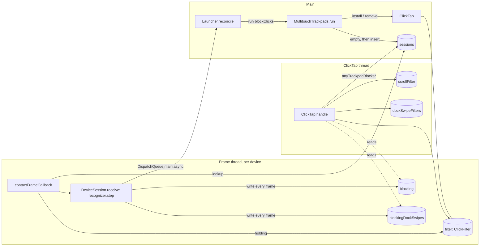

# How Trackpad Launcher blocks clicks, scrolling and the system's swipes today

Code as of `9557bc2` (branch `feature/014-gate-event-tap`). All paths are relative to the worktree root
`/Users/dominykasgrubys/code/trackpad-launcher/.claude/worktrees/014-gate-event-tap/`. I checked every line number
cited here against the source. Where the explorers disagreed or gave stale numbers, the numbers below are the
corrected ones.

## Overview

All blocking goes through one active CoreGraphics event tap, `ClickTap`
(`LauncherKit/Sources/LauncherPlatform/ClickTap.swift`). It is a `.cgSessionEventTap`, `.headInsertEventTap`,
`.defaultTap` tap over 13 event types: presses, releases, drags, Force Touch pressure, scrolling, and the system's
gesture and Dock control events (types 29 and 30). It runs on its own `userInteractive` thread. For each event it
parses a small domain value, reads one blocking flag merged across trackpads, and asks one of three pure state
machines in `LauncherCore` what to do: `ClickFilter`, `ScrollFilter` or `DockSwipeFilter`. The answer is to pass
the event, drop it, or rewrite it in place. A drag becomes a mouse move, and a scroll keeps its phases with every
delta zeroed. Nothing is ever posted.

The flags come from the trackpads. Each running trackpad has a `DeviceSession`
(`LauncherKit/Sources/LauncherPlatform/FrameStream.swift`). On every multitouch frame, the session's frame-thread
callback steps that trackpad's `GestureRecognizer` and writes `Recognition.blocksClicks` and
`Recognition.blocksDockSwipes` into two `Mutex<Bool>`s. The tap thread pulls those flags per event. The model
(`Launcher`) never sees a flag and never sees the tap. Its only lever is `blockClicks: Bool` on
`TrackpadHardware.run(...)`. Every `run` tears down and rebuilds everything: sessions, recognizers, flags, and the
tap with its filters. The tap's mask is fixed at creation, and nothing enables or disables the tap during normal
operation. That is why the scroll (22) and gesture (29/30) streams, which run at frame rate, make a synchronous round
trip through this process whenever fingers touch the pad. Plan 014 wants to remove exactly this cost.

## Key Concepts

| Name | Where | What it is |
|---|---|---|
| `ClickTap` (`final class ClickTap: Sendable`, internal) | `ClickTap.swift:12-89` | Owns the CFMachPort, the run-loop thread and the three filters, each behind a `Mutex`. |
| `TapEvent` (`.pointer`, `.scroll`, `.dockSwipe`) | `ClickTap.swift:103-134` | The parsed vocabulary. `tapTypes` (115-119) builds `tapMask` (120). |
| `ClickFilter` | `LauncherKit/Sources/LauncherCore/ClickFilter.swift:35-82` | Press state machine. `held: [Int: Held]` is keyed by button. It exposes `holding`. |
| `ScrollFilter` | `LauncherKit/Sources/LauncherCore/ScrollFilter.swift:27-82` | Per-scroll-gesture state machine. `stage: Stage?` is private. |
| `DockSwipeFilter` | `LauncherKit/Sources/LauncherCore/DockSwipeFilter.swift:13-34` | Per-Dock-swipe state machine. `current: DockSwipeVerdict?` is private. There is one instance per event type (29 and 30). |
| `Recognition.blocksClicks` / `.blocksDockSwipes` | `LauncherKit/Sources/LauncherCore/GestureRecognizer.swift:18,23`, computed at `182-199` | One trackpad's per-frame halves of the two verdicts. |
| `DeviceSession` | `FrameStream.swift:14-79` | One running trackpad: its recognizer, the two flag mutexes, the window-swipe answer slot, a strong ref to the run's `ClickTap`, and the `deliver` hop to main. |
| `sessions` | `FrameStream.swift:84` | `Mutex<[UInt: DeviceSession]>`, keyed by the device ref's bit pattern. The registry shared by main, the frame threads and the tap thread. |
| `anyTrackpadBlocksClicks()` / `anyTrackpadBlocksDockSwipes()` | `FrameStream.swift:100-108` | The tap-thread merge: copy `sessions.values` out of the lock, then OR each session's flag. |
| `TouchFrame.Press.init?(holding:buttonDown:)` | `LauncherKit/Sources/LauncherCore/Touch.swift:72-82` | The back channel. The click filter's `holding` turns into what a frame says about a press. |
| `TrackpadHardware.run(_:handMode:blockClicks:slides:swaps:)` | `LauncherKit/Sources/LauncherCore/Ports.swift:40` (doc 35-39) | The only arming API. There is no tap-specific port. |
| `Launcher.reconcile(restart:)` | `LauncherKit/Sources/LauncherCore/Launcher.swift:211-231` | The only caller of `hardware.run`. |
| `InMemoryTrackpads` | `LauncherKit/Tests/LauncherCoreTests/InMemoryAdapters.swift:5-127` | The test fake. It wraps a real recognizer, a real `ClickFilter` and a real `ScrollFilter`. It has no `DockSwipeFilter`. |

Exact filter signatures (all `public`):

```swift
// ClickFilter.swift
public mutating func decide(_ event: PointerEvent, trackpadBlocking: Bool) -> PointerVerdict   // :41
public var holding: Holding { get }                                                           // :62  (.nothing / .withheld / .passed)
public mutating func forgetHeldPresses()                                                      // :74
// ScrollFilter.swift
public mutating func decide(_ event: ScrollEvent, trackpadBlocking: Bool) -> ScrollVerdict     // :30
public mutating func forgetGesture()                                                          // :65
// DockSwipeFilter.swift
public mutating func decide(_ phase: DockSwipePhase, trackpadBlocking: Bool) -> DockSwipeVerdict // :16
public mutating func forgetSwipe()                                                            // :30 (unused in production)
// GestureRecognizer.swift
public mutating func step(_ frame: TouchFrame) -> Recognition                                 // :65
public mutating func answerWindowSwipe(began: FrameTime, isWindowSwipe: Bool)                 // :211
```

## How It Works

### 1. Threads and shared state

There are four kinds of thread involved:

- **Main.** `Launcher`, `MultitouchTrackpads.run`, `ClickTap.install()` / `remove()`, and the window-swipe reply.
- **Frame thread(s).** MultitouchSupport's own callback thread. It runs `contactFrameCallback` and
  `DeviceSession.receive`. The code does not establish whether this is one thread for all devices or one per device
  (see Open questions).
- **Tap thread.** The thread named `"ClickTap"` with `.userInteractive` QoS, created by `install()`. It runs
  `ClickTap.handle`.
- **IOKit / NSWorkspace / TCC / cfprefs notifications.** All delivered to main.



Every piece of cross-thread state, with its one writer:

| State | Declared | Writer | Readers |
|---|---|---|---|
| `sessions` | `FrameStream.swift:84` | main: `run` empties it (`MultitouchTrackpads.swift:70`) and inserts one session per device (:111) | frame callback per frame (`FrameStream.swift:87`); tap thread per parsed event (:101, :107) |
| `DeviceSession.recognizer` | `FrameStream.swift:16` | that device's frame thread | same. The comment says it is never contended (:12-13) |
| `DeviceSession.blocking` | `FrameStream.swift:20`, initial `false` | that device's frame thread, every frame (:58) | tap thread via `blocksClicks` (:75), for every parsed event |
| `DeviceSession.blockingDockSwipes` | `FrameStream.swift:22`, initial `false` | that device's frame thread, every frame (:59) | tap thread via `blocksDockSwipes` (:78), Dock swipe events only |
| `DeviceSession.answer` | `FrameStream.swift:28` | main, through the reply closure (:63-65) | frame thread, at the top of every `receive` (:47). It is never cleared |
| `ClickTap.filter` | `ClickTap.swift:14` | tap thread (`decide`, `forgetHeldPresses`) | tap thread; frame threads every frame via `holding` (:49), through `DeviceSession.holding` (`FrameStream.swift:72`) |
| `ClickTap.scrollFilter` | `ClickTap.swift:16` | tap thread | tap thread |
| `ClickTap.dockSwipeFilters` (`[UInt32: DockSwipeFilter]`) | `ClickTap.swift:18` | tap thread | tap thread |
| `ClickTap.port` (`Unchecked<CFMachPort>?`) | `ClickTap.swift:20` | main (`install` :33, `remove` :53-59) | tap thread: run-loop source creation (:36), and re-enabling after a system disable (:70) |
| `ClickTap.runLoop` | `ClickTap.swift:22` | tap thread (:38) | main (`remove`, :60) |
| `MultitouchTrackpads.runs`, `.clickTap`, `startedDevices`, `actuators` | `MultitouchTrackpads.swift:13-21` | main | main. The `deliver` block checks `runs == generation` on main (:99) |

Lock discipline: no code path holds two of these locks at once. `anyTrackpadBlocks*` copies `sessions.values` into
an `Array` before reading any session's flag. `handle` reads the click flag before it takes a filter lock (comment at
`ClickTap.swift:74`). The frame thread takes its locks one after another: `sessions`, then `filter` (via `holding`),
then `answer`, `recognizer`, `blocking` and `blockingDockSwipes`. `docs/architecture.md:18` states the rule "one
writer per Mutex", and `SourcePolicyTests.swift:53` enforces it by banning `nonisolated(unsafe)`.

### 2. The frame thread produces the verdict

`contactFrameCallback` (`FrameStream.swift:86-91`) runs on every frame:

1. Looks the session up in `sessions`. If there is no session, it drops the frame.
2. Builds `TouchFrame.Press(holding: session.holding, buttonDown: anyMouseButtonDown())`. This takes the tap's
   `filter` lock every frame.
3. Calls `session.receive(...)`.

`DeviceSession.receive` (:46-69) then does five things:

1. Reads the `answer` slot.
2. Under `recognizer.withLock`, applies any answer and then calls `step(frame)`. If `beginsSlide`, it installs the
   cursor travel.
3. Runs `blocking.withLock { $0 = recognition.blocksClicks }` (:58).
4. Runs `blockingDockSwipes.withLock { $0 = recognition.blocksDockSwipes }` (:59).
5. If the frame produced an event, delivers it to main.

Both flags are written unconditionally, every frame, in two separate lock acquisitions. Nothing detects a change and
no hook runs on a transition. A tap event can therefore see `blocksClicks` from frame N and `blocksDockSwipes` from
frame N-1. That is harmless today because each tap path uses only one of the two flags.

The verdict itself (`GestureRecognizer.swift:182-199`) is computed from the state after the frame's transitions, the
contacts down (with palm/edge contacts already removed at :66), the contact book, and `frame.time`:

- `.swiping(swipe)` with `swipe.isConfirmed`: both flags true.
- `.rest(rest)` with `rest.isSeries` (a swap series): both flags true.
- Otherwise, with `thumb = state.thumb` (:439-445):
  - The thumb is the anchor in armed/tapping/resting/spoiled.
  - In a rest it is `rest.thumb`.
  - In an unconfirmed swipe it is `swipe.thumb`.
  - In a confirmed swipe or idle it is `nil`.

  Given that thumb, the flags are:
  - `blocksDockSwipes = thumb != nil && some other contact down`. There is no time limit.
  - `blocksClicks` requires the same, plus `book.landingTime(of: thumb) != nil` and
    `frame.time - landedAt < GestureRules.clickBlockingWindow` (3 s, strictly less;
    `GestureRules.swift:23`).

This yields an invariant: `blocksClicks ⇒ blocksDockSwipes` in every branch. `blocksDockSwipes` is therefore the
per-trackpad superset of "this recognizer may block right now". The code does not document this invariant.

The verdict is pure. It is a function of the recognizer's configuration, its private state and the frame. There is no
wall clock: expiry is seen only on a frame where `frame.time` has moved
(`ClickBlockingRecognizerTests.expiryIsSeenOnAFrameWhereNothingButTheClockMoved`).

#### The exact moments the verdict changes

The verdict turns **false to true** on these frames. Each one is a single frame with no warning frame before it:

| Moment | Flags | Code |
|---|---|---|
| A finger lands next to an armed thumb that landed less than 3 s ago | both | `.armed` → `.tapping` (or `.spoiled` on a click), then :192-198 |
| The thumb and a finger land on the same frame (an accepted race) | both, on that frame | `.idle` → `.spoiled(anchor)` at :92-94 |
| A thumb lands under resting fingers (`rest.thumb` set) | both | private `step(_ rest:…)` at :222ff, then :192-198 |
| A `.swipe` begins | both. It is confirmed at once in `beginOrSpoil` (:274ff), which also re-raises `blocksClicks` after the 3 s window | :184-186 |
| A window swipe is confirmed | both, on the first frame processed after the main-thread reply lands. A slow main means several unconfirmed frames, during which only the thumb rules apply | `answerWindowSwipe` :211-219, applied in `receive` :49-51 |
| The first swap fires (`rest.isSeries = true`) | both | :236-240, then :187-189 |
| A thumb already `.down` on a fresh recognizer's first frame after `run` | `blocksDockSwipes` only (with another finger). `blocksClicks` stays false until that thumb lifts and lands again, because its landing time is unknown (:81, `landingTime` :313-315) | |

The verdict turns **true to false** on these frames:

| Moment | Flags | Notes |
|---|---|---|
| The last non-thumb, non-edge contact lifts while the thumb stays | both | Thumb branch: no other contact down |
| The thumb lifts or rolls out of `corner.holds` | both, unless a confirmed swipe or a series is in progress | anchor check at :84-87, rest roll-out at :241-246 |
| 3 s pass since the thumb landed | `blocksClicks` only. Dock swipes stay blocked | Seen on the next frame |
| A confirmed swipe ends (both swipe fingers up) | the state becomes `.spoiled(thumb)` or `restOrIdle`, so it falls back to the thumb rules | A confirmed swipe blocks even after its thumb lifts (`DockSwipeBlockingRecognizerTests.aSwipeBlocksToItsEndAfterTheThumbLifts`) |
| A window swipe is declined (`isWindowSwipe: false`) | thumb rules | :220-222 |
| A swap series ends because every rest finger lifted | both | A series blocks with one rest finger and no thumb (`SwapRecognizerTests`) |
| The `[]` frame the driver sends after the last lift | both false | `Touch.swift:47` |
| `run` replaces the session | the old flags are orphaned, and new sessions start `false` | `FrameStream.swift:11` |

Two facts about this matter for any gate.

First, the state "thumb anchored alone" (`.armed`, nothing else down) publishes `false/false`. `State` is private, and
`Recognition` exposes no "thumb anchored" or "may block soon" bit. Outside the recognizer, nobody can see that a
blocking frame is about to arrive.

Second, if frames stop with contacts down (sleep), the last flags stay latched in that session until the next `run`.

### 3. The flags reach the tap thread

The flags never hop threads as messages. `ClickTap.handle` pulls them per event.

- `anyTrackpadBlocksClicks()` is read once for **every parsed event** (`ClickTap.swift:75`). That includes drags,
  pressure, releases and Dock swipes, whose decisions ignore it.
- `anyTrackpadBlocksDockSwipes()` is read a second time for Dock swipes only (:83).

Each call allocates an `Array` of the sessions. Merging across trackpads is a plain OR, done at read time. Nothing on
the frame thread knows about other trackpads.

The reverse channel matters just as much. `TouchFrame.Press.init?(holding:buttonDown:)` (`Touch.swift:72-82`) maps
the click filter's summary into each frame like this:

| `holding` | Frame's press |
|---|---|
| `.withheld` | `.blocked` (part of the tap) |
| `.nothing` | **nil, even if the button is down** ("a press the filter has not seen yet is nothing") |
| `.passed` | `.click` if the button is down, else nil |
| `nil` (no tap) | `.click` if the button is down, else nil |

The recognizer spoils taps on `frame.press == .click`. So while a tap is live, a press the filter never saw would stop
cancelling taps. That changes recognition, not only blocking. Presses and releases (types 1-4, 25, 26) must keep
reaching the filter. Plan 014's gated set is 6, 7, 27, 34, 22, 29 and 30, which leaves those types out, and this
constraint is why.

### 4. The tap: creation, mask, callback, verdicts

`ClickTap.install()` (`@MainActor static func install() -> ClickTap?`, `ClickTap.swift:25-46`) works in four steps:

1. Calls `CGEvent.tapCreate(tap: .cgSessionEventTap, place: .headInsertEventTap, options: .defaultTap,
   eventsOfInterest: TapEvent.tapMask, callback: clickTapCallback, userInfo: Unmanaged.passUnretained(tap).toOpaque())`.
   If that returns nil, `install` returns nil. The doc comment says this means no Accessibility.
2. Stores the port.
3. Starts a `Thread { [tap] in ... }`. The thread creates a run-loop source from the port, adds it in `.commonModes`,
   publishes its `CFRunLoop` into `runLoop`, and calls `CFRunLoopRun()`.
4. The thread closure retains the tap until the run loop returns. Every `DeviceSession` of the run also holds a
   strong ref. The `userInfo` pointer is unretained.

The mask is asserted bit-for-bit by `TapEventTests.maskCoversPressesTheirReleasesDragsPressureScrollAndGesturesOnly`
(`TapEventTests.swift:8-11`) as `[1, 2, 3, 4, 6, 7, 22, 25, 26, 27, 29, 30, 34]`:

| Raw | Type | Parsed as | Flag used | Volume |
|---|---|---|---|---|
| 1, 3, 25 | left / right / other mouse down | `.pointer(.press(PressID))` | `blocksClicks` (decides the press) | rare |
| 2, 4, 26 | ... mouse up | `.pointer(.release(PressID))` | ignored | rare |
| 6, 7, 27 | ... mouse dragged | `.pointer(.drag(button:))` | ignored | high while a button is held |
| 34 | NSEventTypePressure | `.pointer(.pressure)` | ignored | high during a press |
| 22 | scrollWheel | `.scroll(ScrollEvent)`, never nil | `blocksClicks` | frame rate while scrolling, plus momentum |
| 29, 30 | gesture / Dock control | `.dockSwipe(phase)` only if field 110 == 23, otherwise nil (passes before any lock) | `blocksDockSwipes` | frame rate whenever fingers touch (every gesture event) |

The parsers are in `ClickTap.swift:150-211`:

- `PointerEvent.init?` reads `mouseEventNumber` and `mouseEventButtonNumber`. The button for left and right comes
  from the type.
- `ScrollEvent.init` maps `scrollWheelEventIsContinuous == 0` to `.wheel`. Otherwise the scroll phase wins over the
  momentum phase: 128/1/2/4/8 become `.fingers(...)`, `(0, 1/2/3)` becomes `.momentum(...)`, and anything else
  becomes `.unphased`.
- `DockSwipePhase.init?` maps field 132 as 128 to mayBegin, 1 to began, 4 to ended and 8 to cancelled. **Anything
  else, including 2 and 0, becomes `.changed`.**

Nothing about the device is read. A mouse click or a Magic Mouse scroll is filtered exactly like a trackpad one while
any trackpad blocks.

`handle(_:_:)` (`fileprivate`, `ClickTap.swift:64-88`) works in this order:

1. Handles the disabled notifications (below).
2. Calls `TapEvent(type, event)`. On nil it returns `.passUnretained(event)` before reading any flag.
3. Reads `blocking = anyTrackpadBlocksClicks()`.
4. Dispatches the event:
   - `.pointer` goes to `filter.withLock { $0.decide(pointer, trackpadBlocking: blocking) }.apply(to: event)`.
   - `.scroll` goes to `scrollFilter.withLock { ... }`.
   - `.dockSwipe` reads `anyTrackpadBlocksDockSwipes()` and then calls
     `dockSwipeFilters.withLock { $0[type.rawValue, default: DockSwipeFilter()].decide(...) }`. The per-type filters
     are created lazily.

Verdict application is in `ClickTap.swift:213-251`:

- `.drop` returns nil.
- `.pass` returns the same event.
- `PointerVerdict.passAsMove` sets `event.type = .mouseMoved`, so the cursor keeps moving and no app sees a drag
  whose press it never got.
- `ScrollVerdict.passStill` zeroes `scrollWheelEventDeltaAxis1-3` (integer) and `FixedPtDeltaAxis1-3` and
  `PointDeltaAxis1-3` (double) in place, keeping the type, phases and continuity.
- `DockSwipeVerdict` has no rewrite.

#### Timeout recovery (`ClickTap.swift:65-72`)

On `.tapDisabledByTimeout` or `.tapDisabledByUserInput`, which the system delivers regardless of the mask, `handle`
does the following:

- `filter.withLock { $0.forgetHeldPresses() }` sets `held = [:]`.
- `scrollFilter.withLock { $0.forgetGesture() }` sets `stage = nil`.
- `dockSwipeFilters.withLock { $0 = [:] }` replaces both per-type filters. It does not call `forgetSwipe()`.
- `port.withLock { $0.map { CGEvent.tapEnable(tap: $0.value, enable: true) } }` re-enables the tap.
- It passes the notification event.

Forgetting under-blocks by design. A release, a scroll end or a Dock swipe end may have passed unseen while the tap
was disabled, so the rest of each in-flight item is treated as first seen mid-way (see §5).

The re-enable is **unconditional while `port` is non-nil**. Only `remove()` (which sets `port` to nil) prevents it.
The tap has no notion of "intentionally disabled". If a gate disabled this same tap with `tapEnable(false)`, the next
system-disable notification would turn it back on. This is the hazard plan 014's R4 names.

`grep tapEnable` finds exactly two call sites:

- `ClickTap.swift:55`, on main, the disable inside `remove`.
- `ClickTap.swift:70`, on the tap thread, the re-enable.

Plan 002 made "nothing on the frame thread enables or disables the tap" an explicit acceptance check.
`SourcePolicyTests` does **not** confine `tapEnable`. It confines only `tapCreate`, `CGEventTapCreate` and
`scrollWheel` to the *file* `ClickTap.swift` (`SourcePolicyTests.swift:79-81`).

#### `remove()` (`@MainActor func remove()`, `ClickTap.swift:52-61`)

`remove()` is idempotent and does not rely on macOS to stop delivery after a revoke:

1. Under the `port` lock it calls `tapEnable(false)` and `CFMachPortInvalidate`, then sets the port to nil.
2. It calls `CFRunLoopStop` on the stored loop, if there is one.

The thread then ends and releases its retain on the tap. `ClickTap` has no `deinit`.

There is a small race. If `remove` runs after the thread added its source but before it stored `runLoop`, the stop is
skipped. The run loop should then exit anyway, because the invalidated port's source is removed and no source is
left. This relies on CoreFoundation behaviour. No test covers it.

### 5. The three filters: in-flight state, idle, and first-seen-mid-way

All three filters are pure, clock-free and device-free. Each is fed events strictly in order, plus one `Bool` per
event. None of them has any way to know about events it was not sent.

#### ClickFilter (`ClickFilter.swift:41-81`)

- **`.press(p)`** is the only case that reads the flag: `held[p.button] = trackpadBlocking ? .withheld(p) : .passed(p)`,
  returning `.drop` or `.pass`. A new press of the same button overwrites a stale entry.
- **`.release(p)`** returns `.drop` iff `held[p.button] == .withheld(p)` (same button and same number). It always
  clears the button's entry via `defer`. A release whose number does not match passes and still clears the entry.
- **`.drag(button)`** returns `.passAsMove` iff `held[button]` is `.withheld(_)` (any number), otherwise `.pass`. It
  does not mutate state.
- **`.pressure`** returns `.drop` iff `holding == .withheld` (**any** button withheld), otherwise `.pass`. It does not
  mutate state.

In flight: one entry per button that is down. A withheld press owns its release, its drags and all pressure, until
the release. **The press is decided once, and the flag is ignored afterwards.** A press withheld at 2.9 s stays
withheld past the 3 s mark after `blocksClicks` has gone false, and its drags and pressure must keep being rewritten
and dropped (`ClickBlockingTests.aPressAcrossTheThreeSecondMarkIsBlockedWholeAndStillCountsAsTheTap`, :58-64).

Idle: `holding` is the public query. "Nothing will be altered" is `holding != .withheld`. "Nothing in flight" is
`holding == .nothing`.

First seen mid-way: if the down was never seen, there is no entry, so the release, drags and pressure all pass. That
is identical to a passed press. Drags and pressure never mutate state, so a missed drag or pressure event changes
only that event's own fate. It is safe to miss them exactly when `holding != .withheld`. A missed press or release is
not safe, because of the `.nothing → nil` sampling rule in §3.

#### ScrollFilter (`ScrollFilter.swift:30-81`)

- **`.wheel`** always returns `.pass` and is stateless.
- **`.unphased`** returns `trackpadBlocking ? .drop : .pass` and is stateless.
- **`.fingers(phase)`** decides a treatment from the current stage:
  - From `.touching(current)`, the treatment is `current == .passed && trackpadBlocking ? .stilled : current`. This
    is the "never relaxes" rule: a passed gesture can escalate to stilled, a dropped or stilled one never changes,
    and nothing returns to passed.
  - From `.coasting(_)` or `nil` (a new gesture, or one first seen mid-way), a lowered flag gives `.passed`. A raised
    flag gives `.dropped` if the phase is `mayBegin`/`began`, otherwise `.stilled` ("a gesture first seen mid-way was
    already seen by apps: only stilling keeps it whole", :43).
  - The new stage is `.coasting(t)` on `ended`/`cancelled`, otherwise `.touching(t)`.
- **`.momentum(m)`** inherits the treatment of `.touching(t)` or `.coasting(t)`. With `stage == nil` it returns
  `.pass` ("unknown coasting is never interrupted"). It never reads the flag. `momentum(.ended)` sets `stage = nil`.

In flight is `stage`. It returns to `nil` only on `momentum(.ended)`, `forgetGesture()`, or a new `ClickTap`.
`fingers(.ended)` moves the stage only to coasting. The next gesture's first fingers event then overwrites it.

There is no idle query. Working the states out from `decide`:

| `stage` | Behaviourally equal to `nil`? |
|---|---|
| `nil` | yes |
| `.coasting(.passed)` | **yes**, for every future event |
| `.touching(.passed)` | **no**, in exactly one case: an opening phase (`mayBegin`/`began`) under a raised flag gives `.stilled` here but `.dropped` from nil |
| `.touching/.coasting(.dropped or .stilled)` | no. These are pending alterations: further fingers and momentum events will be dropped or stilled |

`.coasting(.dropped)` can persist indefinitely if no momentum follows. It ends only when the next fingers event
arrives. An "idle" predicate built on `stage` would stay false until the next scroll.

First seen mid-way, compared with a filter that saw the gesture from its start:

| Situation | Unseen start | Seen from start | Same? |
|---|---|---|---|
| Middle phase, flag up | stilled | passed, then escalated to stilled on this same event | Same |
| Middle phase, flag down | passed | passed | Same |
| Momentum first seen | `.pass` (`ScrollSuppressionTests.coastingFromBeforeIsNotInterruptedWhenTheThumbLands`, :98-108) | a passed gesture's momentum passes | Same |
| `mayBegin` unseen, then `began` with the flag up | `.dropped`. Apps got `mayBegin` and then nothing: half-blocked | `.touching(.passed)` escalates, so `.stilled` | **Differs** |
| A passed gesture's `ended` missed | `.touching(.passed)` lingers, so the next gesture's opening under the flag is stilled | the opening is dropped | **Differs**. Needs a reset, which then brings back the row above |

Plan 006 already names the underlying race: "If the system's scroll recognizer emits `mayBegin` before our frame sets
the flag, a gesture we would have dropped is stilled instead"
(`plans/006-five-finger-tap-and-corner-swipe/.temp/architect/design.md:888`). Today that race ends in stilling *because
the filter saw `mayBegin`*.

#### DockSwipeFilter (`DockSwipeFilter.swift:16-33`)

`decide` works in three cases:

- If `current != nil`, it keeps `current`.
- Otherwise, on `mayBegin`/`began`, it returns `trackpadBlocking ? .drop : .pass`.
- Otherwise (first seen mid-way), it returns `.pass`.

Then it sets `current = (phase == .ended || phase == .cancelled) ? nil : verdict`.

A swipe is judged once and kept whole. Dropping one already under way "could leave the Dock stranded between two
desktops" (:11-12). Note that `.changed` is also what every unknown phase value parses to.

In flight is `current`. A pending alteration exists iff `current == .drop`. `.pass` differs from `nil` in one case:
an opening phase under a raised flag passes from `.pass` but drops from `nil`. There is no idle query.

The divergences mirror the scroll filter's. A `mayBegin` that went unseen followed by a `began` under the flag drops a
swipe whose `mayBegin` the Dock already got. A missed `ended` leaves a stale `.pass` that would let the next
under-flag swipe pass. The code cannot tell whether real Dock swipes always send a separate `mayBegin` (128).

There are two independent instances, keyed by event type (29 and 30). Each reads the flag at its own event, so the
two copies of one physical swipe can already disagree today if the flag flips between them.

### 6. How the model arms and disarms: `reconcile` → `run`

`Launcher.reconcile(restart:)` (`Launcher.swift:211-231`) works in four steps:

1. Re-reads `connected`, the preference values, and `granted = permissions.isGranted(.accessibility)`.
2. Computes `active = activity.isActive`. That means at least one trackpad is connected and no `ConflictingSetting`
   (Tap to click `Clicking == 1`, or Look up `TrackpadThreeFingerTapGesture == 2`) is set on any connected kind
   (`Activity.swift:59-71`).
3. Builds the `Run` (`Launcher.swift:197-203`):

   ```swift
   Run(trackpads: active ? connected : [], handMode: settings.handMode, blockClicks: active && granted,
       slides: granted ? settings.slides : settings.slides.subtracting([.windowSwipe]), swaps: settings.isSwapOn)
   ```

4. If `restart || run != lastRun`, it sets `lastRun`, sets `shown = nil` (which ends any switcher), and calls
   `hardware.run(...)`.

One flag, `blockClicks`, arms all three kinds of blocking. The name is historical: scroll and types 29/30 were added
in plan 006.

Triggers:

| Input | Call site | Effect |
|---|---|---|
| Launch | `start()` → `reconcile()` (:101) | always runs (`lastRun == nil`) |
| Hot-plug (IOKit first-match/terminated on `AppleMultitouchDevice`, `MultitouchTrackpads.swift:31-47`) | `.trackpadsChanged` → `reconcile(restart: true)` (:94) | always runs |
| Wake (`NSWorkspace.didWakeNotification`, `MultitouchTrackpads.swift:48-52`) | same | always runs. Devices stop delivering frames across sleep |
| Accessibility grant or revoke (TCC Darwin notification, `SystemPermissions.swift:22`, `refresh` 51-56 fires only on a real change) | `permissions.onChange` (:100) | runs. `blockClicks` and `slides` change. A Screen Recording change alone leaves `Run` equal, so nothing runs |
| Trackpad preferences (cfprefs KVO) | `preferences.onChange` (:99) | runs only if `active` changed |
| `setHandMode` (:134), `setSwipe` (:149), `setSwap` (:166) | `reconcile()` | runs, because `Run` changed. **`blockClicks` is unchanged, but the tap is rebuilt anyway** |
| `setWindowSwipe` (:158) | `reconcile()` | runs only with Accessibility granted. Without it, `.windowSwipe` is already stripped |

`MultitouchTrackpads.run` (`MultitouchTrackpads.swift:68-116`; doc 66-67: "A click tap exists afterwards iff
`blockClicks`, the system allows it and a trackpad is running") runs on main, in this order:

1. `runs += 1` (bumps the generation). `guard let framework` returns if MultitouchSupport is missing.
2. `sessions.withLock { $0 = [:] }` (:70). In-flight frames now find nothing, and the tap's merge reads false.
3. `clickTap?.remove(); clickTap = nil` (:73-74). The comment reads "A withheld press's release may now reach apps: a
   harmless stray mouse-up."
4. Unregisters and stops every started device, and closes the actuators.
5. Lists devices filtered to `trackpads`. `if blockClicks && !devices.isEmpty { clickTap = ClickTap.install() }`
   (:87). **The new tap is live before any new session exists**, so it reads "nobody blocks" until frames flow.
6. For each device: creates a new `DeviceSession` with a fresh `GestureRecognizer(... travel: .linear)` and the new
   `clickTap`, with `deliver` capturing `generation`. Then it inserts the session into `sessions` (:111), registers
   the callback (:112) and starts the device.

**What a run replaces:**

- every session and its flags (which reset to false);
- every recognizer, with an empty book (so a resting thumb has an unknown landing time) and fresh `EdgeContacts`;
- the answer slot;
- the generation, so queued events from old sessions are dropped on main, replies and all;
- the `ClickTap`, together with fresh `ClickFilter`, `ScrollFilter` and `dockSwipeFilters`. Every withheld press,
  dropped or stilled scroll, and dropped Dock swipe in flight is abandoned, which under-blocks. Plan 006 accepted a
  scroll resuming "headless" after a run (`plans/006-…/plan.md:641`);
- the switcher, via `shown = nil` in the model.

There is no "keep the tap, swap the recognizers" path and no "change only the arming" path. The model is never told
if `install()` returned nil. `granted` comes from `AXIsProcessTrusted`, independently of whether `tapCreate`
succeeded.

Revoking Accessibility takes this path: TCC push → `reconcile` → `blockClicks: false` → `run` → `remove()`. It does
not rely on macOS stopping delivery. No test models a silent revoke.

### 7. How the tests model the tap and the filters

There are three layers. Only the middle one composes the model with filters.

**Pure units:**

- `ClickFilterTests` and `PressSamplingTests` in `LauncherKit/Tests/LauncherCoreTests/ClickBlockingRecognizerTests.swift`
  (about 117-226). They cover:
  - drags and pressure (152-180);
  - forget (182-194);
  - the `(.nothing, true) → nil` sampling row.
- `ScrollFilterTests.swift`. It covers:
  - mid-way under the flag giving `.passStill`;
  - forget at 47-57.
- `DockSwipeFilterTests.swift`, with forget at 31-36.
- Recognizer flag suites, with `blocksDockSwipes` exercised only here:
  - `DockSwipeBlockingRecognizerTests`
  - `SwapRecognizerTests`
  - `EdgeContactRecognizerTests`
  - `WindowSwipeRecognizerTests`
  - `WindowSwipeAnswerTests`

**Behavioural fake, `InMemoryTrackpads`** (`InMemoryAdapters.swift:5-127`):

- `run` (:47-59) replaces the recognizers and clears `deaf`, `blocking`, `buttonWasDown` and `pressInProgress`. It
  sets `clickFilter = blockClicks && !trackpads.isEmpty ? ClickFilter() : nil` and
  `scrollFilter = clickFilter == nil ? nil : ScrollFilter()`. `isBlockingClicks` is `clickFilter != nil` (:14). It
  mirrors "a fresh tap per run" and the arming predicate, minus a `tapCreate` failure. `runCount` is the only history.
- `touch(_:on:)` (:84-101) handles each frame in four steps:
  1. `deliverPressEdge` (:103-117) feeds a `.press` or `.release` (always button 0, with incrementing numbers),
     decided on **the flags the previous frame left**, merged as `blocking.values.contains(true)`. The verdicts are
     appended to the cumulative `pressVerdicts`, which `run` does not reset.
  2. It re-samples `TouchFrame.Press(holding: clickFilter?.holding, buttonDown:)`.
  3. It steps the real recognizer.
  4. It stores `blocking[id] = recognition.blocksClicks` and delivers events synchronously. A window-swipe answer is
     applied before the next frame.
- `scroll(_ event: ScrollEvent) -> ScrollVerdict?` (:121-123) runs
  `scrollFilter?.decide(event, trackpadBlocking: blocking.values.contains(true))`. It returns nil when unarmed,
  meaning the event reaches apps untouched.
- `sleep()` (:76) makes the trackpads deaf until the next `run`, and leaves `blocking` latched. `wake()` (:78) fires
  `.trackpadsChanged`. `attach` and `detach` (:65-73) fire hot-plug. `InMemoryPermissions.set(_:granted:push:)` drives
  TCC.

Tests drive the fake through `World` (`LauncherKit/Tests/LauncherCoreTests/World.swift`):

- `play(_:on:)` (173-178) delivers only frames newer than the last one delivered, so tests interleave `scroll(...)`
  calls between pieces of one hand.
- `playFrameByFrame(_:on:observing:)` (281-290) runs a closure after every frame.

Frames come from `TouchScript`. Its only "tap event" is the physical button state carried in each frame. Assertion
idioms:

- **Presses:** `pressVerdicts == [.drop, .drop]` (press and release).
- **Scrolls:** a sequence such as `scroll(.fingers(.began)) == .drop`.
- **Flag probe:** `scroll(.unphased)`, which is stateless and returns `.drop` iff the merged `blocksClicks` is true
  (`WindowSwipeNeedsTwoWindowsTests.swift:109-113`, `WindowSwitcherOnScreenTests.swift:286-295`).
- **Arming:** `isBlockingClicks` (`ClickBlockingTests.swift:115-146`).

**Platform:**

- `LauncherKit/Tests/LauncherPlatformTests/TapEventTests.swift` uses `@testable import LauncherPlatform` with
  synthetic `CGEvent`s. It covers the mask bits (8-11), the check that every masked type parses (13-17), the pointer,
  Dock and scroll parse tables, and the `apply(to:)` rewrites (125-170).
- `DeviceSessionAnswerTests` and `DeviceSessionTravelTests` drive a real `DeviceSession.receive` with
  `clickTap: nil` and read `session.blocksClicks`. This is the only test of the frame-thread flag write.

**No seam exists for:**

- `ClickTap.install()`, `handle` (it is `fileprivate`), `remove()`, the thread, or the timeout path;
- `anyTrackpadBlocks*`;
- "the tap is enabled or installed now";
- `blocksDockSwipes` and `DockSwipeFilter` composed through the model;
- drags and pressure through the fake;
- multi-button presses;
- `tapCreate` refusal;
- any time-ordered mixed script of frames and tap events.

The modelled race is one-sided. A press edge always arrives after frame N-1's flag write and before frame N's step.
That is how the accepted races are expressed:

- `.onLanding` (`ClickBlockingTests.aPressReachingTheTapBeforeTheLandingFrameIsAClickThatCancelsTheTap`, :108-113);
- the thumb and a finger on the same frame;
- `aTapRightAfterAccessIsGrantedBlocksItsPressWithNoFrameBeforeTheThumb` (:66-72).

## Where Things Live

| Path | What to look at |
|---|---|
| `LauncherKit/Sources/LauncherPlatform/ClickTap.swift` | The tap: `install` 25-46, `holding` 49, `remove` 52-61, `handle` 64-88 (timeout path 65-72), `TapEvent`/mask 103-134, `DockSwipeFields` 137-148, parsers 150-211, `apply(to:)` 213-251 |
| `LauncherKit/Sources/LauncherPlatform/FrameStream.swift` | `DeviceSession` 14-79 (`receive` 46-69, flag writes 58-59), `sessions` 84, `contactFrameCallback` 86-91, `anyTrackpadBlocks*` 100-108 |
| `LauncherKit/Sources/LauncherPlatform/MultitouchTrackpads.swift` | `run` 68-116 (tap install at 87), hot-plug and wake 31-52 |
| `LauncherKit/Sources/LauncherCore/ClickFilter.swift`, `ScrollFilter.swift`, `DockSwipeFilter.swift` | The three pure filters |
| `LauncherKit/Sources/LauncherCore/GestureRecognizer.swift` | `Recognition` 4-38, `step` 65, verdict 182-200, `answerWindowSwipe` 211, `State.thumb` 439-445 |
| `LauncherKit/Sources/LauncherCore/Touch.swift` | `TouchFrame.Press.init?(holding:buttonDown:)` 72-82 |
| `LauncherKit/Sources/LauncherCore/Launcher.swift` | `start` 91-101, setters 134-171, `Run` 197-203, `reconcile` 211-231 |
| `LauncherKit/Sources/LauncherCore/Ports.swift` | `TrackpadHardware` 26-46 |
| `LauncherKit/Tests/LauncherCoreTests/InMemoryAdapters.swift` | The fake tap |
| `LauncherKit/Tests/LauncherCoreTests/{ClickBlockingTests, ScrollSuppressionTests, WindowSwipeBlockingTests}.swift` | Behavioural blocking assertions |
| `LauncherKit/Tests/LauncherCoreTests/SourcePolicyTests.swift` | `confined` 71-81. Bans: `Timer` 30-35, `ScrollWheel` 49, `nonisolated(unsafe)` 53, posting. Core imports only Foundation and Observation (152-156) |
| `LauncherKit/Tests/LauncherPlatformTests/TapEventTests.swift` | Mask, parsing and rewrite tests |
| `docs/architecture.md:20` | The "sleeps until an event arrives" claim that R5 replaces (the one-writer rule is at :18) |

## Gotchas

1. **The mask cannot change after `tapCreate`.** CoreGraphics offers only whole-tap `tapEnable`. Gating by type means
   either a second tap with a narrower mask, or toggling a tap with `tapEnable`. The source policy confines
   `tapCreate` to a *file*, not to a single tap, and leaves `tapEnable` unconfined. Plan 002's "nothing on the frame
   thread enables or disables the tap" invariant is checked only by its plan checklist.
2. **The timeout handler re-enables unconditionally** (`ClickTap.swift:70`). It would undo any intentional disable of
   the same tap. It also forgets all three filters, which a gated design would have to stay consistent with.
3. **Drags and pressure follow the press, not the flag.** A gate driven only by recognizer state would close while a
   press is still withheld after the 3 s window, or after a swipe ended with the button held. The tap thread's own
   `holding == .withheld` must keep 6, 7, 27 and 34 flowing. Pressure is not per-button: any withheld press drops all
   pressure.
4. **Scroll and Dock swipe "never relax" depends on seeing every event to the end, even after the flag drops.** The
   lift frame clears the flag before the last `changed`/`ended` and the momentum arrive (`plans/006-…/plan.md:649`).
   `.coasting(.dropped)` with no momentum lingers until the next scroll.
5. **The only non-equivalence between "first seen mid-way" and "seen from the start" is a missed opening.** For
   scroll, it is a `mayBegin` unseen and then `began` under the flag (drop instead of still). For Dock, it is a
   `mayBegin` unseen and then `began` under the flag (drop instead of pass). Stale state from a missed `ended` is the
   other half. Reset with `forgetGesture()` or a dictionary clear. `.coasting(.passed)` is equivalent to nil, but
   `.touching(.passed)` and Dock `.pass` are not.
6. **No frame precedes the first blocking frame.** Thumb-alone publishes `false/false`, and several entries happen on
   one frame (§2). A gate that must already be open when a blocking verdict first appears needs a new recognizer
   output, such as "thumb anchored". The current `Recognition` has none.
7. **`blocksClicks ⇒ blocksDockSwipes`**, so `blocksDockSwipes` is the per-trackpad "may block" superset. It stays
   true indefinitely while a thumb rests with another finger down.
8. **The flags are written every frame without change detection, in two locks.** A transition hook on the frame
   thread would be new. If MultitouchSupport uses several frame threads, a merged "any trackpad" value computed on
   frame threads would need its own synchronisation. Today the merge happens at read time on the single tap thread.
9. **An in-flight `receive` on a replaced session can still run after `run`.** It writes orphaned flags and enqueues a
   dropped event. A frame-thread gating hook on that session could therefore act after `run` installed a new tap.
10. **`anyTrackpadBlocksClicks()` is evaluated, with an `Array` allocation, for every parsed event,** including ones
    that ignore it. Unparsed type-29 traffic returns before any lock, but still costs SkyLight's round trip. That
    round trip is 84% of the app's CPU per the plan.
11. **Mouse and Magic Mouse input is blocked too while a trackpad blocks.** The filters make no device distinction.
12. **Fake divergences.**
    - `pressVerdicts` is cumulative across runs, so in `blockingFollowsTheGrantAndTheRevokeWithoutRelaunching` the
      final `[.drop, .drop]` means "no new verdicts".
    - The fake re-feeds a press held across a `run` as a new press. The real tap would see only an orphan release.
    - The fake never models `blocksDockSwipes`, drags, pressure, timeouts or refusal.

## Open questions (not settled by the code)

- Do MultitouchSupport frame callbacks run on one shared thread or one per device? The code comments conflict: "the
  main queue is FIFO from one frame thread" (`MultitouchTrackpads.swift:96`) against "Reader: frame threads"
  (`ClickTap.swift:13`).
- Does `tapDisabledByUserInput` ever arrive for this tap, and does an app's own `tapEnable(false)` ever produce a
  disabled notification? The explorers disagreed here. One asserted that macOS sends these only for system disables;
  the other could not determine it. Nothing in the repo verifies either view.
- Does macOS always send a scroll `mayBegin` (128) before `began`, and does it do the same for Dock swipes (field
  132)? The answer decides how often divergence 5 would occur under a gate.
- How are the type-29 and type-30 copies of one Dock swipe ordered? Is a coasting gesture's `momentum(.ended)` ever
  delivered after the next gesture's `mayBegin`? In that case it would clear the new gesture's stage
  (`ScrollFilter.swift:59`).
- Do `MTUnregisterContactFrameCallback` and `MTDeviceStop` wait for an in-flight callback? The code does not rely on
  it.
- Does the driver always send the trailing `[]` frame (palm-only lifts, lifts during sleep)? `Touch.swift:47` asserts
  it, but no probe confirms it.
