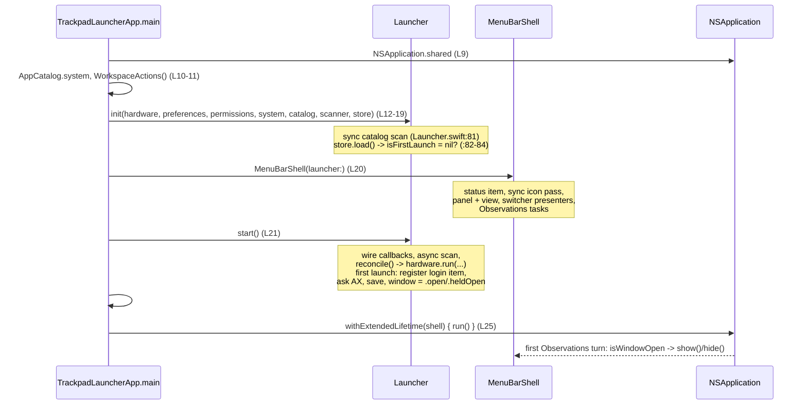
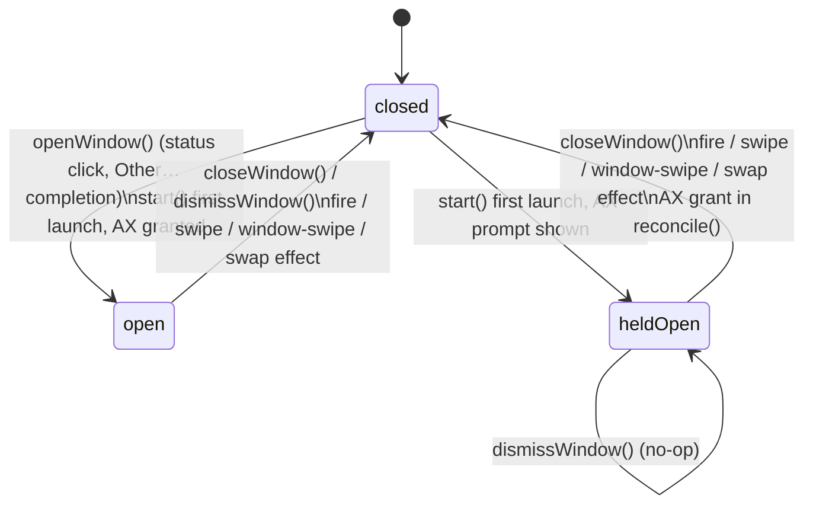

# How Trackpad Launcher's lifecycle and shell work today

Grounding for plan 021. All paths are relative to the worktree root
`/Users/dominykasgrubys/code/trackpad-launcher/.claude/worktrees/021-background-agent-lifecycle/`.
Line anchors were checked against the worktree at the time of writing.

## Overview

Trackpad Launcher is an agent app (`LSUIElement: true`, `project.yml:39`). It has no Dock icon, no main menu and no
`NSApplicationDelegate`. A single `@main` function is the whole composition root
(`TrackpadLauncher/TrackpadLauncherApp.swift:6-27`). It builds the real adapters, hands them to the one
`@MainActor @Observable` model (`Launcher`), builds the AppKit shell (`MenuBarShell`), calls `launcher.start()`, and
runs `NSApplication`. The shell owns a menu bar status item and a borderless, non-activating, popover-style panel (the
"launcher window"). It shows and hides that panel only by observing `Launcher.isWindowOpen`. Every open and close,
whether from a click, Escape, a gesture or a permission grant, is a write to private model state.

Lifecycle policy is thin, and almost all of it sits in one branch of `Launcher.start()`. "First launch" means the
`"settings"` key is absent from `UserDefaults`. The first launch registers `SMAppService.mainApp` once, prompts for
Accessibility once, saves, and opens the window. Nothing else exists today. The app has no single-instance check, no
way to tell a login start from a manual one, no unregister call, no read of the login item's status, no terminate
interception, no move-to-/Applications logic and no disk image. The release script produces a notarised zip and has
never run end to end, because this Mac has no Developer ID certificate. Plan 021 changes nearly every piece described
here. The last sections list what it will touch or invalidate.

## Key concepts

| Concept | Where | What it is |
|---|---|---|
| `TrackpadLauncherApp.main()` | `TrackpadLauncher/TrackpadLauncherApp.swift:8-26` | The only file in the app target. It wires real adapters to ports, then runs the app. |
| `Launcher` | `LauncherKit/Sources/LauncherCore/Launcher.swift:9-384` | The model. It owns first-launch policy, window state, persistence calls, and every gesture effect. |
| `Launcher.Window` | `Launcher.swift:44-49` | A private `enum { closed, open, heldOpen }`. Only `isWindowOpen` (`:22`) is public, so the shell cannot tell a held window from an open one. |
| Ports | `LauncherCore/Ports.swift:26-150` | `TrackpadHardware`, `TrackpadPreferences`, `SystemActions`, `Permissions`, `AppScanner`. Every port has one real adapter in `LauncherPlatform` and one in-memory adapter in the tests (`docs/architecture.md:14`). |
| `SettingsStore` | `LauncherCore/Settings.swift:51-73` | Not a port. It stores one binary-plist record under the key `"settings"` in the `UserDefaults` it is given. |
| `MenuBarShell` | `LauncherUI/MenuBarShell.swift:14-181` | The only `public` type in LauncherUI. It owns the status item, the panel, the outside-click monitor, the Quit menu and both switcher presenters. |
| `LauncherPanel` | `LauncherUI/LauncherPanel.swift:6-50` | `NSPanel` with `[.borderless, .nonactivatingPanel]` and `.popUpMenu` level. It becomes key without activating the app. |
| `LauncherActions` | `LauncherUI/LauncherActions.swift:22-31` | Closures the shell gives the SwiftUI view: icons, `chooseOtherApp` (Other…), and `openSettings(SettingsPane)`. |
| `WorkspaceActions` | `LauncherPlatform/WorkspaceActions.swift:5-118` | The real `SystemActions` adapter. It brings apps to front, reads running and frontmost apps, and registers the login item. |
| `SystemPermissions` | `LauncherPlatform/SystemPermissions.swift:10-62` | Reads and prompts for Accessibility and Screen Recording, and receives the tccd Darwin push. |
| `World` | `LauncherKit/Tests/LauncherCoreTests/World.swift` | The test harness: the real `Launcher` over in-memory adapters, fake `.app` bundles and a throwaway `UserDefaults` suite. `relaunch()` stands in for a second process start. |

Package layout (`LauncherKit/Package.swift`):

```
LauncherCore      (Foundation + Observation only, enforced by a test)
  ^           ^
LauncherPlatform  LauncherUI   (UI does NOT depend on Platform; the app target joins them)
  ^           ^
   TrackpadLauncher app target (composition root only)
Tests: LauncherCoreTests, LauncherPlatformTests. No LauncherUI test target.
```

## How it works

### 1. Process start (composition root)



The steps in `TrackpadLauncherApp.swift`:

1. **`NSApplication.shared` comes first (L9).** `AppIcons` reads `NSApp.effectiveAppearance`. Nothing calls
   `setActivationPolicy`. The `.accessory` policy comes only from `LSUIElement`.
2. **The adapters are built (L10-19).** Several start sensing in their `init`, before `start()`:
   - `MultitouchTrackpads()` dlopens MultitouchSupport and registers IOKit match/terminate and wake notifications (`MultitouchTrackpads.swift:26-53`).
   - `SystemPermissions()` registers `com.apple.tcc.access.changed` and snapshots both grants (`SystemPermissions.swift:12,16-25`).
   - `SystemAppScanner` starts FSEvents (`SystemAppScanner.swift:14-17`).
   - `SystemTrackpadPreferences` starts KVO on the two trackpad preference domains.

   Gestures are not recognised until `hardware.run(...)` runs in `reconcile()`.
3. **`Launcher.init` (`Launcher.swift:70-86`)** runs the synchronous first catalog scan (`:81`), then `store.load()`,
   then `isFirstLaunch = stored == nil` (`:83`), then `settings = stored ?? Settings()`. It saves nothing.
4. **`MenuBarShell(launcher:)` (`MenuBarShell.swift:25-76`)** creates the status item (`:27`) and runs the
   synchronous first icon pass (`:28`). It then builds `LauncherPanel(content: LauncherView(...))` once and reuses it,
   creates `SwitcherPresenter` and `WindowSwitcherPresenter` (`:31-32`), and sets the status button's target and
   action. Last, it starts four `Observations` loops (`:47-75`): status icon image, refit on notice changes, an icon
   re-render on `installedApps`, and **`isWindowOpen` → `show()`/`hide()`**. The doc comment at `:7` says to create
   the shell before `start()` "a first-launch window needs the status item as its anchor". `Launcher.start()`'s doc
   says the same at `:88`.
5. **`launcher.start()` (`Launcher.swift:89-115`)** wires the hardware, launch-progress, scan, preference and
   permission callbacks. It kicks off an async scan (`:101`) and calls `reconcile()` (`:104`), which reads the
   trackpads, preferences and both grants and calls `hardware.run`. Then the first-launch branch runs (`:105-113`):
   ```swift
   if isFirstLaunch {
       system.registerLoginItem()
       let prompting = !isAccessibilityGranted
       if prompting { permissions.ask(.accessibility) }
       store.save(settings)
       window = prompting ? .heldOpen : .open
   }
   ```
   Both effects come before the first save, so a crash in between repeats them (comment at `:106-107`). Then
   `resolveRows()` runs.
6. **Debug builds always open the animation tuner (L22-24).**
7. **`withExtendedLifetime(shell) { application.run() }` (L25).** The shell retains the launcher, and the launcher
   retains the adapters. `run()` calls `finishLaunching` itself. The first `Observations` emission happens on the
   first main-actor turn after the loop starts. On a first launch it reads `true` and calls `show()`. On later launches
   it reads `false` and calls `hide()`, which only does an `orderOut`.

Two synchronous main-thread passes run before the run loop: the catalog scan and the icon pass(es). They are a
documented exception, "so no click can arrive before their results exist" (`docs/architecture.md:19`).

### 2. The launcher window: one state machine, owned by the model



- `openWindow()` (`Launcher.swift:186-190`) sets `.open` only from `.closed`, then runs `resolveRows()` and
  `scanner.scan()`. A test enforces that only `start` and `openWindow` request scans (`RecentAppsTests.swift:157-179`).
- `closeWindow()` (`:193`) always closes. Its callers are the status icon click, the right-click menu, Escape, Other…
  and the System Settings buttons.
- `dismissWindow()` (`:196`) closes only `.open`. Its callers are the panel resigning key and the global outside-click
  monitor.
- `.heldOpen` exists because the system Accessibility prompt takes focus and its buttons count as outside clicks
  (`:44-46`). The hold ends on an explicit close, a fired effect, or a grant (`reconcile`, `:219`).
- Gesture effects close the window by writing `window = .closed` directly. No port or callback is involved. The writes
  are in `fire` `:265`, swipe lift `:309`, window-swipe lift when the haptic plays `:345`, and swap `:361`. Silent
  outcomes, such as an unassigned gesture, lifting on the frontmost app or nothing to swap, leave the window alone.

**Showing (`MenuBarShell.show`, `:121-131`).** It starts an off-main icon pass, then calls `refit()`, then
`panel.makeKeyAndOrderFront(nil)`, with **no `NSApp.activate()`**. Last it installs
`NSEvent.addGlobalMonitorForEvents([.leftMouseDown, .rightMouseDown, .otherMouseDown]) → dismissWindow()`.

**Hiding (`hide`, `:133-137`).** It removes the monitor and calls `orderOut`. The monitor exists only while the window
is visible.

**Placement (`refit`, `:143-155`, plus `LauncherPanel.fitToContent`, `LauncherPanel.swift:44-50`).** The panel is
centred under the status item's window, with x and y clamped 8 pt inside the screen's visible frame. Until the status
window has a real frame, the panel goes to the top-right corner. It re-fits on the status window's
`didMoveNotification`. The `Displays.screen(under:)` helper ("the pointer's display") exists, but only the switcher
presenters use it.

**Panel configuration (`LauncherPanel.swift:12-41`).**
- Style and level: `[.borderless, .nonactivatingPanel]`, `level = .popUpMenu`, and
  `collectionBehavior [.canJoinAllSpaces, .fullScreenAuxiliary, .ignoresCycle]`.
- Lifetime and focus: `hidesOnDeactivate = false` and `isReleasedWhenClosed = false`. `canBecomeKey` is overridden to
  true, and `canBecomeMain` is left at its default of false.
- Escape: `cancelOperation` → `onCancel` → `closeWindow()`.
- Key loss: `resignKey` → `onResignKey` → `MenuBarShell.resignedKey`. That calls `dismissWindow()` unless the current
  event is a `.leftMouseDown` on the status button's own window. Skipping that case avoids the close-then-reopen race
  with the toggle on mouse-up.

**Close paths.**

| Trigger | Code | Model call | Ends a held window? |
|---|---|---|---|
| Status icon left click while open | `MenuBarShell.swift:87-88` | `closeWindow()` | yes |
| Right-click or Control-click on the icon | `showContextMenu` `:95-96` | `closeWindow()` | yes |
| Escape | `LauncherPanel.cancelOperation` → `:39` | `closeWindow()` | yes |
| Panel resigns key | `resignedKey` `:105-109` | `dismissWindow()` | no |
| Mouse-down in another app | monitor `:126-130` | `dismissWindow()` | no |
| Other… | `chooseOtherApp` `:162` | `closeWindow()`, reopened in the completion | yes, and it comes back `.open`, not held |
| System Settings button | `openSettings` `:177` | `closeWindow()` | yes |
| Gesture, swipe, window swipe or swap effect | `Launcher.swift:265/309/345/361` | `window = .closed` | yes |
| Accessibility granted | `reconcile` `:219` | `window = .closed` | only acts when held |

A right mouse-down on the status button is not exempt in `resignedKey`, because only `.leftMouseDown` is checked. It
therefore dismisses through `resignKey` before `showContextMenu` closes the window anyway.

### 3. Other…, System Settings buttons, Quit

**Other… (`MenuBarShell.makeActions`, `:161-175`).** The AppPicker's "Other…" item
(`AppPicker.swift:104`, `pickOther` `:152-155`) calls `actions.chooseOtherApp`. That runs four steps in order:
1. `launcher.closeWindow()`.
2. `NSApp.activate()`. This is the only activation in shipping code.
3. Build an `NSOpenPanel` for `.application` types, starting in `/Applications`.
4. `chooser.begin { ... }`. This is a free-standing, non-modal panel, not a sheet.

The completion calls `setAssignment(.appBundle(at:), for:)` on OK, then **always** calls `launcher.openWindow()`,
Cancel included. The window has to close first because a `.popUpMenu`-level panel would sit over the chooser, and its
resign-key dismissal would fight it. The `orderOut` lands on a later main-actor turn through `Observations`. Nothing
deactivates the app afterwards.

**System Settings buttons (`LauncherView.swift:29-50` → `openSettings`, `MenuBarShell.swift:176-179`).** These call
`closeWindow()` and then `NSWorkspace.shared.open(pane.url)`. The rationale is in `LauncherActions.swift:30`: System
Settings takes focus, and a held window must not sit over it. The panes are `SettingsPane.trackpad`, `.accessibility`
and `.screenRecording`, mapped to `x-apple.systempreferences:` URLs (`LauncherActions.swift:5-18`). The exception is
the screen-recording hint in its `.ask` state. It calls `launcher.askForScreenRecording()` (`Launcher.swift:178-183`),
which records the ask, saves, and runs `CGRequestScreenCaptureAccess()`. It does **not** close the window. If the
system prompt takes key, `dismissWindow()` would close an `.open` window. That last step is inferred, not verified.

**Quit (`showContextMenu`, `MenuBarShell.swift:94-103`).** A right-click or Control-click closes the window and builds
a one-item `NSMenu`: "Quit Trackpad Launcher", `#selector(NSApplication.terminate(_:))`, key equivalent "q", nil
target. The shell attaches it with `statusItem.menu = menu`, calls `performClick`, then sets `statusItem.menu = nil`,
so that left clicks keep reaching the action. Because there is no delegate, `terminate` cannot be intercepted. There is
no main menu, so ⌘Q, ⌘W and ⌘M do nothing at any other time. Quit used to be a button in the window. Commit `22d059a`
(#25) moved it to the right-click menu.

### 4. Permission prompting

- Only two places call `Permissions.ask`:
  - `Launcher.swift:110` asks for `.accessibility`, only on the first launch and only if access is not already granted.
  - `Launcher.swift:182` asks for `.screenRecording`, from `askForScreenRecording()` and only when the hint is `.ask`.
- The real adapter (`SystemPermissions.swift:38-45`) calls `AXIsProcessTrustedWithOptions(["AXTrustedCheckOptionPrompt": true])`
  or `CGRequestScreenCaptureAccess()`. The key is written as a literal because the constant is a non-Sendable global.
- No persisted "asked for Accessibility" flag exists. "Ask once" is a side effect of the first-launch derivation.
  `AccessibilityTests.swift:20-36` pins "prompts once, never again after relaunch". Screen Recording does have a flag:
  `Settings.hasAskedForScreenRecording`.
- The model learns about grant changes by push only. tccd's Darwin notification triggers `SystemPermissions.refresh()`,
  which fires `onChange` only when the grant set changed. `onChange` calls `reconcile()`, and a grant while held closes
  the window.
- Ordering is pinned by tests. The prompt comes before the first save (`AccessibilityTests.swift:75`), and so does the
  login-item registration (`PersistenceTests.swift:63-72`).
- A source scan confines the APIs. `AXIsProcessTrusted`, `notify_register` and `ScreenCaptureAccess` may appear only in
  `SystemPermissions.swift` (`SourcePolicyTests.swift:76-79`).

### 5. Settings persistence and what tells a first run apart

- **Storage.** `SettingsStore(defaults: .standard)` (`TrackpadLauncherApp.swift:19`) writes to the bundle-id domain
  `com.domasgru.TrackpadLauncherApp`. Debug and Release share this ID (`project.yml` `settings.base`), so they share
  settings and the login-item identity. The ID has the `App` suffix because the plain one was taken by an older
  experiment on this Mac (`plans/001-trackpad-launcher-app/development-logs.md:60`).
- **`load()` (`Settings.swift:60-65`).** It returns `nil` only when `data(forKey: "settings")` is nil. Undecodable data
  loads as `Settings()`, not nil, so "a user who turned the login item off is never re-enrolled" (`:60-61`).
- **Fields (`Settings.swift:8-21`).** `handMode`, `assignments`, `isLaunchAnimationOn`, `isSwipeOn`, `isSwapOn`,
  `isWindowSwipeOn` and `hasAskedForScreenRecording`. The decoder rule (`:5-6`) is: a missing key takes its default, an
  unknown key is ignored, and a bad value fails the whole record. New fields fit this rule as long as they have
  defaults.
- **Saves happen on every intent.** `setAssignment` `:125`, `setHandMode` `:140`, `setLaunchAnimation` `:148`,
  `setSwipe` `:155`, `setWindowSwipe` `:164`, `setSwap` `:172`, `askForScreenRecording` `:181`, and the first-launch
  save `:111`. Nothing is saved at quit.
- **First run.** The first run is defined by `"settings"` being absent and nothing else. No separate marker exists.
  The doc comment at `Settings.swift:3` calls this the implicit "launched before". In Debug builds the same domain also
  holds the `AnimationTuner.*` keys, so a non-empty domain does not mean "has run".
- **Tests.** `World` uses a path-named throwaway suite. `relaunch()` builds a new `SettingsStore` and a new `Launcher`
  over the same adapters (`World.swift:182-189`). `seedSettingsRecord` plants raw records.
  `PersistenceTests.swift:21-61,153-167` cover the four cases: first, second, undecodable and empty record.

### 6. Login item

- The port is `SystemActions.registerLoginItem()`, documented as "Open at Login. Idempotent. Called only on first
  launch." (`Ports.swift:60-61`).
- The real adapter is `try? SMAppService.mainApp.register()` (`WorkspaceActions.swift:88-91`). It swallows errors,
  which covers an unsigned build or a user-disabled item. It registers whichever bundle is running, so a first launch
  from DerivedData or `build/perf` registers that copy.
- The only caller is the first-launch branch, `Launcher.swift:108`.
- Nothing calls `unregister`. Nothing reads `SMAppService.status`. The app has no UI toggle. The port has no "is
  enabled" query.
- The test double is `RecordingSystemActions.loginItemRegistrations` with an `onRegisterLoginItem` hook
  (`InMemoryAdapters.swift:262,271-272,287-290`). Nothing tests the real `SMAppService` call.
- Plan 001's R17 required this item, and its Quit "MUST NOT remove the login item"
  (`plans/001-trackpad-launcher-app/plan.md:366-399`). Plan 021's R12 reverses that.

### 7. Trackpad Launcher's own activation in the model

**Today's invariant: Trackpad Launcher is (almost) never the active app.** The reason is the
`.nonactivatingPanel`, not `LSUIElement`. The launcher window becomes key while the user's app stays frontmost, so
swipes, swaps and window swipes read the real frontmost app even while the window is up. The app activates itself in
only two places: `NSApp.activate()` before the Other… chooser (`MenuBarShell.swift:163`), and the Debug-only tuner
(`AnimationTuner.swift:55-58`). Comments and docs build on this invariant:
- `Apps.swift:34-35`
- `RunningAppsReader.swift:36-37`
- `WindowSwitcher.swift:27`
- `Switcher.swift:4-5`
- `LaunchOverlay.swift:142`
- `AnimationTuner.swift:41-42`
- `docs/domain-model.md:66`

**Self-exclusion is by PID in every case, never by bundle ID or activation policy.** All of it sits below the port, in
LauncherPlatform:

| Site | Filter |
|---|---|
| `RunningAppsReader.frontmost()` `:38-43` | `frontmostApplication.pid != own`, else nil |
| `FrontmostAppWindows.read()` `:45-51` | same rule, else `.noApp` |
| `LaunchServicesOrder.apps()` `:38,43-44` | `ApplicationType == "Foreground"` and `pid != own` |
| `RunningAppsReader.fallbackApps` `:24-28` | `.regular` and `pid != own` |
| `ActivationTracker.note` `:25` | `.regular` and `pid != own`, so the app's own activation never enters recency |

A `.regular` Trackpad Launcher with a Dock icon would therefore still be kept out of `apps` and `frontmost`.
`SwitcherPresenter.dockLocation` (`SwitcherPresenter.swift:102-106`) filters only on `.regular`. That filter feeds
icon pre-rendering only, not the row, so the worst case is that the app's own icon gets cached. This resolves the
question the composition-root explorer raised.

**What the model does when `frontmost == nil`.** `RunningApps.frontmost == nil` covers three cases without telling them
apart: Trackpad Launcher is active, no app is active, or the frontmost app has no bundle. Each consumer then behaves as
follows:
- **Switcher** (`Switcher.swift:20-27`): the row is the running apps minus assigned bundle IDs. The selection starts
  on `apps.first`, which is the previously-front ⌘-Tab app. `selectsFrontmost` is always false, so lifting with no
  travel brings that app to front with a haptic and closes the window. That previous app is also subject to
  `leavingOut`, whereas a real frontmost app is never left out.
- **Swap** (`SwapSeries.swift:16-24`): the target is `apps.first`, which re-activates the previous front app instead
  of the one behind it. The in-flight check compares optional URLs, and `nil == nil` is true (`:18`).
- **Window swipe:** `.noApp` makes `WindowSwitcher.Content` nil (`WindowSwitcher.swift:145`), so the slide is never a
  window swipe.
- The previous front app can be recovered from `apps.first` only if it is a ⌘-Tab app. A menu bar app with a window
  that was in front is lost. No "last non-self frontmost" memory exists anywhere. `ActivationTracker` exists only on
  the fallback path.

**Bring to front.** All activation of other apps goes through `WorkspaceActions.open`
(`WorkspaceActions.swift:63-80`). It calls `NSWorkspace.openApplication(at:configuration:)` with `activates = true`
("reproduces a Dock click"). `bringToFront` (`:39`) and `bringToFrontBouncing` (`:45-54`) both use it. The code has no
`NSRunningApplication.activate`, no `yieldActivation` and no `activateIgnoringOtherApps`. Window raising
(`FrontmostAppWindows.raise`, `:93-99`) uses `kAXRaiseAction` only. Today all of this runs from a process that is
never active.

**Test fakes.** `RecordingSystemActions.frontmost` and `World.makeFrontmost(nil)` both model "no active app, or
Trackpad Launcher itself" (`InMemoryAdapters.swift:267`, `World.swift:193`). The fake `bringToFront` does not move
`frontmost`, so a test lands an activation with `World.activate(_:)` (`World.swift:231-235`).

### 8. Build, sign, test, release

```mermaid
flowchart LR
    Y[project.yml + Config/*.xcconfig] -->|xcodegen generate (manual)| P[TrackpadLauncher.xcodeproj + Info.plist<br/>both gitignored]
    P -->|Xcode Run, Debug| D[Apple Development, hardened runtime, DEBUG<br/>opens animation tuner]
    P -->|Scripts/perf/build.sh| PF[Release config, Apple Development<br/>build/perf/dd/...]
    P -->|Scripts/release.sh| R[archive -> export developer-id -> codesign checks<br/>-> zip -> notarytool --wait -> staple app -> spctl<br/>-> build/release/TrackpadLauncher.zip]
    K[LauncherKit] -->|Scripts/test.sh = swift test| T[LauncherCoreTests + LauncherPlatformTests<br/>SourcePolicyTests scans Sources + TrackpadLauncher/]
```

- **`project.yml`.** One application target. Its sources are `TrackpadLauncher/` (without `Info.plist`) plus
  `assets/*.svg|png`. Its dependencies are the three LauncherKit products. The `info:` block generates `Info.plist`
  with exactly these keys: `CFBundleName` and `CFBundleDisplayName` "Trackpad Launcher", version `1.0` / `1` (hard-coded
  literals), `LSUIElement: true` and `LSMinimumSystemVersion 26.0`. The project also has:
  - `PRODUCT_BUNDLE_IDENTIFIER com.domasgru.TrackpadLauncherApp`;
  - `GENERATE_INFOPLIST_FILE NO`;
  - no entitlements file and no sandbox;
  - no asset catalog or app icon (the generated project names `AppIcon`, but no catalog exists);
  - no `LSMultipleInstancesProhibited`, no `NSSupports*Termination` keys and no shared schemes.
- **xcconfigs.**
  - `Base.xcconfig`: macOS 26, universal, Swift 6, complete strict concurrency, MainActor default isolation,
    `ENABLE_HARDENED_RUNTIME = YES` in both configs, and `CODE_SIGN_STYLE = Manual`.
  - `Debug.xcconfig`: Apple Development, team `CQK27876UL`.
  - `Release.xcconfig`: Developer ID Application, team `CQK27876UL`, `--timestamp`.
  - `DEBUG` comes only from xcodegen's debug preset. It does reach package targets, as shown by the `#if DEBUG` tuner
    call that links.
- **`Scripts/test.sh`.** It runs `swift test` in `LauncherKit` with Xcode's `DEVELOPER_DIR`. Tests always build in the
  debug configuration. `TunerCodingTests` would not compile under `-c release`.
- **`Scripts/release.sh`.**
  1. Preflight: a Developer ID identity (`:17-18`), `NOTARY_PROFILE` (`:20-24`).
  2. `xcodebuild archive` with a generic macOS destination (`:29-37`).
  3. Export with `method developer-id` (`:39-58`).
  4. `codesign --verify --strict`, plus checks for `Authority=Developer ID Application` and `flags=0x10000(runtime)`
     (`:60-65`).
  5. A ditto zip, `notarytool submit --wait`, then staple and validate **the .app** and run `spctl` (`:67-72`).
  6. The final `TrackpadLauncher.zip` (`:74-75`).

  The script makes no disk image and runs no `hdiutil`. It does not run `xcodegen generate` first, while
  `Scripts/perf/build.sh:14` does. On a clean checkout or this worktree it therefore fails at the archive step. It has
  never run end to end: this Mac has only an Apple Development identity, and plan 021 makes getting the certificate a
  non-goal (`plan.md:360`).
- **`Scripts/perf/build.sh`.** It builds the Release configuration, so `DEBUG` is not set, but signs it with Apple
  Development. `docs/performance.md:8` says to quit every other copy "because two copies both react to gestures".
- **SourcePolicyTests (`LauncherKit/Tests/LauncherCoreTests/SourcePolicyTests.swift`).** It does a plain substring
  scan per line, comments included. It scans `LauncherKit/Sources` and `TrackpadLauncher/` (`:111-117`), so an app
  delegate in the app target is scanned too. Confinement matches by file name (`:221`). The rules that matter for
  lifecycle work:
  - **Banned:** all logging, all network, `.write(to:` / `createFile(atPath` / `FileHandle(forWriting`, `Timer` (as a
    substring, so a name like `relaunchTimer` fails), `asyncAfter`, `Task.sleep`, `makeTimerSource`, display links,
    and `keyDown`/`keyUp`/`flagsChanged` in any spelling (R9 "no keyboard"). `performKeyEquivalent`,
    `cancelOperation`, `performClose` and menu `keyEquivalent:` strings all pass.
  - **Confined:** `addGlobalMonitorForEvents` may appear only in `["MenuBarShell.swift", "BounceOverlay.swift"]`
    (`:90-92`). Its rule text describes the bounce, not the outside-click monitor. `addLocalMonitorForEvents` may
    appear only in `BounceOverlay.swift`.
  - **No entry exists** for `SMAppService`, `setActivationPolicy`, `NSStatusItem`, `SecCode*`, `Bundle.main.bundleURL`,
    `FileManager.moveItem/copyItem/replaceItemAt`, `Process`/`hdiutil`, or `openApplication`.
  - LauncherCore may import only Foundation and Observation (`:177-183`). A new port that needs ServiceManagement or
    Security types must keep those types in LauncherPlatform.

## Where things live

| Path | What |
|---|---|
| `TrackpadLauncher/TrackpadLauncherApp.swift` | Composition root, the only app-target source |
| `project.yml`, `Config/{Base,Debug,Release}.xcconfig` | Bundle, Info.plist keys, signing |
| `LauncherKit/Sources/LauncherCore/Launcher.swift` | Model: `start()`, first launch, window state, gesture effects |
| `LauncherKit/Sources/LauncherCore/Settings.swift` | `Settings` record and `SettingsStore` |
| `LauncherKit/Sources/LauncherCore/Ports.swift` | Port protocols (`SystemActions.registerLoginItem` at `:60-61`) |
| `LauncherKit/Sources/LauncherCore/Apps.swift`, `Switcher.swift`, `SwapSeries.swift`, `WindowSwitcher.swift` | Frontmost-app semantics |
| `LauncherKit/Sources/LauncherUI/MenuBarShell.swift` | Status item, panel show/hide, outside-click monitor, Quit menu, Other…, Settings buttons |
| `LauncherKit/Sources/LauncherUI/LauncherPanel.swift` | The non-activating popover panel |
| `LauncherKit/Sources/LauncherUI/LauncherView.swift`, `LauncherActions.swift`, `AppPicker.swift`, `StatusIcon.swift` | Window content, action closures, pickers, menu bar icon |
| `LauncherKit/Sources/LauncherUI/SwitcherPresenter.swift`, `WindowSwitcherPresenter.swift` | Switcher overlays, currently owned by `MenuBarShell` |
| `LauncherKit/Sources/LauncherPlatform/WorkspaceActions.swift` | Bring to front, `SMAppService` |
| `LauncherKit/Sources/LauncherPlatform/SystemPermissions.swift` | Accessibility and Screen Recording read, ask and push |
| `LauncherKit/Sources/LauncherPlatform/RunningAppsReader.swift`, `LaunchServicesOrder.swift`, `ActivationTracker.swift`, `FrontmostAppWindows.swift` | Running and frontmost reads, self-exclusion |
| `LauncherKit/Tests/LauncherCoreTests/{World,InMemoryAdapters,SourcePolicyTests}.swift` | Harness, fakes, source scan |
| `Scripts/release.sh`, `Scripts/test.sh`, `Scripts/perf/build.sh` | Release, test, perf build |
| `docs/architecture.md`, `docs/domain-model.md`, `docs/product-overview.md`, `docs/performance.md`, `docs/menubar-window.png` | Docs the plan rewrites |

## Gotchas

1. **The window's visibility is model state, delivered asynchronously.** The shell never shows or hides the panel
   directly in response to a click. `Observations` delivers on a later main-actor turn, so `orderOut` happens after the
   intent returns. Other… relies on this ordering: `closeWindow`, `activate` and `begin` run first, and the `orderOut`
   follows.
2. **`dismissWindow` and `closeWindow` differ only because of `.heldOpen`.** An ordinary window that does not close on
   outside clicks makes both `.heldOpen` and `dismissWindow` meaningless.
3. **The first launch is inferred, not recorded.** An empty or garbage record counts as "launched before" on purpose.
   Any new lifecycle state, such as "Quit turned login off" or "has run", must respect this rule and the decoder rule.
4. **Registering the login item is fire-and-forget.** It happens once, its failures are swallowed, and the app never
   observes the item's state. A user disabling the item is invisible to the app today.
5. **Adapters start sensing at construction.** IOKit, tccd, FSEvents and KVO registrations begin in the `init`s, before
   `start()`. Gestures need `hardware.run`, which happens only in `reconcile()`. `Launcher.init` saves nothing, but it
   does do the full synchronous catalog scan.
6. **Two copies both react to gestures** (`docs/performance.md:8`). Nothing prevents it.
7. **Debug builds always open the animation tuner** and write `AnimationTuner.*` keys into the app's defaults domain.
8. **`release.sh` produces a zip, needs xcodegen run first, and needs a certificate that is absent.**
9. **`#if DEBUG` and "signed for release" disagree on the perf build** (Release configuration, Apple Development
   signature). Hardened runtime is on in both configurations, so the runtime flag cannot tell development from release.
   `Authority=Developer ID Application` can.
10. **The app has no icon.** Once it appears in the Dock or a DMG window, it shows the generic app icon.
11. **⌘Q/⌘W handling cannot be written as `keyDown`.** The source scan bans that token. Menu key equivalents and
    `performClose`/`cancelOperation` are fine.

## What plan 021 will touch or invalidate

Requirement numbers refer to `plans/021-background-agent-lifecycle/plan.md`.

### Code that goes away or changes shape

- **`MenuBarShell` (R1).** The status item, `StatusIcon.swift`, `refit()`'s status-item anchoring, the
  status-window move observer, `statusItemClicked`, `showContextMenu`, `resignedKey` and the global outside-click
  monitor all go away (R7: outside clicks never close). It also owns `SwitcherPresenter` and
  `WindowSwitcherPresenter`, plus the first synchronous icon pass that `docs/architecture.md:19` relies on. Those need a
  new owner. The doc comments in `SwitcherPresenter.swift:5` and `WindowSwitcherPresenter.swift:5` say "Owned by
  `MenuBarShell`". The shell is the only public LauncherUI entry point (`MenuBarShell.swift:25`), so the composition
  root changes with it.
- **`LauncherPanel` (R7).** A borderless, `.nonactivatingPanel`, `.popUpMenu`-level panel becomes an ordinary titled
  window with close and minimise buttons, at normal level. It must open centred on the pointer's display, where
  `Displays.screen(under:)` already exists. Escape currently maps through `cancelOperation`. ⌘W needs `performClose`
  or a menu item. ⌘Q needs a main menu item "Close Settings" (R8). Today there is no main menu at all.
- **Activation policy and Dock (R6).** Nothing calls `setActivationPolicy` today, and `LSUIElement: true` is the only
  policy source. The app now needs to switch policy while its window is open.
- **`NSApplicationDelegate` (R2, R8, R9).** None exists. Reopen handling (`applicationShouldHandleReopen` or an open
  event while running), Dock Quit and ⌘Q interception, and "logout and restart still terminate silently" all need one.
  The delegate would live in the app target, which the source scan also covers.
- **`Launcher.start()` first-launch branch (R5, R9, R12, R13, R18, R22).** Today it registers once and opens the
  window on first launch only. The plan needs four new behaviours: a manual open on later runs opens the window (R4);
  a login start opens nothing (R9); a gate before anything starts, during which the move dialog (R18) must not sense
  gestures, prompt, register or save; and the login start, Quit unregister and re-register rules (R12, R13), which need
  new `SystemActions` surface (unregister, status read) and probably new persisted state. `isFirstLaunch` and its
  meaning stay as they are (R5 "no saved settings").
- **`Launcher.Window` (R7, R15, R16, R17).** `.heldOpen`, `dismissWindow()` and the `reconcile` hold-ending at `:219`
  lose their reason to exist. The four gesture-effect writes at `Launcher.swift:265, 309, 345, 361` must stop closing
  the window (R15).
- **Other… (R16).** `closeWindow(); NSApp.activate(); NSOpenPanel.begin; openWindow()` becomes a sheet on the settings
  window. The always-reopen-on-completion and the drop-the-hold side effects go away.
- **System Settings buttons (R17).** `openSettings` stops calling `closeWindow()`.
- **Quit (R10, R11, R12).** A red capsule button at the end of `LauncherView` replaces the status-menu item. A real
  terminate must turn login start off (`SMAppService` unregister, which does not exist today) only when it was on. The
  pre-#25 history of `LauncherActions.quit` (`git show 22d059a`) is a precedent for wiring a Quit closure.
- **Frontmost handling (R15).** The settings window will activate Trackpad Launcher, so swipes, swaps and window swipes
  fall into the `frontmost == nil` branch. R15 wants "the app that was in front before it" treated as frontmost. No
  memory of that exists. It can come from `apps.first` only for ⌘-Tab apps, which loses a menu bar app's window. The
  `RunningApps` and `FrontmostWindows` types or the platform readers will need to change.
- **Single instance (R2, R3) and move to /Applications (R18-R21).** No code exists for either. `Bundle.main` is used
  only for resources (`LauncherView.swift:130`).
- **Release (R24).** `release.sh` needs a disk-image step that signs, notarises and staples the image, and probably
  `xcodegen generate`. It needs a Developer ID certificate the developer must obtain. An app icon is advisable for the
  Dock and the DMG.

### Tests whose expectations flip

- **Window stays open after an effect (R15).** These now expect the window to stay open:
  - `LauncherTests.swift:26, 43`
  - `LaunchBounceFiringTests.swift:31, 67, 188`
  - `SwapTests.swift:31`
  - `SwitcherOnScreenTests.swift:210, 424`
  - `WindowSwitchingTests.swift:74, 97`

  Their names say "AndClosesTheWindow", e.g.
  `twoFingerTapBringsItsAppToFrontPulsesPlaysTheLaunchAnimationAndClosesTheWindow` and
  `theThumbLiftingSwapsToThePreviousAppWithTheHapticAndNoAnimationAndClosesTheWindow`.
- **Held window (R7).** `AccessibilityTests.swift:20-36`
  (`firstLaunchPromptsOnceAndHoldsTheWindowOpenUntilAnExplicitClose`, which asserts that `dismissWindow` keeps it
  open), `:53` (`aGrantEndsTheHoldAndClosesTheWindow`) and `:63` (`aFiredGestureClosesAHeldWindow`).
  `:38` (`firstLaunchWithAccessAlreadyGranted…OpensAnOrdinaryWindow`, which uses `dismissWindow` at `:44-45`) also
  changes if `dismissWindow` goes.
- **Relaunch (R4 vs R9).** `PersistenceTests.swift:36-45` (`secondLaunchStaysQuietAndDoesNotRegisterAgain`, which
  asserts `!isWindowOpen` at `:43`), plus `:55`, `:136` and `:166`, assert that a relaunch opens no window. Under the
  plan that holds for a login start but not for a manual open. `World.relaunch()` will need a way to say how the app
  was started.
- **Login item.** `PersistenceTests.swift:21-34, 63-72` and `AccessibilityTests.swift:26` (registration count and
  ordering) gain siblings for unregister and status (R12, R13). `RecordingSystemActions` needs new recording surface.
- **`frontmost == nil` as "Trackpad Launcher in front" (R15).**
  - `SwitcherOnScreenTests.swift` `// MARK: Trackpad Launcher in front` (`:363` onward): the three
    `withNoReadableFrontmostApp…` tests.
  - `SwitcherAssignedAppsTests.swift:134-161`.
  - `SwapTests.swift:82-95` (`aMenuBarAppInFrontIsSkippedAndNoFrontmostAppSwapsToTheFirstRunningApp`).
  - `WindowSwipeNeedsTwoWindowsTests.swift:98` (`.noFrontmostApp`).
  - The `frontmost: nil` row in `WindowTitleRuleTests.swift:29`.

  These keep their meaning for "no active app" but stop describing "Trackpad Launcher in front".
- **Unchanged.**
  - `SwitcherAssignedAppsTests.swift:95` asserts the window stays open after a silent lift. This resolves the
    activation explorer's open question.
  - The other silent-outcome asserts keep the window open: `LauncherTests.swift:107`, `SwapTests.swift:146`,
    `SwitcherOnScreenTests.swift:280, 434, 518`, `WindowSwitchingTests.swift:111, 127, 227`, `ActivityTests.swift:127`
    and `SwipeSettingTests.swift:15`.
  - `RecentAppsTests.swift:104-155` uses `closeWindow`/`openWindow` explicitly. It survives as long as those intents
    stay.

### Source-scan entries

- **`SourcePolicyTests.swift:90-92`.** `addGlobalMonitorForEvents` is allowed in `MenuBarShell.swift`. Drop that file
  when the outside-click monitor goes. The rule text already describes only the bounce.
- **Rules to consider adding** (by convention, not enforced today):
  - confinement for `SMAppService` / `ServiceManagement` (today only `WorkspaceActions.swift`);
  - confinement for `setActivationPolicy`;
  - confinement for the file-moving calls of the move feature;
  - confinement for any code-signature read.
- **Bans that constrain the design.** `Timer` (substring), `asyncAfter` and `Task.sleep` rule out "wait for the old
  process to exit" polling for R3 and R20. The own-files ban (`.write(to:`, `createFile(atPath`) does not catch
  `FileManager.copyItem/moveItem/replaceItemAt`. The prose rule in `docs/architecture.md:27` ("no files written other
  than settings in `UserDefaults`") does cover them, so the doc and the test disagree in scope.

### Stale comments

- `MenuBarShell.swift:6-13` (the whole dismissal contract) and `:94`.
- `Launcher.swift:88`: "Call once, after the status item exists."
- `Launcher.swift:44-46`: the `.heldOpen` rationale.
- `Launcher.swift:184-196`: the docs for `openWindow`, `closeWindow` and `dismissWindow` ("Icon click, Escape…",
  "An outside click, or the panel losing focus…").
- `Launcher.swift:4-6`: "…or closes the window from a gesture".
- `Ports.swift:60-61`: "Called only on first launch."
- `LauncherView.swift:10`: "Quit lives in the status item's right-click menu."
- `LauncherActions.swift:26-30`: Other… "closes the window, activates, … and reopens the window", and openSettings
  "Closes the window explicitly…".
- The "never activates" set:
  - `Apps.swift:34-35`
  - `RunningAppsReader.swift:36-37`
  - `WindowSwitcher.swift:27`
  - `Switcher.swift:4-5`
  - `LaunchOverlay.swift:142` ("The app is never active, so it never deactivates either.")
  - `AnimationTuner.swift:41-42` ("a menu bar app that is otherwise never active")
  - `InMemoryAdapters.swift:267` and `World.swift:193` ("nil models no active app, or Trackpad Launcher itself")
- `WorkspaceActions.swift:88`: the reason why registration may fail stays true, but the method gains siblings.

### Doc sentences

The plan renames *launcher window* to *settings window* (plan line 15).

- **`docs/product-overview.md:3`:** "displayed in the menubar only, you never see it in the dock", "Menubar window
  design - [image](./menubar-window.png)", "In menubar window…".
- **`docs/domain-model.md`:**
  - `:6` "A macOS menu bar app…".
  - `:36, :45, :63, :69, :84, :105, :122, :140, :143`: "launcher window" becomes "settings window".
  - `:39` (swap): "with no frontmost app, as while Trackpad Launcher itself is active, …" and "the launcher window
    closes".
  - `:66` (Frontmost app): "Trackpad Launcher is active only when macOS makes it so: right after it is opened … and
    around the Other… chooser", plus the whole "When there is none, as while Trackpad Launcher itself is active…" tail.
  - `:80-81`: the `## Launcher window` heading and "The window that opens from the menu bar icon … Quit is in the menu
    that a right-click … opens".
- **`docs/architecture.md`:**
  - `:19`: who runs the first icon pass, now that `MenuBarShell` is gone.
  - `:25`: "the NSEvent monitors to … the launcher window's outside-click monitor".
  - `:27`: "no files written other than settings in `UserDefaults`", which the move-to-/Applications feature
    contradicts.
  - `:30`: distribution now includes a notarised disk image.
  - `:12`: the module list already names ServiceManagement.
  - `:6` still says the Xcode 26 toolchain while Xcode 27.1 is installed. This is unrelated to the plan but noticed.
- **`docs/performance.md`:**
  - `:8`: "Quit every other copy … because two copies both react to gestures" changes meaning under single-instance
    handling.
  - `:57-58, :79`: "menu window" wording. The rejected "release the window's content on close" decision is relevant if
    the settings window gets torn down on close.

## Open questions

These come from the explorers and remain unresolved unless marked otherwise.

- **Login item at runtime.** Does `SMAppService.mainApp.register()` succeed for an Apple-Development-signed build or a
  released build, and what `status` does it reach? The code never reads it. Plan 001 also left open whether a login
  item registered by a development build is acceptable on the developer's Mac (`plans/001-…/plan.md:1402`).
- **Logout.** What does AppKit do at logout for this delegate-less agent app? The default terminate is assumed but not
  verified. Once a delegate intercepts Dock Quit and ⌘Q (R8), it must still let logout, restart and shutdown terminate.
- **`finishLaunching`.** `NSApplication.run()` is called without an explicit `finishLaunching`. Would a future
  delegate's `applicationDidFinishLaunching`-time behaviour work as expected? Untested, because no delegate exists.
- **Other… activation.** Does the app stay active after the Other… `NSOpenPanel` closes, and for how long? Does the
  reopened panel become key while the app is active?
- **Screen Recording prompt.** Does `CGRequestScreenCaptureAccess()`'s prompt actually take key from the panel and
  dismiss an `.open` window?
- **Escape in an open picker menu.** AppKit's menu tracking presumably consumes Escape inside an open `NSPopUpButton`
  menu, so `cancelOperation` does not fire. Nothing in the repo verifies this. R8 depends on it.
- **Cooperative activation.** On macOS 14 and later, including 26, does
  `NSWorkspace.openApplication(… activates: true)` reliably activate the target and order it above Trackpad Launcher's
  own key window, or is `NSApp.yieldActivation(to:)` needed first? This needs an E2E probe.
- **LaunchServices application type.** What `ApplicationType` does LaunchServices report for the app under
  `LSUIElement`, and after `setActivationPolicy(.regular)`? Does the front-to-back array put the app first when it
  activates, so that `apps.first` is reliably the previously-front app? The PID filter makes exclusion safe either way.
- **Frontmost timing.** How quickly does `NSWorkspace.frontmostApplication` report Trackpad Launcher when the settings
  window becomes key, and how quickly does it revert after a bring-to-front? This decides whether "remember the last
  non-self frontmost app" needs a `didActivateApplicationNotification` observer on the primary (LaunchServices) path.
  No observer exists there today.
- **Scheme creation.** Do Xcode 27.1 and xcodegen 2.46 still auto-create the `TrackpadLauncher` scheme that
  `xcodebuild -scheme` needs, given that the project has no shared schemes?
- **`get-task-allow`.** Does the Debug build actually get `com.apple.security.get-task-allow` injected? This is
  standard behaviour but was not checked on a built product.
- **Signing team.** Team `CQK27876UL` in the xcconfigs differs from the `(JFC6LR2268)` suffix on the installed Apple
  Development identity. The suffix is probably the certificate's own ID, but this was not confirmed.
- **Login start versus manual start.** How does the app tell a login start from a manual open? R9 and R22 need it, and
  nothing in the code does it today. The explorers found no existing mechanism to build on.
- **Unread code.** `BounceOverlay.swift`'s monitors and the bodies of `SwitcherPresenter` and `WindowSwitcherPresenter`
  beyond their headers and `dockLocation` were not traced. No dependency on the status item or the panel was seen.
