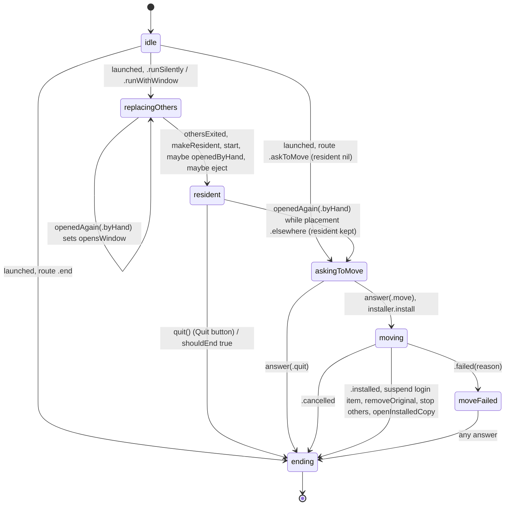
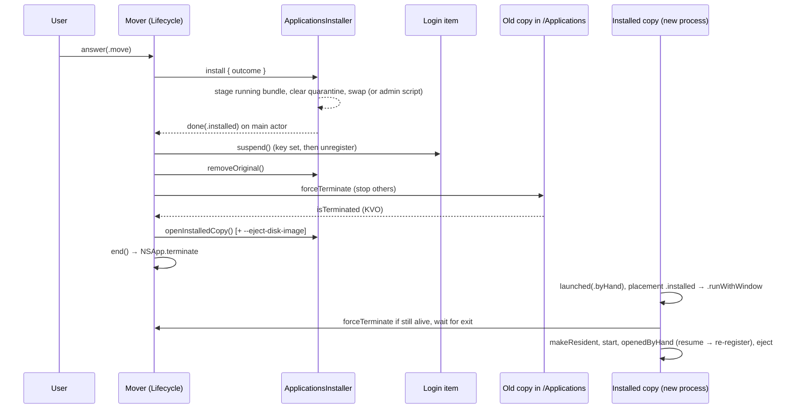

# How it works: process lifecycle, the move into /Applications, the settings window, and the build/release pipeline

Grounding for plan 022 (in-app updates). This describes the code as it stands; it does not design the feature. All paths are relative to the worktree root `/Users/dominykasgrubys/code/trackpad-launcher/.claude/worktrees/022-in-app-updates`. It merges four explorer reports (`how-lifecycle.md`, `how-move.md`, `how-settings-window.md`, `how-build-release.md` in this folder). Where they disagreed, I checked the code.

## Overview

Trackpad Launcher is a background agent app (`LSUIElement: true`, `project.yml:39`). Two `@MainActor @Observable` models make every decision. **`Lifecycle`** owns the process: what happens when it starts, when it is opened again, when it is asked to quit, and the move into /Applications. **`Launcher`** owns the gestures, the settings, and whether the settings window is open or closed. `Lifecycle` builds `Launcher` only once the process will actually run gestures. Platform effects (stopping other processes, installing files, the login item, scanning apps) sit behind small callback-based ports. A thin AppKit/SwiftUI shell renders model state and passes user intents back to the models. A source-scan test enforces product promises such as "no network code", "no timers" and "these APIs live in exactly one file" (`docs/architecture.md:11-14, 20, 27`).

The planned update touches each of these pieces. It needs (1) a fact today's code computes and then throws away, "release build running from /Applications"; (2) the moment the settings window goes from closed to open, which lives only in `Launcher.window`; (3) a replace-and-relaunch sequence like the move's, except that the move never replaces the bundle of the process that is running; and (4) a release pipeline that today stops at a local DMG, with no published release list, no tags and no version in the artefact name.

## Key Concepts

| Concept | Where | Meaning |
|---|---|---|
| `Build` | `LauncherCore/Placement.swift:3-7` | `.release` = signed with a Developer ID; `.development` = anything else (Xcode, the perf build, ad hoc). Decided by signature, never by `#if DEBUG`. |
| `Location` | `Placement.swift:15-31` | Where this copy lies: `running` (`Bundle.main.bundleURL`, possibly a translocation mount), `original`, `isTranslocated` (as reported by macOS), `diskImage`. |
| `Placement` | `Placement.swift:33-59` | Pure rule. `.installed` = inside /Applications at any depth and not translocated, **whatever the build**. `.development` = a development build anywhere else. `.elsewhere` = a release build anywhere else (DMG, ~/Downloads, ~/Applications, translocated). |
| `Opening` | `LauncherCore/Lifecycle.swift:5-10` | `.atLogin` (the open event carries the login-item marker) or `.byHand`. |
| `Route` | `Lifecycle.swift:13-26` | Pure table `(Opening, Placement, olderCopyRuns) -> .runSilently / .runWithWindow / .askToMove / .end`. |
| `Lifecycle.Stage` | `Lifecycle.swift:127-138` | Private state machine: `idle`, `replacingOthers(opensWindow:eject:)`, `resident(Launcher)`, `askingToMove(resident:)`, `moving(resident:)`, `moveFailed(reason:resident:)`, `ending`. |
| `Launcher.Window` | `LauncherCore/Launcher.swift:44-52` | `.closed` or `.open(request: Int)`. The only window state there is. `request` counts openings by hand in this process. |
| `QuitRequest` | `Lifecycle.swift:41-47` | `.system` (logout/restart/shutdown) or `.other` (Dock Quit, AppleScript, Activity Monitor, another app). |
| `StartAtLogin` | `Lifecycle.swift:72-107` | Concrete (not a port) owner of the login-item rules `enrol / suspend / resume`, with one defaults key `startAtLoginTurnedOffByQuit`. |
| Ports | `LauncherCore/Ports.swift` | `@MainActor` protocols, none `async`. Results arrive through settable callbacks or `@escaping @MainActor` completions. Each has a real adapter in `LauncherPlatform` and an in-memory one in the tests. |
| `SettingsShell` | `LauncherUI/SettingsShell.swift` | AppKit shell. It renders `launcher.window`, owns the activation policy and the main menu, and resizes the window. |
| Composition root | `TrackpadLauncher/TrackpadLauncherApp.swift:17-92` | `AppDelegate` is the only app delegate. It parses AppKit signals into values and builds everything. |

### Who owns what

```
AppDelegate (composition root)
 ├─ Lifecycle  ── owns the process; ports: RunningCopies, Installer; + StartAtLogin (wraps LoginItem), Placement
 │    └─ builds via makeResident() ──► Launcher ── owns gestures, settings, window state
 │                                        ports: TrackpadHardware, TrackpadPreferences, SystemActions,
 │                                               Permissions, AppScanner; + AppCatalog, SettingsStore, StartAtLogin
 ├─ MoveDialogPresenter ── observes lifecycle.moveDialog, answers lifecycle.answer(_:)
 └─ SettingsShell ── observes launcher.window etc.; knows Launcher + an opaque `quit` closure, never Lifecycle
```

`Lifecycle` only asks `Launcher` to do three things: `openedByHand()`, `closeWindow()`, and read `isWindowOpen`. `Launcher` knows nothing about the process: it has no `Placement`, no `Build`, no `Lifecycle` and no quit (`Launcher.swift:76-80`). The only path from the window into `Lifecycle` is the `LauncherActions.quit` closure, injected at `TrackpadLauncherApp.swift:68`. A single `StartAtLogin` instance is shared by `Lifecycle` and `Launcher`.

## How It Works

### 1. Process start

`TrackpadLauncherApp.main()` installs `AppDelegate` and runs the app (`TrackpadLauncherApp.swift:6-13`). No SwiftUI `App` is involved.

**`applicationWillFinishLaunching`** (`TrackpadLauncherApp.swift:28-39`) builds the process model:

1. `NSApp.disableRelaunchOnLogin()`. Only the login item starts the app at login.
2. `ThisCopy.location()` (`LauncherPlatform/ThisCopy.swift:22-35`) reads `Bundle.main.bundleURL`. It resolves translocation through the private `SecTranslocateIsTranslocatedURL` / `SecTranslocateCreateOriginalPathForURL`, looked up with `dlsym` (`ThisCopy.swift:40-61`); if a symbol is missing, the copy counts as not translocated. It then looks for the disk image holding the *original* (`DiskImages.image(holding:)`: `statfs` plus a DiskArbitration device model of `"Disk Image"`, `DiskImages.swift:9-22`).
3. `Placement(build: CodeSignature.buildOfThisProcess(arguments: CommandLine.arguments), location:)` (`:32-33`). The `Build` value is computed inline, passed to `Placement`, and then **discarded**. Nothing stores it.
4. `StartAtLogin(item: SystemLoginItem(), defaults: .standard, placement:)`.
5. `Lifecycle(placement:, copies: SystemRunningCopies(), installer: ApplicationsInstaller(location:), startAtLogin:, makeResident:)`.
6. `MoveDialogPresenter(lifecycle:)`.

**Build classification** (`LauncherPlatform/CodeSignature.swift:7-39`). The code checks the Developer ID requirement string at `:8-9`: `anchor apple generic and certificate 1[field.1.2.840.113635.100.6.2.6] exists and certificate leaf[field.1.2.840.113635.100.6.1.13] exists`. `buildOfThisProcess` runs `SecCodeCopySelf` and `SecCodeCheckValidity`. If the check passes, the build is `.release`. If it fails, the build is still `.release` when the arguments contain exactly `--as-release-build` (a hook for hand-testing without a certificate), and `.development` otherwise (`:14-22`). The requirement pins no team identifier, has no `notarized` clause and checks no bundle identifier. `build(of url:)` (`:26-32`) is an internal static check of a bundle on disk with `kSecCSDoNotValidateResources`. Two explorers grepped for callers and so did I: it has **no production caller**, only `CodeSignatureTests.swift`.

**`applicationDidFinishLaunching`** (`:42-46`). The open Apple event (`oapp`) exists only from this point. `ThisCopy.launch(event:arguments:)` (`ThisCopy.swift:9-18`) maps `keyAEPropData == keyAELaunchedAsLogInItem` to `.atLogin`; anything else, including a nil event, is `.byHand`. It also parses `--eject-disk-image <volume>`. Those two arguments, this one and `--as-release-build`, are the only launch arguments the app reads. The result goes to `lifecycle.launched(_:)`.

**`Lifecycle.launched`** (`Lifecycle.swift:178-188`) runs once (`guard case .idle`). It reads `copies.others()` and computes the `Route`:

| Opening | Placement | olderCopyRuns | Route |
|---|---|---|---|
| atLogin | any | true | `.end` |
| atLogin | any | false | `.runSilently` |
| byHand | `.elsewhere` | any | `.askToMove` |
| byHand | `.installed` / `.development` | any | `.runWithWindow` |

`olderCopyRuns` is true when some other copy has `startedEarlier` (`:181`). A login start defers to an older copy. An opening by hand never defers: it stops every other copy.

- `.end` calls `end()`.
- `.askToMove` sets `stage = .askingToMove(resident: nil)`. No `Launcher` is built, no copy is stopped, and nothing senses gestures.
- `.runSilently` / `.runWithWindow` call `replace(others, opensWindow: false/true, eject:)` (`:239-242`). This sets `stage = .replacingOthers(...)` **first**, because `copies.stop(...)` may call back synchronously, then waits for every other copy to exit.

**`othersExited()`** (`:244-252`) runs only if the stage is still `.replacingOthers`. It calls `makeResident()`, then `launcher.start()`, sets `stage = .resident(launcher)`, opens the window if `opensWindow` is set (`launcher.openedByHand()`), then ejects the disk image if one was passed.

**`makeResident`** (`TrackpadLauncherApp.swift:61-74`) is the only place `Launcher`'s real adapters are built. It builds `SettingsShell` before `Lifecycle` calls `launcher.start()`, so the shell's blocking first icon pass (`SettingsShell.swift:23`) finishes before any gesture can arrive. `Launcher.start()` (`Launcher.swift:98-115`) wires the port callbacks, scans and reconciles. It "asks nothing, opens nothing, saves nothing", which is all a login start does.



### 2. Opening again (reopen)

`applicationShouldHandleReopen` (`TrackpadLauncherApp.swift:48-53`) parses the `rapp` event with `ThisCopy.opening(of:)` and calls `lifecycle.openedAgain(opening)`. It always returns `false`, so AppKit does no reopen handling of its own. `openedAgain` (`Lifecycle.swift:191-198`) computes `Route(opening, placement:, olderCopyRuns: false)`:

- In `.replacingOthers` with `.runWithWindow`: the copy keeps waiting but sets `opensWindow: true`, keeping `eject`.
- In `.resident` with `.runWithWindow`: `launcher.openedByHand()`. The window opens, or comes to the front.
- In `.resident` with `.askToMove`: the stage becomes `.askingToMove(resident: launcher)`. A copy outside /Applications that was started at login keeps its gestures while the dialog asks.
- Anything else, such as a login reopen or a reopen while asking, moving, failed or ending, does nothing.

The delegate has no open-document or open-URL handler. It implements only the four callbacks named here.

### 3. Quit paths

There are several ways to "quit", and only one of them actually quits.

| Path | Code | Effect |
|---|---|---|
| *Quit Trackpad Launcher* (red button) | `SettingsView.swift:53` → `LauncherActions.quit` → `{ lifecycle.quit() }` (`TrackpadLauncherApp.swift:68`) → `Lifecycle.quit()` (`Lifecycle.swift:226-230`) | Works only in `.resident`. Calls `startAtLogin.suspend()`, then `end()`. The window stays `.open` in the model (`LifecycleTests.swift:148-157`). |
| *Close*, title-bar close, ⌘W, Escape | `SettingsView.swift:55`; `windowShouldClose` → `closeWindow()`, returns `false` (`SettingsShell.swift:66-69`); `SettingsWindow.cancelOperation` → `onCancel` (`SettingsShell.swift:33`) | `Launcher.closeWindow()`. Gestures keep running. |
| ⌘Q | The app menu's only item is *Close Settings*, key `q` (`SettingsShell.swift:71-83`). There is **no** `terminate:` menu item. | `closeWindow()` |
| Dock Quit, AppleScript, Activity Monitor | `applicationShouldTerminate` → `lifecycle.shouldEnd(quitSignals.request(for: event))` → `.terminateNow` / `.terminateCancel` (`TrackpadLauncherApp.swift:55-57`). `.terminateLater` is never used. | See `shouldEnd` below. |
| Logout / restart / shutdown | `QuitSignals.request(for:)` (`QuitSignals.swift:22-33`) returns `.system` for `kAEQuitReason`, a sender that is `com.apple.loginwindow`, or a `willPowerOffNotification` already seen. | Always ends. |

`Lifecycle.shouldEnd` (`Lifecycle.swift:201-212`):

- `.ending`, `.idle`, `.replacingOthers`, `.askingToMove`, `.moveFailed` return `true`.
- `.moving` returns `request == .system`. An ordinary quit during the install is refused, and no window is touched.
- `.resident`: an `.other` request while the window is open closes the window and refuses the quit. Otherwise the process ends, so a logout is never held up.

**`end()`** (`:233-236`) sets `.ending` first, then calls `copies.endThisCopy()`, which is `NSApp.terminate(nil)` (`SystemRunningCopies.swift:47`). AppKit then calls `applicationShouldTerminate` again, synchronously. That answer must be yes, which is why the stage is set before the call. `Info.plist` sets `NSSupportsSuddenTermination: true` (`project.yml:40`), and nothing disables sudden or automatic termination.

### 4. Stopping other copies

`SystemRunningCopies` (`LauncherPlatform/SystemRunningCopies.swift`):

- `others()` (`:10-20`) lists every `NSRunningApplication` with this bundle identifier except this process. That covers any build at any path, including the old menu bar version. `startedEarlier` comes from a total order: launch date, a missing date counts as latest, then lower pid (`:67-70`).
- `stop(_:then:)` (`:22-45`) drops processes that have already terminated. If none are left, it calls `exited()` **synchronously**. Otherwise it calls `forceTerminate()` on each and watches KVO `isTerminated` with `[.initial, .new]`. Each exit hops back through `DispatchQueue.main.async { MainActor.assumeIsolated { ... } }`. `Remaining` counts each pid once, and the last exit calls `finish()`. There is no deadline: timers are banned, so a copy that survives `forceTerminate` blocks the flow forever, a tradeoff plan 021 accepted. `watches` is a single array, so a second concurrent `stop` replaces the first one's observations.
- A force-terminated copy runs no termination code at all: no `applicationShouldTerminate` and no `StartAtLogin.suspend`.

### 5. Starting at login

`StartAtLogin` (`Lifecycle.swift:72-107`) sits over `SystemLoginItem` (`SMAppService.mainApp`). Its defaults key `startAtLoginTurnedOffByQuit` lives beside the `settings` record, not inside it.

- `enrol()`, on the first run by hand: `register()`, then forget the key.
- `suspend()`, from the Quit button or a successful move: if the item is on, set the key to true, **then** unregister.
- `resume()`, from the first opening by hand in a process that is not a first run: if the key is set, `register()`; on success, forget the key.

All three do nothing for `Placement.development`. Because a development build *inside* /Applications is `.installed`, such a build does touch the real login item. `SystemLoginItem.register()` treats `kSMErrorAlreadyRegistered` as success.

### 6. The move into /Applications

The move is the existing "replace a copy in /Applications and hand over to it" flow, which is why it matters most for an update.

**Asking.** A copy opened by hand with `Placement.elsewhere` reaches `.askingToMove`. `Lifecycle.moveDialog` derives `.asking` or `.failed(reason:)` from the stage (`Lifecycle.swift:158-164`). `MoveDialogPresenter` (`LauncherUI/MoveDialogPresenter.swift:10-43`) watches it with `Observations({ lifecycle.moveDialog })`, shows an `NSAlert` with `runModal()` after `NSApp.activate()`, and sends `lifecycle.answer(.move / .quit)`. The strings live in `Copy.swift:14-21`.

**`answer`** (`Lifecycle.swift:215-223`):

- `(.askingToMove, .move)`: `stage = .moving(resident:)`, then `installer.install { installed($0) }`.
- `(.askingToMove, .quit)` and `(.moveFailed, _)`: `end()`.
- Anything else is ignored. A second *Move* during the install does nothing.

**`ApplicationsInstaller.install(then:)`** (`LauncherPlatform/ApplicationsInstaller.swift:22-30`) starts a `Task` on the main actor. The task awaits the `@concurrent private static func copy` (`:70-98`) and calls `done(outcome)` once, back on the main actor. There is no progress reporting and no cancellation API. `copy`:

1. `destination(of:in:)` (`:55-68`) reads `Bundle(url: location.running)?.bundleIdentifier` and enumerates /Applications for `.app` bundles with that identifier. It prefers a direct child with the original's name, then any direct child, then the shallowest nested one. If none exists, it falls back to `/Applications/<original name>`. So it replaces the installed copy whatever its name or depth.
2. `BundleInstall.stage(location.running, near: destination)` (`BundleInstall.swift:10-23`) copies the **running bundle** into a fresh `.itemReplacementDirectory` on the destination's volume, then clears `com.apple.quarantine` from every item with `removexattr(..., XATTR_NOFOLLOW)` (`:55-64`). A copy with no quarantine mark is never translocated. Staging happens **before** the writability check.
3. The writability check (`:82-84`) passes when /Applications is writable and the destination either does not exist or is itself writable. Nothing inside the existing bundle is checked.
4. If writable: `BundleInstall.swap` (`BundleInstall.swift:27-35`) calls `FileManager.replaceItemAt(destination, withItemAt: staged)` with no backup name or options, or `moveItem` when the destination is absent. The doc comment calls this "one step: an atomic replace". On a throw the destination is untouched, the staged copy is discarded, and the outcome is `.failed(reason: localizedDescription)`.
5. If not writable: `PrivilegedInstall.swap` (`PrivilegedInstall.swift:37-48`) runs one shell script as root through `AuthorizationAdministrator` (`:53-98`). That uses `AuthorizationCopyRights` with `[.interactionAllowed, .extendRights, .preAuthorize]`, which shows the system password prompt, and then the deprecated `AuthorizationExecuteWithPrivileges`, looked up with `dlsym`. The script (`:22-35`) does `mv destination aside`, `mv staged destination`, and on failure moves the old copy back; finally `rm -rf aside`. The aside folder is the staging folder, outside /Applications. The results map as follows: `errAuthorizationCanceled` → `.cancelled`; exit status 0 → `.installed`; another exit status → `.failed(Copy.applicationsFolderNotChanged)`; an authorization failure → `.failed(Copy.cannotWriteToApplications)`.

**`Lifecycle.installed`** (`Lifecycle.swift:257-270`) runs only if the stage is still `.moving`. `.cancelled` calls `end()`. `.failed` sets `.moveFailed`, and the dialog then shows the reason. `.installed` runs this exact order, which the comment at `:254-256` says converges after a crash at any point:

1. `startAtLogin.suspend()`: the login item is handed over before the original can go.
2. `installer.removeOriginal()` (`ApplicationsInstaller.swift:32-37`). It does nothing if the copy is on a disk image or the original *is* the destination. Otherwise it removes the original only if it can be deleted (`BundleInstall.swift:49-52`).
3. `copies.stop(copies.others()) { installer.openInstalledCopy(); end() }`: every other copy, including an old copy in /Applications, is force-stopped. Only after all of them have exited does the mover open the installed copy and end itself.

**`openInstalledCopy()`** (`ApplicationsInstaller.swift:39-47`) builds an `NSWorkspace.OpenConfiguration` with `activates = true`. If the mover lies on a disk image, it adds `arguments = ["--eject-disk-image", volume]`. It then calls `openApplication(at: destination(...))`, which re-enumerates /Applications. There is no completion handler, `createsNewApplicationInstance` is not set, and no flag says "open your window".

**How the installed copy opens its window.** It is a plain opening by hand. Its open event has no login marker (`.byHand`), it lies in /Applications (`.installed`), so its route is `.runWithWindow`. It lists the mover in `others()` if the mover is still alive, force-stops it, waits for the exit, builds its resident, opens the window and ejects the disk image (`ReplacingOtherCopiesTests.swift:108-121`). Its first `openedByHand()` calls `startAtLogin.resume()`, which re-registers the login item because the mover set the key. The move test's effect log is `["install", "unregister", "removeOriginal", "stop", "openInstalledCopy"]` (`MoveToApplicationsTests.swift:131-159`).



Only four things pass between the mover and the installed copy: the open event (no login marker means by hand), the `--eject-disk-image` argument, the shared defaults domain (`settings`, `startAtLoginTurnedOffByQuit`), and process termination.

### 7. The settings window: state in the model, rendering in the shell

**State.** `Launcher.window` is `public private(set) var window: Window = .closed` (`Launcher.swift:52`), and it is observed. `isWindowOpen` is `window != .closed` (`:22`). Two intents write it:

- `openedByHand()` (`Launcher.swift:190-204`). On the first call in the process (`openings == 0`), a first launch enrols the login item, asks for Accessibility if it is missing, and saves the settings; any later launch calls `startAtLogin.resume()`. **Every** call then sets `openings += 1`, `window = .open(request: openings)`, `resolveRows()` and `scanner.scan()`. That includes a call made while the window is already open, which is how the window comes to the front. Reopening while open therefore moves `.open(request: n)` to `.open(request: n+1)` with no `.closed` in between (`LifecycleTests.swift:25-45` expects `[.closed, .open(1), .open(2), .open(3), .closed, .open(4)]`).
- `closeWindow()` (`:206-207`): `window = .closed`. It has no guard and no other side effect.

So "opened from closed" has no method or event of its own. In the model it shows only as the previous value of `window` being `.closed`. In the shell it is the `isShown` flag.

**Rendering.** `SettingsShell` (`LauncherUI/SettingsShell.swift`) observes the models through long-lived `Task`s running `for await ... in Observations({...})`, kept in `observations` and cancelled in `isolated deinit` (`:36-63`):

- `Observations({ launcher.window })` → `render(_:)` (`:96-116`). On `.open` from not-shown, it sets `isShown = true`, `setActivationPolicy(.regular)` (the app joins the Dock and ⌘-Tab), runs `renderIcons()`, `fit()` and `centre()`. On every `.open` it deminiaturizes the window, calls `makeKeyAndOrderFront` and `NSApp.activate()`. On `.closed` (if shown) it ends any attached sheet, calls `orderOut`, and sets `.accessory`.
- `Observations({ (activity, isAccessibilityGranted, isSwipeOn, screenRecordingHint) })` → `refit()`.
- `Observations({ launcher.installedApps })` → `renderIcons()`.

**Window geometry.** `fit()` (`:128-138`) sets the content size to `hosting.fittingSize` and keeps the top edge fixed. Content added at the top pushes everything down and grows the window downward, with no animation. `refit()` runs only when that four-value tuple changes. A new conditional group in `SettingsView` changes the SwiftUI layout but **does not resize the `NSWindow`** unless its driving state reaches `fit()`. The window is `[.titled, .closable, .miniaturizable]` with `isReleasedWhenClosed = false`, and its hosting view is built once (`SettingsWindow.swift:11-23`).

**View.** `SettingsView` (`LauncherUI/SettingsView.swift:14-66`) has no view model. It holds `let launcher: Launcher` and reads `@Observable` properties directly. Its `VStack(spacing: 10)` contains, in order: the gesture-row `FormGroup` (currently the first group), `SwitcherSection`, `ThumbPicker`, three conditional `SettingsNotice` groups behind plain `if`s (no transitions), and the button row (*Quit Trackpad Launcher* with `TintedButtonStyle(tint: .red)`, then *Close*). The view sends intents as direct calls (`launcher.closeWindow()`, `launcher.setSwipe(on:)` and so on) or through `Binding(get:set:)`. AppKit-only effects go through `LauncherActions` closures built in `SettingsShell.makeActions` (`:149-168`). The layout is `.padding(16).frame(width: 326)` (`:62-64`), which gives a 294 pt group column. `FormGroup` uses corner radius 12 and a 10 pt horizontal inset on `.quaternarySystemFill`. `SettingsNotice` puts 11 pt text **above** a bordered button; no existing component puts text on the left and a button on the right in one row. `LauncherUI` contains no `ProgressView`, `NSProgressIndicator`, `.disabled(`, `.transition(` or `.animation(`.

**What an opening starts, and what happens on close.** Today each opening starts two pieces of async work, and closing the window cancels neither:

- `scanner.scan()`. `SystemAppScanner.scan()` (`SystemAppScanner.swift:21-39`) coalesces requests, runs an unstructured `Task` that awaits a `@concurrent` read, and delivers through `onScan`. A late result is applied on purpose, so the list stays fresh while the window is closed (`RecentAppsTests.swift:138-155`).
- An icon pass, on the first show only. `AppIcons` discards stale passes with a `generation` counter, but the settings shell never bumps it.

The codebase has three existing patterns for dropping a late result:

- **Model-side stage/record guards.** The model has no `Task` handles at all; a grep for `Task` in `Sources/LauncherCore` finds none. Examples: `guard case .moving = stage` (`Lifecycle.swift:258`), `guard case .replacingOthers = stage` (`:245`), `guard let bounce = bounces[app]` (`Launcher.swift:276-278`).
- **Generation counters** in UI and platform code: `AppIcons.generation`, `OverlayPanel.generation`, `MultitouchTrackpads` runs.
- **A model-issued serial plus a cancellable `Task`** in `WindowSwitcherPresenter.swift:38-45, 82-98`, with the serial coming from `Launcher.swift:57, 332-337`.

### 8. Ports, adapters and how async-delivering ports keep model tests synchronous

The rule (`docs/architecture.md:13-14`): framework and wire types never cross a port, and external data is parsed into domain types inside the adapter. Every port has exactly two adapters: the real one in `LauncherPlatform` and an in-memory one in the tests. A concrete type that can be pointed at a temp directory or a throwaway `UserDefaults` suite (`SettingsStore`, `AppCatalog`, `StartAtLogin`) does not go behind a port, **unless it delivers asynchronously**. Those types sit behind a port "so the model's tests stay synchronous".

All eight ports in `Ports.swift` are `@MainActor ... : AnyObject`, and **none** is `async`. Results come back through one of two shapes:

- A settable push callback: `TrackpadHardware.onEvent`, `TrackpadPreferences.onChange`, `Permissions.onChange`, `AppScanner.onScan`, `SystemActions.onLaunchProgress`.
- An `@escaping @MainActor` completion: `RunningCopies.stop(_:then:)` and `Installer.install(then:)`.

| Port | Real adapter | In-memory adapter (`Tests/LauncherCoreTests/InMemoryAdapters.swift`) |
|---|---|---|
| `TrackpadHardware` | `MultitouchTrackpads` | `InMemoryTrackpads` (`:6`) |
| `TrackpadPreferences` | `SystemTrackpadPreferences` | `InMemoryTrackpadPreferences` (`:245`) |
| `SystemActions` | `WorkspaceActions` | `RecordingSystemActions` (`:260`) + `FakeWindows` (`:344`) |
| `Permissions` | `SystemPermissions` | `InMemoryPermissions` (`:427`) |
| `AppScanner` | `SystemAppScanner` | `InMemoryAppScanner` (`:624`) |
| `RunningCopies` | `SystemRunningCopies` | `InMemoryRunningCopies` (`:575`) |
| `LoginItem` | `SystemLoginItem` | `InMemoryLoginItem` (`:456`) |
| `Installer` | `ApplicationsInstaller` | `InMemoryInstaller` (`:524`) |

**The real-adapter async shape.** A `@MainActor` adapter method starts a `Task`, awaits a `@concurrent` static that does the blocking work off the main actor, and then calls the callback or completion back on the main actor. Examples: `ApplicationsInstaller.install` (`:22-30, 70-98`) and `SystemAppScanner.scan`. The model never awaits anything. It hands over a closure and handles the result later, as an ordinary synchronous method call guarded on its current stage.

**How tests stay synchronous.** An in-memory adapter either delivers inline or **holds** the callback until the test releases it:

- `InMemoryInstaller.install` records `"install"` in the shared `EffectLog` and stores `done`. `release(_ outcome:)` (`:544`) fires it, wrapping `.installed` in `onEffect` / `onInstalled` hooks so a test can snapshot state at the moment /Applications changes. `isHolding` reports whether a completion is pending.
- `InMemoryRunningCopies.stop` (`:590`) holds `exited` until `letExit(_:)` or `letStoppedCopiesExit()`. It fires synchronously when there is nothing to wait for, as KVO `.initial` would. `deliverExitAgain()` replays a duplicate push. `endThisCopy()` (`:618`) calls `lifecycle?.shouldEnd(.other)` to mirror AppKit asking again.
- `InMemoryAppScanner` delivers inline unless `holdScans()` was called; `deliverHeldScan()` releases a held scan, and `scanRequests` counts calls.
- `RecordingSystemActions.report(_:for:)` pushes progress inline. A test withholds a report by not calling it, or delivers one late by calling it afterwards.

**Harnesses.** `World` (`World.swift:36-223`) builds a real `Launcher` over in-memory adapters, a real `AppCatalog` over temp folders, and a real `SettingsStore` on a throwaway suite. `LifecycleWorld` / `OneProcess` (`LifecycleWorld.swift`) model one Mac with several processes. Each `OneProcess` is a real `Lifecycle` that builds a real `Launcher`. It records the `history` of `Launcher.Window` after each intent and takes `snapshots` around every effect, which the kill-anywhere convergence tests replay (`MoveToApplicationsTests.swift:244-283`). Real adapters are tested in `LauncherPlatformTests`, which bridge completions with `withCheckedContinuation` (`ApplicationsInstallerTests.swift:8-12`) and use internal test seams: `ApplicationsInstaller.init(location:applications:administrator:)`, `protocol Administrator` with `TestAdministrator`, and `BundleFixture`. All tests use Swift Testing (`@MainActor @Suite struct`). There is no UI test target. `MoveDialogPresenter`, `AuthorizationAdministrator`, `openInstalledCopy`, `DiskImages.eject` and `SystemRunningCopies.stop` have no automated tests; only the ordering function of `SystemRunningCopies` is tested.

### 9. Source-scan rules

`LauncherKit/Tests/LauncherCoreTests/SourcePolicyTests.swift` scans `LauncherKit/Sources` and `TrackpadLauncher/` (`:157-162`). It matches with a plain, case-sensitive `line.contains(token)`, **comments included**. Confinement is by file `lastPathComponent` (`:265-271`). Tests are not scanned. The header says to add to the lists rather than write prose.

- **Banned everywhere** (`:13-70`):
  - logging: `print(`, `NSLog(`, `os_log`, `Logger(`, `import os`, ...
  - **network**: `URLSession`, `import Network`, `NWConnection`, `CFSocket`, `CFStream`. These are on the banned list, not the confined one, so no file may use them today.
  - **own files**: `FileHandle(forWriting`, `.write(to:`, `createFile(atPath`
  - **timers and polling**: `Timer` (a substring, so any identifier containing it fails), `asyncAfter`, `makeTimerSource`, `displayLink`, `DisplayLink`, `Task.sleep`
  - `nonisolated(unsafe)`
  - `SMAppService.agent/.daemon/.loginItem`, `SMLoginItemSetEnabled`
  - `NSStatusBar`, `NSStatusItem`
- **Confined to one file** (`:81-150`), the entries relevant here:

| Tokens | Allowed only in |
|---|---|
| `SecCode`, `SecStaticCode`, `SecRequirement` | `CodeSignature.swift` |
| `copyItem(`, `moveItem(`, `replaceItemAt(`, `removeItem(`, `quarantinePropertiesKey` | `BundleInstall.swift` |
| `/bin/mv`, `/bin/rm`, `AuthorizationExecuteWithPrivileges`, `AuthorizationCopyRights` | `PrivilegedInstall.swift` |
| `forceTerminate`, `.terminate(` | `SystemRunningCopies.swift` |
| `setActivationPolicy` | `SettingsShell.swift` |
| `runModal` | `MoveDialogPresenter.swift` |
| `currentAppleEvent` | `ThisCopy.swift`, `TrackpadLauncherApp.swift` |
| `keyAELaunchedAsLogInItem`, `SecTranslocate` | `ThisCopy.swift` |
| `kAEQuitReason` | `QuitSignals.swift` |
| `statfs`, `DADisk`, `unmountVolume` | `DiskImages.swift` |
| `SMAppService` | `SystemLoginItem.swift` |
| `disableRelaunchOnLogin` | `TrackpadLauncherApp.swift` |

- **Imports:** `LauncherCore` may import only `Foundation` and `Observation` (`:222-228`).
- **Not confined:** `NSWorkspace.openApplication`, `dlsym`, `removexattr`, `isWritableFile`, and the `Authorization*` calls other than the two above.

The prose these lists enforce: no network code, no logging, and no files written other than `UserDefaults` and the move's copy (`docs/architecture.md:27`); no timers, polling or background loops, every input is a push (`:20`).

### 10. How a release is built and what it produces

**Configuration.**

- `project.yml` (xcodegen) generates the gitignored `TrackpadLauncher.xcodeproj` and `TrackpadLauncher/Info.plist`. Edit `project.yml`, never the plist.
- Bundle identifier: `com.domasgru.TrackpadLauncherApp` (`project.yml:44`). The bundle on disk is `TrackpadLauncher.app`; the display name is "Trackpad Launcher".
- `Config/Base.xcconfig`: hardened runtime in **both** configurations, manual signing, Swift 6 strict concurrency, `SWIFT_DEFAULT_ACTOR_ISOLATION = MainActor`, deployment target 26.0.
- `Config/Debug.xcconfig` signs with `Apple Development`. `Config/Release.xcconfig` signs with `Developer ID Application`, team `CQK27876UL`, and `--timestamp`.
- Versioning is **uncommitted work on this branch**: `Config/Version.xcconfig` (untracked) sets `MARKETING_VERSION = 1.0.0` and `CURRENT_PROJECT_VERSION = 1`. It is `#include`d from `Base.xcconfig`, and `project.yml` now substitutes `$(MARKETING_VERSION)` / `$(CURRENT_PROJECT_VERSION)` into `CFBundleShortVersionString` / `CFBundleVersion`. HEAD still ships the literals `"1.0"` / `"1"`. The branch also adds an `AppIcon.icon` and `ASSETCATALOG_COMPILER_APPICON_NAME: AppIcon`.
- `LSMinimumSystemVersion` is a literal `"26.0"` (`project.yml:41`). The minimum is stated separately in `project.yml:5`, `Base.xcconfig:2` and `Package.swift:6`.

**`Scripts/release.sh`**, one command, with `set -euo pipefail`:

1. Preflight: a Developer ID Application identity, `NOTARY_PROFILE`, a working `notarytool history`, and xcodegen.
2. `rm -rf build/release`.
3. `xcodegen generate`.
4. `xcodebuild archive` (Release, Developer ID, team).
5. Export with an `ExportOptions.plist` (`developer-id`, manual).
6. `codesign --verify --strict`, plus checks for `Authority=Developer ID Application` and `flags=0x10000(runtime)`.
7. `ditto` zip, then `notarytool submit --wait`, then `stapler staple` / `validate` on the **app**. The app is stapled before it goes into the image, "so a copy dragged out opens offline".
8. Lay out the DMG with `hdiutil` and Finder AppleScript (background, `/Applications` symlink), then convert to UDZO.
9. Sign, notarise and staple the **DMG**.
10. `spctl --assess` on both.

`--image-only <app>` builds an unsigned image for checking the layout.

**Output.** The script produces `build/release/TrackpadLauncher.dmg` (signed, notarised, stapled), `build/release/export/TrackpadLauncher.app` (signed, notarised, stapled), and the `.xcarchive`. The file names carry no version, and each run wipes the previous output. The script never reads or prints the version, and it uploads, tags and publishes nothing.

**Distribution today.** The origin is `github.com/domasgru/trackpad-launcher`, which is **public**, with **no GitHub releases and no git tags**. No appcast, Sparkle, `gh release` or download host appears anywhere in the repo. The docs say only "direct download only, as a disk image" (`docs/architecture.md:29-30`).

**At runtime** the app never reads its own version. No code reads `CFBundleShortVersionString` or `CFBundleVersion`; the only version strings are in the test fixture `BundleFixture.swift:39`. Its identity comes only from `CodeSignature.buildOfThisProcess` → `Placement`, plus `Bundle.main.bundleIdentifier` in `SystemRunningCopies` and `Bundle(url:)?.bundleIdentifier` in `ApplicationsInstaller.destination`.

## Where Things Live

| Path | What to look at |
|---|---|
| `TrackpadLauncher/TrackpadLauncherApp.swift` | Composition root: delegate callbacks, `makeResident`, where `Build` is computed and dropped. |
| `LauncherKit/Sources/LauncherCore/Lifecycle.swift` | `Opening`, `Route`, `Launch`, `QuitRequest`, `RunningCopy`, `StartAtLogin`, `MoveDialog`, `InstallOutcome`, `Lifecycle` and its `Stage`. |
| `LauncherKit/Sources/LauncherCore/Launcher.swift` | `Window`, `openedByHand()`, `closeWindow()`, `isWindowOpen`, `start()`. |
| `LauncherKit/Sources/LauncherCore/Placement.swift` | `Build`, `Location`, `DiskImage`, `Placement`. |
| `LauncherKit/Sources/LauncherCore/Ports.swift` | Every port; `RunningCopies` / `LoginItem` / `Installer` at `:150-186`. |
| `LauncherKit/Sources/LauncherCore/Copy.swift` | Every user-facing string, asserted verbatim by `CopyTests`. *Close* and the switch titles are literals elsewhere. |
| `LauncherKit/Sources/LauncherPlatform/` | `ThisCopy`, `CodeSignature`, `SystemRunningCopies`, `QuitSignals`, `SystemLoginItem`, `ApplicationsInstaller`, `BundleInstall`, `PrivilegedInstall`, `DiskImages`, `SystemAppScanner`. |
| `LauncherKit/Sources/LauncherUI/` | `SettingsShell`, `SettingsWindow`, `SettingsView` (plus `FormGroup` / `SettingsNotice` / `TintedButtonStyle`), `LauncherActions`, `MoveDialogPresenter`, `AppIcons`, `WindowSwitcherPresenter`. |
| `LauncherKit/Tests/LauncherCoreTests/` | `InMemoryAdapters.swift`, `World.swift`, `LifecycleWorld.swift`, `LifecycleTests`, `MoveToApplicationsTests`, `ReplacingOtherCopiesTests`, `StartAtLoginTests`, `RecentAppsTests`, `SourcePolicyTests`, `CopyTests`. |
| `LauncherKit/Tests/LauncherPlatformTests/` | `ApplicationsInstallerTests`, `PrivilegedInstallTests`, `CodeSignatureTests`, `ThisCopy*Tests`, `QuitSignalsTests`, `RunningCopiesOrderTests`, `BundleFixture`. |
| `LauncherKit/Package.swift` | Targets: Core (Foundation and Observation only), Platform (depends on Core), UI (depends on Core, `defaultIsolation(MainActor.self)`), two test targets. `.macOS(.v26)`. |
| `project.yml`, `Config/*.xcconfig` | Bundle id, plist keys, signing, version (`Config/Version.xcconfig`, untracked). |
| `Scripts/release.sh`, `Scripts/test.sh`, `Scripts/perf/build.sh` | Release pipeline, `swift test`, and the perf build (Release config signed with Apple Development, which reads as `.development`). |
| `docs/architecture.md` | Shape (`:11-14`), concurrency and push-only (`:16-22`), privacy and banned APIs (`:27`), distribution (`:29-30`). |

## Gotchas

Gotchas that bear on the planned feature, with the explorers' duplicates merged.

**Identity and build**

1. **"Release build in /Applications" is not available from any stored value.** `Placement.installed` means inside /Applications *whatever the build*, and `Build` is discarded in `applicationWillFinishLaunching` (`TrackpadLauncherApp.swift:32-33`). Neither `Lifecycle` nor `Launcher` holds it, and `Launcher` does not even receive `Placement`.
2. **`--as-release-build` turns a development build into `.release`** (`CodeSignature.swift:21`). It exists for hand-testing release-only paths.
3. **The Developer ID requirement accepts any team and does not require notarisation.** The team ID appears only in the xcconfigs and `release.sh:20`, never in Swift. `build(of:)` skips resource validation and has no production caller. No code checks notarisation, team or bundle identifier.
4. **The app never reads its own version**, and HEAD ships `"1.0"`. Three-part versions such as `1.0.0` exist only in the uncommitted `Version.xcconfig`.

**The settings window**

5. **`openedByHand()` is both "open" and "bring to front".** It runs on every opening by hand, bumps `request`, re-resolves rows and requests a scan each time, open or not. The closed-to-open transition is visible only as the previous `window` value in the model, and as `isShown` in the shell. Today's scan re-runs when the window is brought to the front; plan R1 says a re-front must not check again.
6. **Closing the window drops nothing today.** `closeWindow()` only writes `.closed`, and work started by an opening completes after the close by design. `LauncherCore` has no `Task` handles. It discards late results by guarding on the current stage or record; UI and platform code use generation or serial counters and `Task.cancel()`.
7. **`Observations` delivers asynchronously to the shell.** The shell's `isShown` flag, not the stream of values, is what makes `render` idempotent. A `.closed` immediately followed by `.open` within one main-actor turn would presumably reach the shell only as the final `.open`. This is general Observation behaviour; nothing in the repo tests it. The settings explorer also left open whether writing `.closed` over `.closed` emits a change; `isShown` makes that harmless.
8. **The window resizes only for a fixed tuple of state** (`SettingsShell.swift:38-45`). A new conditional group changes the SwiftUI content but not the `NSWindow` frame. `fit()` pins the top edge and the window grows downward, with no animation.
9. **⌘Q is not Quit, and the Quit button cannot look disabled yet.** The app menu's only item is *Close Settings* (⌘Q). The Dock's Quit closes the window while it is open, and ends the process only when it is closed, which in accessory mode means it has no Dock icon to quit from anyway. Only the red button truly quits, through `Lifecycle.quit()`, which also suspends start at login and works only in `.resident`. `TintedButtonStyle` (`SettingsView.swift:279-293`) ignores `isEnabled`, and no `.disabled(` exists anywhere.
10. **The precedent for "refuse ordinary quits during an install" is the move.** `.moving` refuses `.other` quits but honours `.system` ones, and it does not touch the window (`Lifecycle.swift:204`). The move has no settings window, though; in `.resident`, `shouldEnd(.other)` closes an open window.
11. **The window is 326 pt wide, not 266.** The commit `efee3a6` "The settings window is 266 pt wide" changed the deleted menu-bar `LauncherView.swift`. The current code is `.padding(16).frame(width: 326)`, which gives a 294 pt group column (`SettingsView.swift:62-64`). The settings explorer resolved this, and I confirmed it in the code.
12. **No existing component has the card's shape.** `SettingsNotice` puts text above a left-aligned button, while the plan's card is text-left, button-right in one row. There is no progress UI anywhere.

**Replacing and relaunching**

13. **The move never replaces the bundle that is running.** `Installer.install` always copies `location.running`, this process's own bundle, and the port has no parameter for another source (`ApplicationsInstaller.swift:77`, `Ports.swift:173-186`). For a copy already in /Applications, `removeOriginal()` does nothing because the original is the destination (`:35`). An update would put a *downloaded* bundle at the path of the *running* process, which no existing code or test does.
14. **The new copy's window opens only because it is opened by hand from /Applications.** No argument or environment variable says "open your window". `openInstalledCopy` passes only `--eject-disk-image`, and sets neither `createsNewApplicationInstance` nor a completion.
15. **The old process is stopped from both sides.** The mover force-stops every other copy, then opens the installed copy and ends itself without waiting for the open to complete. The new copy also force-stops any other copy still alive, the mover included, before it builds its resident. Any opening by hand stops every other copy with the same bundle id, with no version comparison. Gestures keep running in the old process until it stops.
16. **`forceTerminate` runs no termination code** in the stopped process: no `shouldEnd`, no `suspend`. `stop` has no deadline, so a copy that survives it stalls the flow forever.
17. **The login item is handed over through a defaults key.** The mover's `suspend()` sets `startAtLoginTurnedOffByQuit` and unregisters. The installed copy's first `openedByHand()` calls `resume()`, which re-registers. `resume()` runs only on the first opening in a process that is not a first run.
18. **Atomicity differs by path.** The unprivileged path relies on `FileManager.replaceItemAt` with no options. Its doc comment says "one atomic step", but nothing in the repo verifies that. The administrator path is explicitly two `mv`s: a kill between them leaves /Applications without the app, with the old copy in the staging folder (`PrivilegedInstall.swift:17-21`). A cancelled password prompt gives `.cancelled`, which in the move **ends the process** (`Lifecycle.swift:260`).
19. **Staging comes before the writability check,** so a full copy is made before any password prompt (`ApplicationsInstaller.swift:77-85`). Writability checks only /Applications and the bundle directory itself.
20. **`Bundle(url:)` caches by path.** `Apps.swift:205-211` reads `Contents/Info.plist` directly, with the comment "`Bundle(url:)` caches by path and would hide a bundle replaced in place". `ApplicationsInstaller.destination` uses `Bundle(url:)?.bundleIdentifier` twice, once in `copy` and once in `openInstalledCopy`.
21. **The administrator path calls `wait(&status)`,** which reaps any child of the process, not a specific pid (`PrivilegedInstall.swift:95`).

**Policy and pipeline**

22. **The source scan matches substrings, comments included.** Network APIs are banned outright with no confinement escape, and so are `.write(to:`, `Timer`, `asyncAfter` and `Task.sleep`. `replaceItemAt(`, `removeItem(`, `/bin/mv` and `forceTerminate` are each confined to one file by name, so a new file that merely mentions one of them, even in a comment, fails the build. `LauncherCore` may import only Foundation and Observation.
23. **The release pipeline stops at a local DMG.** Artefact names carry no version, there are no tags, and no release metadata exists, including no minimum-macOS declaration outside the app's own Info.plist. Each release runs two notarytool round-trips, one for the app and one for the DMG.

## Open Questions

None of these can be settled from the code alone. They come from the explorers, merged.

- **The relaunch at the same path.** What does `NSWorkspace.openApplication(at:)` do when a process launched from that exact path is still running after its bundle was replaced on disk: start a new instance, or reopen the old process? A reopen would arrive as `applicationShouldHandleReopen` → `openedAgain(.byHand)` in the old process. The move always opens a different path after stopping every other copy, so it never hits this case.
- **Is `FileManager.replaceItemAt` atomic for an app bundle?** Whether it is a single atomic exchange on APFS, and what a restart in the middle leaves behind, is unverified (`BundleInstall.swift:25-26`, `Ports.swift:177`).
- **Do the login item and TCC grants survive an in-place replacement?** Whether the `SMAppService.mainApp` registration and the Accessibility / Screen Recording grants follow a bundle replaced at the same path, and so whether the move-style `suspend()`/`resume()` handover is needed there, was already open in plan 021 (grounding F38) and remains unsettled.
- **How does `QuitSignals` classify `NSApp.terminate(nil)` called from inside the app?** It does not matter today, because `.ending` accepts any request.
- **Who owns a copy installed through the administrator path?** By inference from `mv` it stays the staging user's, but no test covers it.
- **Where is the DMG meant to be hosted?** The repo never says. The GitHub repo is public with no releases.
- **Unverified pipeline behaviour.** Whether `notarytool submit --wait` exits non-zero on an "Invalid" verdict, and whether actool adds `CFBundleIconName` for `AppIcon.icon`, were not checked.
- **Why is `isSwipeOn` in the refit tuple?** No conditional group appears to depend on it directly; this was not traced.
- **The card's exact measurements** are not grounded here: no explorer inspected the Figma design.
- **Probes outside the explorer reports.** The `probes/` folder next to this file holds probe outputs (code-signing requirements, the GitHub release API, URLSession headers and timeouts). They were not part of the four explorer reports, and this document does not rely on them.
