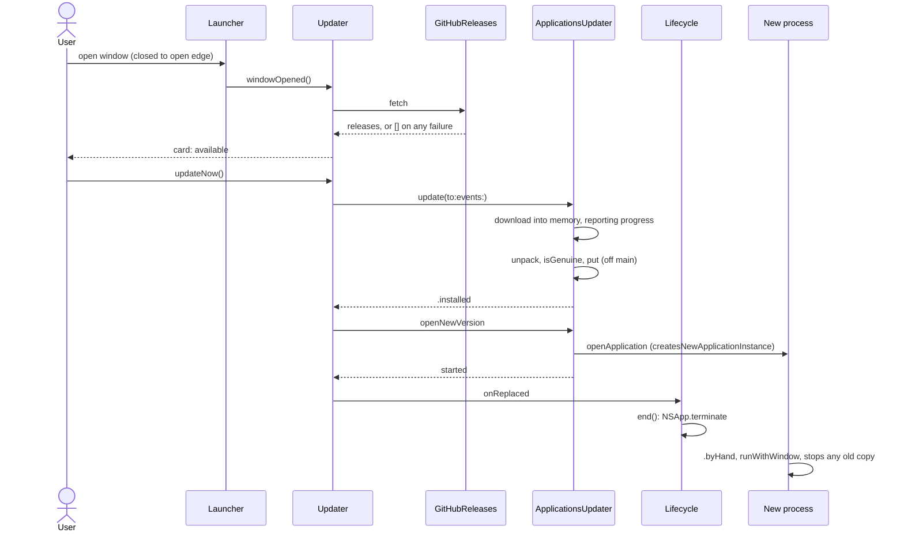
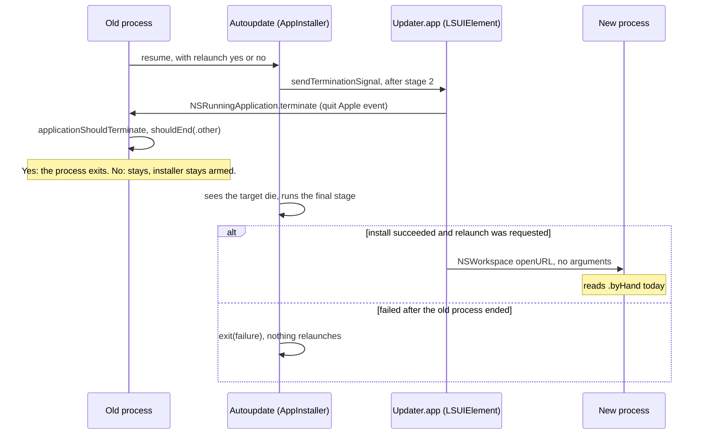

# How in-app update works today, and the systems Sparkle 2 will touch

Grounding for plan 039. This describes what exists. It decides nothing.

**Reading conventions.** Paths are relative to the worktree root. `Core/`, `Platform/` and `UI/` are `LauncherKit/Sources/LauncherCore/`, `LauncherPlatform/` and `LauncherUI/`. `App` is `TrackpadLauncher/TrackpadLauncherApp.swift`. `CoreTests/` and `PlatformTests/` are under `LauncherKit/Tests/`. `Policy` is `CoreTests/SourcePolicyTests.swift`. `Sparkle:` cites upstream Sparkle source (branch `2.x` with CHANGELOG head 2.10.1, and tag `2.10.1`); line numbers can drift with the pinned version.

**Evidence labels.** Unmarked claims about this repo were read in code. *Observed* means seen in command output on this Mac. *Sparkle-read* means read in Sparkle's source or docs and not run. *Inferred* means a conclusion, not shown directly. Open items are `[Open]` and are collected at the end.

**Anchor baseline.** Every anchor is at `aafb049` (1.0.14). `origin/main` is two commits ahead at 1.0.15, build 16. See Gotcha 1: `UI/SettingsView.swift`, `Core/Copy.swift`, `CoreTests/CopyTests.swift` and the docs differ there.

Detail too long for this document stays in the explorer files beside it: `how-updater.md` has the full deletion inventory and every call site, `how-signals.md` has the full source-policy tables, `how-build-release.md` has the probe results, and `how-lifecycle.md` has the Sparkle driver trace.

## Overview

Today, updating is entirely driven by the settings window. Opening the window from closed makes one request to GitHub's release list. If a newer release qualifies, a card appears. *Update now* downloads an Apple Archive (`.aar`) into memory, unpacks and verifies it, swaps it over the running bundle, opens the new version, and ends the old process. There is no timer, no retry, no persisted state and no background work. If nobody opens the window, nothing happens. The logic is a pure state machine, `Updater`, in `LauncherCore`, behind two ports, with real adapters in `LauncherPlatform`.

Sparkle 2 replaces that path but lands on four systems with firm rules of their own. The process lifecycle treats anything it cannot prove is a login as an opening by hand, which shows a window and a Dock icon and takes focus. Time and input follow a "no timers, every input is a push" rule, and the gesture pipeline has no signal for "any finger on the pad". The release pipeline is built around one signed `.aar` that every shipped copy reads under strict rules, and those rules outlive the code that implements them. Finally, `SourcePolicyTests` encodes much of this as a text scan of the repo's own Swift, which cannot see into a binary framework.

## Key Concepts

| Concept | What it is |
|---|---|
| `Updater` (`Core/Updater.swift:9-142`) | `@MainActor @Observable` state machine: idle, checking, offering, downloading, installing, opening, failed. Owns card state and `isInstalling`. |
| `InstalledRelease` (`Core/Update.swift:32-41`) | The one update gate. A failable init: nil unless truly Developer ID signed, `.installed`, and version readable. |
| `Release`, `UpdateEvent`, `UpdateCard`, `Version` (`Core/Update.swift`, `Core/Version.swift`) | The offer, the install's outcomes, what the card renders, and dotted-number comparison. `Release.newerVersion` (`Core/Update.swift:23-25`) is the one "what counts as newer" rule. |
| Ports `ReleaseList`, `UpdateInstaller` (`Core/Ports.swift:204-228`) | What `Updater` calls. Real adapters are `GitHubReleases` and `ApplicationsUpdater`. |
| `Installer` port and `ApplicationsInstaller` | The move to /Applications. Its `put` (`Platform/ApplicationsInstaller.swift:87-105`) is the one swap shared with updates. |
| `Placement` (`Core/Placement.swift`) | `.installed` (inside /Applications at any depth, not translocated, any build), `.development`, `.elsewhere`. |
| `Opening`, `Route`, `Launch` (`Core/Lifecycle.swift:5-38`) | How a process started, the pure table of what that leads to, and the carrier for extra facts about one start. |
| `Lifecycle` (`Core/Lifecycle.swift:124-284`) | The process state machine. Its stages are idle, replacingOthers, resident, askingToMove, moving, moveFailed, ending. |
| `Launcher` (`Core/Launcher.swift`) | Gestures, settings, and the settings window as model state. Exists only once resident. |
| `QuitRequest` (`Core/Lifecycle.swift:41-47`) | `.system` (logout, restart, shutdown) or `.other` (everything else). |
| `DeviceSession` (`Platform/FrameStream.swift:23`) | One running trackpad on the frame thread. Replaced by every `hardware.run`. |
| `LaunchClock` (`Platform/LaunchClock.swift`) | The one general deadline facility: an opacity animation on a layer in a never-shown panel. |
| The `.aar` contract | The asset name, inner bundle name and repository path that every shipped copy requires (`docs/architecture.md:36`). |
| `SourcePolicyTests` | Case-sensitive substring scan of this repo's `.swift` files for banned and confined tokens. |

## How It Works

### 1. Starting a process

Everything runs synchronously on the main thread inside AppKit's launch callbacks.

`applicationWillFinishLaunching` (`App:28-41`) reads the location, computes `Placement`, builds `StartAtLogin`, builds the updater through `makeUpdater` (`App:46-57`), and builds `Lifecycle`. The launch event does not exist yet: `currentAppleEvent` is nil here (comment at `Platform/ThisCopy.swift:6`). `Lifecycle.init` wires `updater?.onReplaced` (`Core/Lifecycle.swift:177`).

`applicationDidFinishLaunching` (`App:60-64`) parses the event through `ThisCopy.launch` and calls `lifecycle.launched`, which computes a `Route` (`Core/Lifecycle.swift:181-191`). Routes that run stop other copies first: `replace` sets `.replacingOthers` and calls `copies.stop`. `othersExited` (`:257-265`) then builds the resident (`makeResident`, `App:79-93`), calls `launcher.start()`, sets `.resident`, and opens the window if the route asked for it.

Gestures are live when `hardware.run` returns inside `launcher.start()` (`Core/Launcher.swift:110-127`, `:278`). With no other copy running, `stop` calls back synchronously (`Platform/SystemRunningCopies.swift:35-38`), so that happens inside `applicationDidFinishLaunching`.

There is no launch-to-first-gesture measurement. The nearest number is "Startup, first 6 s: 1078 ms" of CPU on an M3 Pro (`docs/performance.md:54`, 2026-10-17 baseline). Waiting for other copies has no timeout (`Platform/SystemRunningCopies.swift:28-31`), and nothing senses gestures during it.

`Updater` is built before the route is known, so it exists even in a process about to take `.end` or still in `.replacingOthers`. Today that is harmless, because it does nothing until a window opens.

### 2. Today's update, end to end

**Check.** `Launcher.openedByHand` calls `updater?.windowOpened()` only on the closed-to-open edge (`Core/Launcher.swift:224`, `:230`). `GitHubReleases.fetch` does a plain GET of `https://api.github.com/repos/domasgru/trackpad-launcher/releases` on a fresh ephemeral session (`Platform/GitHubReleases.swift:9`, `:23-37`). Any failure yields `[]`, which goes to `.idle`, so a failed check is silent and never retried. `parse` (`:124-130`) keeps non-draft, non-prerelease entries and takes the first asset that `counted` accepts (`:132-139`). `Updater.checked` (`Core/Updater.swift:113-116`) then applies `Release.newerVersion`.

**Window close.** `windowClosed()` drops any check and offer and cancels a download, but leaves an install alone (`Core/Updater.swift:70-78`).

**Download.** `ArchiveDownload.archive` (`Platform/GitHubReleases.swift:50-68`) receives into memory only. It requires status 200 and exactly the listed size. `timeoutIntervalForRequest = 30` is the idle timeout, and `waitsForConnectivity = false` makes an offline request fail at once (`:162-163`). Stale results are dropped twice over, by `Updater`'s ticket and by `ApplicationsUpdater.attempt` (`Platform/ApplicationsUpdater.swift:20`, `:43`).

**Install.** `ApplicationsUpdater.install` runs off the main actor (`Platform/ApplicationsUpdater.swift:77-91`). It has three steps:

1. `BundleInstall.unpack` (`Platform/BundleInstall.swift:76-89`) extracts into a staging folder on the destination's volume. Every entry is checked by `admits` (`:94-115`) before it is written. Quarantine is then cleared (`:150-159`).
2. `CodeSignature.isGenuine` (`Platform/CodeSignature.swift:60-82`) checks the staged bundle.
3. `ApplicationsInstaller.put` swaps it in, falling back to an administrator prompt when it cannot write.

The swap always targets `location.running`, whatever that bundle is named.

**Hand-over.** `openNewVersion` sets `activates = true` and `createsNewApplicationInstance = true`, because otherwise the old process only gets a reopen (`Platform/ApplicationsUpdater.swift:65-74`). A successful start fires `onReplaced`, and `Lifecycle.replaced()` calls `end()` (`Core/Lifecycle.swift:240-243`). The new process meanwhile reads as `.byHand`, so it force-stops any old copy. Whichever happens first, the old process ends (`Core/Updater.swift:136-137`). If the open fails, `Updater` goes to `.failed` with /Applications already holding the new version, and *Try again* re-downloads.

**Result.** The settings window always opens on the new version, it activates, and the Dock icon shows. This is promised in `docs/architecture.md:11` and `docs/domain-model.md:12`, and pinned by `CoreTests/UpdateInstallTests.swift:84`.

**Persisted state: none.** `CoreTests/UpdateInstallTests.swift:94-95` pins the defaults suite unchanged across an update.

### 3. What decides whether a copy may update

**"Developer ID in /Applications" is decided once at start.** `InstalledRelease.init?` (`Core/Update.swift:36-40`) has two inputs that matter:

- `placement == .installed`. `Placement` compares standardized path components, so `/ApplicationsOld` and `~/Applications` are not inside (`Core/Placement.swift:42-58`). `.installed` ignores the build, so a development build in /Applications is `.installed` (`:35`).
- `developerIDSigned`, which excludes that build. `CodeSignature.developerIDSigner()` (`Platform/CodeSignature.swift:36-44`) takes no arguments, so `--as-release-build` cannot fake it, whereas `buildOfThisProcess` honours that flag for the move and login rules. A test pins the difference (`PlatformTests/CodeSignatureTests.swift:49-52`).

The move dialog is excluded by construction: `.askToMove` comes only from `.elsewhere`, and `.elsewhere` gets no `Updater`. A moved copy qualifies because the move opens a new process, which runs the gate itself from /Applications (`Core/Lifecycle.swift:278-281`).

**"Can write to its own bundle" is decided nowhere at start.** Core has no such concept. The only check is at swap time (`Platform/ApplicationsInstaller.swift:89-91`): the parent folder is writable, and the bundle directory is writable if it exists. Neither check is recursive. When it fails, `PrivilegedInstall.swap` prompts, so a standard account today reaches a password prompt after download and verification. R12 says "its own bundle", while the code's rule also requires the parent, which the atomic swap needs. *Inferred:* moving a directory across parents needs write on itself, and the exchange needs write on the parent.

**`isGenuine` is stricter than R6 names.** These client-side protections exist today, and a replacement keeps or knowingly drops each:

| Protection | Where |
|---|---|
| `notarized` required, satisfied offline by the stapled ticket | `Platform/CodeSignature.swift:65` |
| Team and identifier equal the running copy's | `Platform/CodeSignature.swift:65` |
| Bundle's version and minimum macOS equal the offer | `Platform/CodeSignature.swift:76-81` |
| Strict validation, nested code, all architectures | `Platform/CodeSignature.swift:72-75` |
| Archive entries filtered before they are written | `Platform/BundleInstall.swift:94-115` |
| Quarantine cleared on every item | `Platform/BundleInstall.swift:150-159` |
| Download URL prefix pinned to this repository | `Platform/GitHubReleases.swift:10`, `:134` |
| Exact byte length | `Platform/GitHubReleases.swift:64-66`, `:97` |
| Archive held in memory only, so a kill leaves nothing on disk | `Platform/GitHubReleases.swift:39-42` |
| Constant headers, across the redirect too | `Platform/GitHubReleases.swift:11`, tested at `PlatformTests/ApplicationsUpdaterTests.swift:355` |

The constant headers are `User-Agent: TrackpadLauncher`, `Accept-Language: en`, `X-GitHub-Api-Version: 2022-11-28`, and `Accept`.

### 4. How a start is classified

`ThisCopy.opening(of:)` (`Platform/ThisCopy.swift:15-18`) is the only classifier. If `keyAEPropData` holds `keyAELaunchedAsLogInItem`, the opening is `.atLogin`. Anything else, a nil event included, is `.byHand`. So `.byHand` means "not proven to be a login", not a positive signal. `launch(event:arguments:)` adds `--eject-disk-image <volume>`, the one existing case of a process telling the next one something through arguments. Other arguments are ignored.

| Opening | Placement | Older copy runs | Route | Effect |
|---|---|---|---|---|
| `.atLogin` | any | yes | `.end` | Terminates. Stops nobody. |
| `.atLogin` | any | no | `.runSilently` | Stops later copies, stays closed. |
| `.byHand` | `.elsewhere` | any | `.askToMove` | Dialog only. Stops nobody, no resident. |
| `.byHand` | `.installed`, `.development` | any | `.runWithWindow` | Stops every other copy, opens the window. |

`Route.init`'s switch is exhaustive (`Core/Lifecycle.swift:18-25`). `openedAgain` has a `default`, so a route it does not list is a no-op on reopen (`:194-201`). A reopen of the same running build starts no process and arrives as `aevt/rapp`, handled by `applicationShouldHandleReopen`. A different build at the same path, or another path, starts a second process (plan 021 F4-F6, probed).

**What the silent path already gives.** On `.runSilently`, `launcher.window` stays `.closed`, and `render(.closed)` returns early (`UI/SettingsShell.swift:144`). The only `setActivationPolicy(.regular)` and the only activation for the window are in `render(.open)` (`:154`, `:164`). `openedByHand` never runs, so there is no `resume`, enrol, Accessibility ask or save, and `openings` stays 0, so a later real opening behaves as a normal first opening (`CoreTests/LifecycleTests.swift:47-64`, `:66-89`). The process is `.accessory` from `LSUIElement: true` (`project.yml:39`).

**What the loud path does.** `.runWithWindow` goes through `othersExited` to `openedByHand`. On the first opening that calls `startAtLogin.resume()`. It then sets `window = .open`. The shell's observation (`UI/SettingsShell.swift:98-103`) renders it: `.regular` policy is the Dock icon, then `makeKeyAndOrderFront`, then `AppActivation.activateOverOtherApps()`.

### 5. How a process ends

`applicationShouldTerminate` (`App:73-75`) is the single gate. It answers `.terminateNow` or `.terminateCancel`, never `.terminateLater`. `QuitSignals.request` (`Platform/QuitSignals.swift:22-33`) says `.system` if the event has a quit reason, the sender is `com.apple.loginwindow`, or `willPowerOffNotification` was seen. Otherwise it says `.other`, including for the nil event a programmatic `NSApp.terminate(nil)` produces.

`Lifecycle.shouldEnd` (`Core/Lifecycle.swift:204-219`):

| Stage | `.system` | `.other` |
|---|---|---|
| `.ending`, `.idle`, `.replacingOthers`, `.askingToMove`, `.moveFailed` | yes | yes |
| `.moving` | yes | no |
| `.resident`, window open | yes | `closeWindow()`, then no |
| `.resident`, window closed, not installing | yes | yes |
| `.resident`, window closed, `isInstalling` | yes | no |

The window check comes before `isInstalling`, so during an install the first `.other` closes the window and the second refuses (`CoreTests/UpdateInstallTests.swift:202-220`). `shouldEnd` is a query with an effect.

Ways to quit:

- **Quit Trackpad Launcher** (`UI/SettingsView.swift:105`, closure at `App:86`) calls `Lifecycle.quit()` (`Core/Lifecycle.swift:233-237`). This is the only path to `startAtLogin.suspend()`, so a hand-over going through `quit()` would turn starting at login off. Today it is a no-op while installing, and the button is disabled (`UI/SettingsView.swift:107`).
- **⌘Q, the close button, ⌘W, Escape, Close** all reach `closeWindow()`. No Quit menu item exists, so ⌘Q never reaches `NSApp.terminate` (`UI/SettingsShell.swift:116`, `:124`).
- **Dock Quit** is an Apple event, `.other`. The Dock icon exists only with the window open, so it closes the window and cancels.
- **AppleScript, Activity Monitor, a peer's `terminate()`** are `.other`. With the window open they close it; with it closed they end, unless installing.
- **Another copy opened by hand** uses `forceTerminate()`. No gate runs. The port's contract is that a copy "can neither refuse, nor ask its user, nor hang the stop" (`Core/Ports.swift:170-172`).

`end()` sets `.ending` before terminating because AppKit re-enters `shouldEnd` synchronously (`Core/Lifecycle.swift:245-249`). `.terminate(` is confined to `SystemRunningCopies.swift` (`Policy:171`).

**The single-instance rule** (`Platform/SystemRunningCopies.swift:14-54`): `others()` lists the identifier family, release and `.debug`, minus this pid. `stop` arms a kernel exit source for each pid before calling `forceTerminate()`. The older copy wins at login; by hand, from /Applications or as a development build, the new copy stops everyone.

### 6. What Sparkle does at the end of an install, read against this lifecycle

All Sparkle behaviour here is *Sparkle-read*. None of it has been run with this app.

**How the quit arrives.** The framework does not call `terminate:` (absent from the strings of the 2.9.6 binary, *Observed*). `AppInstaller` signals the agent (`Sparkle: Autoupdate/AppInstaller.m:756-770`), and the agent calls `[runningApplication terminate]` on apps matching identifier **and** path (`Sparkle: InstallerProgressAppController.m:369-379`). Its comment says this gives the app "a chance to delay or cancel the request". Plan 021 probed that a peer's `terminate()` arrives exactly like the Dock's Quit and can be cancelled (`plans/021-background-agent-lifecycle/development-logs.md:18`). So it reads as `.other`, unless power-off was announced.

| Situation under today's `shouldEnd` | Answer | Consequence |
|---|---|---|
| Resident, window closed, no install flag | yes | Ends. `end()` is skipped and the stage stays `.resident`, which is harmless. Login item untouched. |
| Resident, window closed, an "installing" flag true | no | Sparkle is refused. A flag kept with today's meaning makes the update deadlock against itself. |
| Resident, window open | `closeWindow()`, no | Refused, and the window closes on the user. The quit event is asynchronous, so a window can open after an idle check passed. |

**How the relaunch arrives.** The agent uses plain `[[NSWorkspace sharedWorkspace] openURL:]`, then exits 0.3 s later (`Sparkle: InstallerProgressAppController.m:402-412`). No arguments or launch options are passed. An `open`-style launch delivers `oapp` with no `keyAEPropData` (plan 021 F1, probed for `open`, not for `openURL` from another process). So the path today is `.byHand`, `.runWithWindow`, window, Dock icon, focus. Nothing in the event or the arguments can carry "this was a relaunch". The explorer found no Sparkle-owned signal readable by the new process, on the driver and agent paths it checked.

**Things that are not what their names suggest:**

- `updaterShouldRelaunchApplication:` returning NO **aborts the install**. It does not mean "install without relaunch" (`Sparkle: SPUInstallerDriver.m:502-516`).
- `updater:willInstallUpdateOnQuit:immediateInstallationBlock:` is the silent path, and it relaunches. Its block passes `installWithToolAndRelaunch:YES` with `displayingUserInterface:NO` (`Sparkle: SPUUpdaterDelegate.h:430-431`, `SPUUpdateDriver.m:862-866`, `:937-938`).
- A plain exit installs with no relaunch unless one was requested: "Sparkle will always attempt to install the update when the app terminates" (`Sparkle: SPUUpdaterDelegate.h:433`). `_shouldRelaunch` is set only by the resume message (`Sparkle: AppInstaller.m:661-670`, `:828`). That matches R13's scenario.
- `updaterWillRelaunchApplication:` fires once per install, from `installerWillFinishInstallationAndRelaunch:` when relaunch is YES, before the resume message goes out (`Sparkle: SPUUpdateDriver.m:880-897`, `SPUInstallerDriver.m:549-558`). `updater:willInstallUpdate:` fires just before it.

**Hazards from that sequence:**

- **A refused quit leaves the installer armed.** Once `_shouldRelaunch = YES` is set and the quit is cancelled, nothing clears it, and the installer keeps waiting for the target to die (`Sparkle: AppInstaller.m:410-418`). A later *Quit Trackpad Launcher* or logout would then install **and relaunch**, against R13 and possibly R14. A repeated resume can change the flag but also re-sends the termination signal (`:672-684`). *Inferred from reading, not run.*
- **`sendTerminationSignal` is one shot per request.** The retry path exists only for a user driver (`Sparkle: SPUInstallerDriver.m:547`, `AppInstaller.m:678-683`).
- **A final-stage failure relaunches nothing.** It goes to `cleanupAndExitWithStatus:EXIT_FAILURE` (`Sparkle: AppInstaller.m:806-815`), and the agent exits on invalidation. R11 requires a working copy running within 10 s. The old process is gone, and the repo bans its own relaunchers (`Policy:88-91`), child processes (`:40-44`) and timers (`:52-55`).
- **Sparkle's view of copies is narrower than the app's.** It signals the same identifier at the same path and watches only the first match (`Sparkle: InstallerProgressAppController.m:289-305`). A running Debug copy is outside its view. If a Debug or other-path copy force-kills the /Applications copy while the installer waits, the installer sees the target die and goes on to install (`Sparkle: AppInstaller.m:410-418`).

**Constraints on any "this was a relaunch" fact.** These follow from the facts above; the choice of mechanism belongs to the design:

- Reusing `.atLogin` as it stands routes `(.atLogin, _, true)` to `.end` (`Core/Lifecycle.swift:20`), so a relaunched copy that saw any earlier copy would end itself, while R9 says the new version stops the old one. `Route` has no input for "silent, and stop everyone".
- Precedents exist: `StartAtLogin` holds one fact under its own defaults key (`Core/Lifecycle.swift:67-76`), and `Launch` carries extra facts about a start (`:29-38`). `currentAppleEvent` is confined to `ThisCopy.swift` and `App`, and `keyAELaunchedAsLogInItem` to `ThisCopy.swift` (`Policy:163-168`).
- State written before termination can go stale: the install fails with the same version left, or the install succeeds and the relaunch is lost. Each stale case then meets a later real opening by hand, which R9 says opens the window as usual.
- "Version changed since last run" is not a usable signal alone. R16's last card opens the first automatic-update version by hand, and a user's manual install also changes the version, and both of those show the window today.

**Teardown details.** The gesture stack dies with the process; there is no `applicationWillTerminate`. `MultitouchTrackpads.run` notes a withheld press's release can leak as a stray mouse-up (`:75`). `Bundle.main` reading the new bundle after a swap (`Core/Update.swift:30-31`) stops being a hazard if the swap happens after this process exits.

### 7. Trackpad and window signals

R8 needs "no contact of any kind for 1 minute" and "window closed". The window half is easy. The contact half has no existing signal.

**The frame path.** MultitouchSupport calls `contactFrameCallback` (`Platform/FrameStream.swift:106-111`) on its own thread. It finds the session, parses the frame, and calls `DeviceSession.receive` (`:57-84`). That runs the recognizer under a `Mutex`, and only a recognised event hops to main through `deliver`, guarded by a generation check (`Platform/MultitouchTrackpads.swift:98-108`). Per-frame main hops do not exist. An ordinary touch reads no clock (`Core/TrackpadTapState.swift:24-25`). The rule for frame-thread state is a `Mutex` with one writer (`docs/architecture.md:18`), and `nonisolated(unsafe)` is banned (`Policy:75`).

**What "no contact" looks like.**

- No frames arrive while nothing touches the pad. *Observed:* 40 s hands off gave 0 callbacks, including none after `MTDeviceStart`. Also `docs/performance.md:47`. So silence is the normal idle state, and there is no heartbeat to confirm a stopped device.
- A frame can exist and hold no contact. Parsing keeps only states 3 and 4 (`Platform/TouchFrameParsing.swift:58-62`), so hover-only or lift-only records give `touches == []` from a non-empty raw frame. `!frame.touches.isEmpty` is the correct read of "a finger made contact"; "a callback arrived" is not.
- `[]` is the frame after the last lift (`Core/Touch.swift:47`), and repeats occur (`PlatformTests/DeviceSessionAnswerTests.swift:163-164`).

**Why `Recognition` cannot supply it.** `step` removes palm-band contacts at its first line (`Core/GestureRecognizer.swift:97`), for as long as they stay down. So `blocking`, `isInThumbTouch`, `TrackpadTapState.level` and `state == .idle` do not describe occupancy, and a resting palm counts as contact under R8 but not for the recognizer.

| Tap point | Sees palms | Treats hover as contact | Resets on `run` | Notes |
|---|---|---|---|---|
| `contactFrameCallback`, raw `count` | yes | yes | no | Would need raw states, breaking "only this file knows its layout" (`Platform/TouchFrameParsing.swift:3`). |
| `DeviceSession.receive`, `frame.touches` (`Platform/FrameStream.swift:57`) | yes | no | yes | Already directly testable. |
| Inside `GestureRecognizer.step`, before `:97` | yes | no | yes | `InMemoryTrackpads.touch` would reach it. `frame` is shadowed at `:97`. |
| After `step`, from `Recognition` | no | no | yes | Misses resting palms. |

Existing shapes for crossing threads without per-frame hops: `tap?.wake()` fires only on a flip (`Platform/FrameStream.swift:74`), and `mergedTapState(at:)` reads per-device state from another thread after copying sessions out (`:118-122`).

**Sessions are not stable.** `MultitouchTrackpads.run` empties `sessions` first and replaces every `DeviceSession` (`Platform/MultitouchTrackpads.swift:68-116`), so in-flight frames are dropped and stale events are dropped on main. `run` happens on more than wake and hot-plug: thumb corner, swipe, window swipe and swap settings, a trust change, and a tap-to-click preference change all trigger it, with the window closed, even mid-touch (`Core/Launcher.swift:123-124`, `:158-190`, `:274`). State held in a session vanishes there, an occupied-to-empty edge can vanish silently, and a main-side flag fed by edges can stick. After `run`, a resting finger reappears as `.down` on the first frame (`Core/GestureRecognizer.swift:111-114`).

**When recognition stops.** It stops when no trackpad is connected, the framework failed to load (any missing symbol fails `init?`, `Platform/MultitouchSupport.swift:29-56`), the device is not a trackpad, the process has no resident yet, the system is asleep before `run` on wake, or a `run` is in progress. It does **not** stop for a missing Accessibility or Screen Recording permission, for all gestures unassigned, or for the window state (`Core/Activity.swift:51-54`, `Core/Launcher.swift:270-273`). A silently dead device would fail toward "idle". There is no signal between process start and the resident.

**Window edges** reach `Updater` by direct method call from `Launcher` (`Core/Launcher.swift:230`, `:237`), with no port, since both are Core models. `closeWindow()` has five kinds of caller: `windowShouldClose`, which always returns false so AppKit never closes it (`UI/SettingsShell.swift:111-114`); the ⌘Q item (`:116`); Escape (`:74`); the Close button (`UI/SettingsView.swift:108`); and `Lifecycle.shouldEnd` for the Dock's Quit (`Core/Lifecycle.swift:212-213`). The model is the only truth, and it flips before AppKit's `orderOut`. A minimised window stays `.open`. Today's `windowOpened` starts a check and `windowClosed` cancels a download; the plan drops those semantics, leaving just the edges.

**Sleep and wake.** `NSWorkspace.didWakeNotification` is observed in one place (`Platform/MultitouchTrackpads.swift:48-52`), and it exists only for a resident. It is folded into `.trackpadsChanged`, so Core cannot tell wake from hot-plug (`Core/Ports.swift:8-9`). `willPowerOffNotification` is at `Platform/QuitSignals.swift:12`. `willSleepNotification`, screen lock, display sleep and session switch are not observed. There is no reachability code, and `import Network` is banned (`Policy:45`).

### 8. How time passes

`docs/architecture.md:20` is the rule: "No timers, no polling, no background loops: every input is a push", which "is what keeps idle CPU at zero". Time passes only on Core Animation's clock and in one network request's idle timeout, and a deadline "cannot outlive" its effect. A search of the sources finds no timer; the single `DispatchSource` is a process-exit source (`Platform/SystemRunningCopies.swift:42`).

The mechanisms that exist:

- **`LaunchClock`** (`Platform/LaunchClock.swift`): each deadline is a 1-to-1 `opacity` animation on a layer in a shared 1×1 never-ordered panel, made with the first clock and closed with the last. Internal to `LauncherPlatform`, `@MainActor`. Users are `LaunchWatch` and `BackgroundHider`. The longest production deadline is 10 s (`Core/WatchedLaunch.swift:55`).
- **`Uptime`** (`Core/Uptime.swift:3-5`): Core defines the value and never reads the clock. The single read is `Platform/UptimeNow.swift:6`, confined at `Policy:121`. It deliberately cannot be compared with `FrameTime`, the driver's clock (`Core/Touch.swift:33-34`).
- **The lift window**: a frame thread stamps a deadline, another thread compares on its next event, and nothing fires at the end.
- **The network idle timeout**, which goes away with `GitHubReleases`.

Core stays clock-free, so a pure rule there takes times handed in, as `TrackpadTapState` does. `InMemoryTrackpads.advanceClock(by:)` (`CoreTests/InMemoryAdapters.swift:135-136`) is the existing test form of "time passing with the pad empty".

`Deadline` reports *passed* on a system stop: `animationDidStop(finished: false)` that was not cancelled counts as passed (`Platform/LaunchClock.swift:83-84`, `:91-96`). That suits a cap, but for an idle minute it means a deadline can fire early.

### 9. Build, packaging and release

**App target.** `project.yml` is the one tracked source of the Info.plist (`:32-40`), and the plist and `.xcodeproj` are generated and gitignored. Sparkle keys would go in those properties, and the one plist serves both configurations, so Debug would carry them too. Deployment target 26.0, hardened runtime on in Base, manual signing, no entitlements, not sandboxed. `@executable_path/../Frameworks` is already in the runpath (*Observed*). The shipped 1.0.14 bundle has no `Frameworks` folder and no symlinks (*Observed*), so Sparkle would be the first nested code and the first symlinks in any release.

**Versions.** `MARKETING_VERSION` becomes `CFBundleShortVersionString`, and `CURRENT_PROJECT_VERSION` becomes `CFBundleVersion` (`Config/Version.xcconfig`). The card compares the marketing version. Sparkle compares `CFBundleVersion`: `generate_appcast` wrote `<sparkle:version>15</sparkle:version>` for 1.0.14 (*Observed*). They are different numbers. The build number has risen by one every release, but only `bump_version` does that (`Scripts/release.sh:160-161`). `preflight_version` checks the marketing version only (`:169-182`), so a hand-raised marketing version keeps the old build number and passes every check.

**`Scripts/release.sh` in order:**

1. Preflight (`:128-142`): `gh`, Developer ID identity, notary profile, `xcodegen`, on `main`, clean including untracked files, equal to `origin/main`.
2. `Scripts/test.sh` (`:338`). Nothing has changed yet.
3. `bump_version` commits locally, if an argument was given. `preflight_version` follows.
4. `rm -rf "$OUT"` (`:342`), then `xcodegen generate`, `xcodebuild archive`, `-exportArchive` with `method=developer-id`.
5. Check the export: main app only, without `--deep` (`:375-382`).
6. Notarise and staple the app (`:386-391`). Stapling and its validation are what stop a rejected build under `set -e` (*Inferred*).
7. `archive_and_check "$APP" strict` (`:187-235`, called at `:393`): `ditto` to `TrackpadLauncher.app`, which is where the name changes, then `aa archive`, `aa extract`, and `codesign --verify --strict --deep` on the unpacked copy, plus identifier, team, ticket and extended attribute checks.
8. `build_image`, sign, notarise and staple the disk image, `spctl` on both (`:395-405`). `build_image` needs Finder Automation, so a release is not fully headless today.
9. Push the version commit (`:408-412`), then `gh release create "v$EXPECTED_VERSION" "$DMG" "$AAR" ... --latest` (`:413-415`).

Signing inside the bundle is left to `xcodebuild`, and `--deep` is never used to sign (`Scripts/release.sh:15-16`, `docs/architecture.md:35`). Any EdDSA signature computed over the final file comes after step 7 at the earliest, and a feed cannot be published before step 9 (*Inferred*).

**Failure undo.** Before the push, `cleanup` resets the version commit, so the same command retries (`:69-81`). If the publish fails, main already holds the version and the script says to rerun with no argument (`:416`). After publishing there is no undo.

**Hosting facts** (*Observed*). All 16 releases are full releases. The repository is public with no GitHub Pages. `immutable-releases` is enabled, so assets cannot be added to a published release: an appcast hosted as an asset has to go up in the same `gh release create` and cannot be corrected afterwards. A feed committed to a branch would be pushed after the release, adding a separate failure point (*Inferred*). There is no CI; releases are built on this Mac (`README.md:39-40`).

### 10. What every old card requires (R16)

The contract code is unchanged since v1.0.0, so one list covers every old version (*Observed*, `git diff v1.0.0 HEAD`; `BundleInstall.swift` differs only by a renamed constant).

- **To be seen:** a non-draft, non-prerelease entry in the release list's default page, with an `uploaded` asset whose URL starts with `https://github.com/domasgru/trackpad-launcher/releases/download/`, named `TrackpadLauncher-<version>-macOS-<minimum>.aar`, split on exactly one `-macOS-`. Tag, title and body are ignored.
- **To download:** exactly the listed size, status 200.
- **To unpack:** every entry under `TrackpadLauncher.app/`, no `.` or `..`, not absolute; only directories, regular files and relative symlinks staying strictly inside the bundle. `TrackpadLauncher.app` exists afterwards.
- **To be genuine:** the `isGenuine` checks in section 3, against the old copy's team and identifier, offline, so the ticket must be stapled.
- **To finish:** it swaps over the running copy and opens with `activates = true`, so the first automatic-update version arrives as an opening by hand with a window, from old code that writes nothing new.

Other assets do not disturb old copies: `parse` takes the first asset `counted` accepts and skips other names (`Platform/GitHubReleases.swift:128`, `:132-139`). A release with no valid `.aar` is simply invisible to them.

**A release embedding Sparkle against this contract.** A scratch export with Sparkle went through `Scripts/release.sh --archive-only`. The real `BundleInstall.unpack` accepted the `.aar`, and `SecStaticCodeCheckValidity` passed with `isGenuine`'s exact flags but **no requirement** (*Observed*, Apple Development signed). The `Developer ID`, `notarized` and identifier requirement over nested Sparkle code was not exercised.

**Sparkle against the same `.aar`** (*Sparkle-read* unless marked):

- `.aar` is a supported format, extracted with `/usr/bin/aa extract -d` (`Sparkle: Autoupdate/SUPipedUnarchiver.m`).
- The old app must set `SUVerifyUpdateBeforeExtraction = YES`, or extraction fails with "Extracting aar archives require setting SUVerifyUpdateBeforeExtraction to YES in the old app" (`Sparkle: Autoupdate/AppInstaller.m`). So the first automatic-update version has to carry it for one `.aar` to serve both.
- With that key on, changing EdDSA keys "can only be done if the update archive is a Developer ID code signed disk image".
- The inner name can differ. `SUInstaller installSourcePathInUpdateFolder:forHost:` matches the host's file name, then `<host name>.app`, then any bundle with the host's identifier, and installs to `host.bundlePath`. So `TrackpadLauncher.app` installs over `/Applications/Trackpad Launcher.app` by identifier.
- `generate_appcast` accepted v1.0.14's asset and wrote version, short version, minimum system version and an enclosure, but **no `sparkle:edSignature`** even with a key supplied (*Observed*). The likely reason is that the old bundle has no `SUPublicEDKey` (*Inferred*).
- `generate_appcast` reuses an `appcast.xml` already in the folder, keeps 3 versions per branch point by default, and takes one download URL prefix for new items (*Observed*, `--help`). `release.sh`'s `rm -rf "$OUT"` would remove a local feed, and R4's "needs a newer macOS" scenario needs older items kept (*Inferred*).
- The DMG could also be an enclosure, and is the only format that allows key rotation under that key. Not probed.

No Sparkle signing key exists yet: the keychain item `https://sparkle-project.org` is not found (*Observed*).

### 11. Embedding Sparkle (probed on a scratch copy)

The package is `.binaryTarget`-based, version 2.10.1 published 2026-10-25, 10.2 MB artifact, one universal slice, plus `bin/{generate_appcast, sign_update, generate_keys, BinaryDelta}` (*Observed*). The framework has a versioned layout, 9 symlinks, and nested `Autoupdate`, `Updater.app`, `Downloader.xpc`, `Installer.xpc`.

| | Variant A: dependency of `LauncherPlatform` | Variant B: dependency of the app target |
|---|---|---|
| Change | `Package.swift` only; `project.yml` needs nothing | `project.yml` `packages` and `dependencies` |
| Embedded in the app | Yes, automatically | Yes, automatically, with no Embed phase |
| Where an adapter lives | `LauncherPlatform`, with every other real adapter | `TrackpadLauncher/`, which `swift test` does not compile |
| `swift test` | Builds and loads Sparkle; a focused test touching `SPUUpdater` passed | Untouched |
| Probed | Debug, perf-style, archive, export, test | To a Debug build |
| Pin | `exact:`; `swift test` writes `LauncherKit/Package.resolved` | Xcode's file, inside the gitignored project |

A separate LauncherKit library target for the adapter was not probed. `LauncherCore` cannot import Sparkle in any variant (`Policy:315-321`). `LauncherUI` does not depend on `LauncherPlatform` (`LauncherKit/Package.swift:15-19`).

**Signing of nested code** (*Observed*). Helpers ship ad hoc. They stay ad hoc in Debug, perf-style and inside the `.xcarchive`. After `-exportArchive` they carry the export identity, team and hardened runtime. This was seen with Apple Development, not Developer ID.

**Load cost.** The executable links Sparkle non-weakly, so every build loads it and, through it, `WebKit`, including builds where the updater never starts (*Observed*). Memory cost is unmeasured. Bundle grows from 6.0 MB to 8.8 MB, and the `.aar` from a 1.0.14 tree from 4.8 MB to 5.66 MB (*Observed*).

### 12. Source policy

**Scan mechanics.** Roots are `LauncherKit/Sources` and `TrackpadLauncher/`, `.swift` only (`Policy:221-226`, `:350-355`). Matching is a case-sensitive substring per line, so comments and string literals count. `Confined` allows by file name. `neverDeclared` reads only `project.yml` (`Policy:95-97`, `:365-367`). Tests, scripts, plists, `Config/`, `Package.swift` and `.build` are not scanned. **Sparkle's binary, package checkout and helper plists are invisible to it.** The rules bind this repo's Swift only.

**What applies to new Swift here:**

- `import Sparkle` fails only in `LauncherCore`.
- `Timer`, `asyncAfter`, `Task.sleep`, `makeTimerSource`, `displayLink` and `DisplayLink` are banned anywhere (`Policy:52-57`), including in comments and inside identifiers such as `SPUUpdaterTimer`. Some APIs pass the scan while breaking `docs/architecture.md:20`: `NSBackgroundActivityScheduler`, `Thread.sleep`, `ContinuousClock`, `usleep`, `perform(_:with:afterDelay:)`, non-timer `DispatchSource` kinds, and `SCNetworkReachability`.
- `http` is confined to `GitHubReleases.swift` (`Policy:112`), so a feed URL in Swift trips it; an Info.plist value in `project.yml` does not.
- `.write(to:`, `FileHandle(forWriting` and `createFile(atPath` are banned, so `UserDefaults` is the only unflagged persistence. `docs/architecture.md:27-30` lists every file the app may write.
- `SuddenTermination` is banned in code, and `NSSupportsSuddenTermination` in `project.yml`.
- `systemUptime` is confined, so a new clock read goes through `Uptime.now`, which is internal to `LauncherPlatform`.

**Stale after removal.** A `Confined` rule passes with zero hits, so deleting files leaves dead allowances: `URLSession` and `http` (`Policy:110-112`), the `AppleArchive` family (`:177-182`), `createsNewApplicationInstance` (`:188-190`). Bans `downloadTask` and `.download(` (`:33-34`) state a now-false rule, and `theNetworkBansAreAllStillListed` requires them, so removing them means editing `required` too (`:204-214`).

## Where requirements land today

Descriptive only: what exists for each requirement.

| Req | What exists today |
|---|---|
| R1 | Check only on window opening. No start check, no schedule, no retry. No reachability. Wake reaches Core only as `.trackpadsChanged`. `Updater` is built before the route. |
| R2 | `InstalledRelease` gate covers it, including the move dialog by construction. Sparkle still loads in every build. |
| R3 | Constant headers, no query string, today. Sparkle's request contents: `[Open]` O5. |
| R4 | `Release.newerVersion` over `parse`. Sparkle compares `CFBundleVersion`. Sparkle's selection: `[Open]` O5. |
| R5 | Foreground download with a card, cancelled on window close. Background behaviour: Sparkle's. |
| R6 | `isGenuine`, stricter than R6's words (section 3). No EdDSA key exists. |
| R7 | `release.sh` steps 6 and 8, plus the `isGenuine` client check today. |
| R8 | Window edges exist. No contact signal, no idle deadline. |
| R9 | Silent route exists but is unreachable from a relaunch. 10 s unmeasured end to end. |
| R10 | Same path and identifier. No login item call on update. See O21, O24. |
| R11 | Atomic swap today, in-process. Sparkle's final-stage failure relaunches nothing. |
| R12 | No start-time predicate. `put`'s expression is the only precedent, and it prompts. |
| R13 | `quit()` guard and `SettingsView.swift:107` both block during install today. Refused-quit hazard in section 6. |
| R14 | `.system` always ends in every stage. Logout route unobserved: O22. |
| R15 | `UpdateCardView`, `SettingsView`'s card, `Fit.card`. |
| R16 | Section 10. After the card code is deleted, nothing in the repo runs its rules. |

## Where Things Live

| Area | Files |
|---|---|
| Update model and rules | `Core/Updater.swift`, `Core/Update.swift`, `Core/Version.swift`, `Core/Ports.swift:204-228` |
| Update adapters | `Platform/GitHubReleases.swift`, `Platform/ApplicationsUpdater.swift` |
| Shared with the move | `Platform/ApplicationsInstaller.swift`, `Platform/BundleInstall.swift`, `Platform/PrivilegedInstall.swift` |
| Signature | `Platform/CodeSignature.swift` |
| Process | `Core/Lifecycle.swift`, `Core/Placement.swift`, `Platform/ThisCopy.swift`, `Platform/QuitSignals.swift`, `Platform/SystemRunningCopies.swift` |
| Composition root | `TrackpadLauncher/TrackpadLauncherApp.swift` |
| Window | `Core/Launcher.swift`, `UI/SettingsShell.swift`, `UI/SettingsView.swift`, `UI/UpdateCardView.swift` |
| Frames | `Platform/MultitouchTrackpads.swift`, `Platform/FrameStream.swift`, `Platform/TouchFrameParsing.swift`, `Core/GestureRecognizer.swift`, `Core/TrackpadTapState.swift` |
| Time | `Platform/LaunchClock.swift`, `Core/Uptime.swift`, `Platform/UptimeNow.swift` |
| Build and release | `project.yml`, `Config/*.xcconfig`, `LauncherKit/Package.swift`, `Scripts/release.sh`, `Scripts/test.sh`, `Makefile` |
| Test harness | `CoreTests/LifecycleWorld.swift` (one Mac and its processes over real `Lifecycle`, `Launcher`, `Updater`), `CoreTests/InMemoryAdapters.swift`, `CoreTests/SourcePolicyTests.swift` |
| Rules in prose | `docs/architecture.md`, `docs/domain-model.md`, `docs/product-overview.md`, `README.md` |

**The test harness.** `world.launch(...)` builds a `OneProcess` and calls `lifecycle.launched` exactly as `applicationDidFinishLaunching` does. `Opening` and `QuitRequest` are injected, so `ThisCopy` and `QuitSignals` have their own suites. `InMemoryRunningCopies.endThisCopy` calls `shouldEnd(.other)`, reproducing AppKit's re-entry (`CoreTests/InMemoryAdapters.swift:666-668`). Every port has a real and an in-memory adapter (`docs/architecture.md:14`). `init(restoring:)` is how the "kill at any effect" tests work (`CoreTests/LifecycleWorld.swift:45-59`). `SystemRunningCopiesStopTests` covers `stop` with real processes.

### What the hand-written path shares, and what is its alone

Full inventory with line ranges: `how-updater.md`.

**Update-only:** `Platform/GitHubReleases.swift`, `Platform/ApplicationsUpdater.swift`, `UI/UpdateCardView.swift`, `Core/Updater.swift`, `Release`, `UpdateEvent`, `UpdateCard`, the update ports, `Copy.update*` strings; in `BundleInstall`, the AppleArchive imports, `extract`, `admitted`, `unpack`, `admits`, `MemoryStream`; in `CodeSignature`, `isGenuine`. Tests: `UpdateCheckTests`, `UpdateInstallTests`, `ApplicationsUpdaterTests`, `GitHubReleasesTests`, `BundleInstallTests`, `LocalReleaseServer`, `CraftedArchive`, `UpdateFixtures`, `Scripts/make-update-fixtures.sh`.

**Depends on the design:** `InstalledRelease`, `Version` (its only non-update home would be `InstalledRelease.version`), `Signer`, and `ThisCopy.version()` and `macOS()`.

**Must stay, because the move uses it:** the `Installer` port and `ApplicationsInstaller` whole, including `put`; `PrivilegedInstall`, `Administrator` and `AuthorizationAdministrator` whole; `BundleInstall`'s `quarantine`, `newFolder`, `stage`, `swap`, `discard`, `removeOriginal`, `clearQuarantine`; `CodeSignature.buildOfThisProcess`, `requirement()` and `developerID`; `ThisCopy.launch`, `opening`, `location`; `Placement`, `Route`, `MoveDialog`; `Copy.cannotWriteToApplications` and `Copy.applicationsFolderNotChanged`. `how-signals.md` lists `PrivilegedInstall.swift` among deletions that would leave stale policy rules; that does not apply, since the move calls it at `Platform/ApplicationsInstaller.swift:101`.

**Prose that describes the deleted behaviour:** `docs/architecture.md:7, 11, 12, 20, 27, 30, 35, 36`, `docs/domain-model.md:12, 21, 32-52`, `docs/product-overview.md:8`, `README.md:17-18, 34, 39, 69-72`, and the header of `Scripts/release.sh:8-9`.

## Gotchas

1. **This branch is behind `origin/main`.** `origin/main` has 1.0.15 and the settings window redesign (#45). `SettingsView.swift` changed substantially: on main the card is at `:31-32`, the Quit disable at `:82`, and `FormRow` at `:114`. A new `AccessibilityHintCard.swift` and `GearView.swift` exist there, `Core/Copy.swift` and the docs differ, and a `docs/architecture.md` line about animations now names a gear animation that never completes. UI, Copy and docs anchors here need re-reading after a rebase. v1.0.15 is the latest release, so R16's "last card" is at least that.
2. **`LauncherActions` is a red herring.** It carries the `quit` closure only (`UI/LauncherActions.swift:20-34`). The Quit button's disabled state reads `updater` directly.
3. **`RunningApp` is not a lifecycle type** (`Platform/RunningApp.swift`). `SystemRunningCopies` is.
4. **`SettingsShell.updater` is stored but never read outside `init`** (`UI/SettingsShell.swift:24`).
5. **`powerOffAnnounced` is never reset** (`Platform/QuitSignals.swift:6`, `:14`). After a logout is announced and then cancelled, every later quit reads `.system`, so a Dock Quit ends the process. It would also make a Sparkle quit pass by accident.
6. **The release's self-check is not the card's check.** `archive_and_check` uses `aa extract` and `codesign`, not `admits`, `notarized` or the version equality. `--archive-only` tests the script only. `docs/architecture.md:36` calls the asset name and inner bundle name a contract.
7. **`codesign` at `release.sh:378-383` reads the main app only.** The nested check first happens at `:210`, after notarisation. The notary service would catch an unsigned helper first (*Inferred*).
8. **`LauncherKit/Package.resolved` would be a new file**, not gitignored (`.gitignore:1-7`). Left untracked, it fails `git status --porcelain` at `Scripts/release.sh:139`.
9. **SwiftPM's binary download touched the keychain.** The first `swift test` sat about 8 minutes in `SecItemCopyMatching` (*Observed* by `sample`), probably on a dialog (*Inferred*). `release.sh:338` and `make test` run plain `swift test`, so a headless or agent run can hang. A later `swift test --disable-keychain` reported "from cache", so it proves nothing about a cold cache. A warm cache on this Mac now hides the cold path.
10. **A plain build needs the network the first time.** Today nothing resolves remotely. Sparkle's repository clones at 49 MB, plus the 10 MB artifact, and `release.sh` and `make run` use separate derived data.
11. **A retried release reuses its build number.** That is safe for Sparkle only because nothing was published.
12. **The sudden-termination rule exists because of updates.** Plan 038: loginwindow force-quits, 3 s after a foreground app ends, every child that is a windowless UI element and declares sudden termination (`Policy:14-18`, `docs/architecture.md:11`). Under Sparkle the LaunchServices parent becomes `Updater.app`, and loginwindow ignores non-foreground deaths (plans 035, 038; *Inferred*, unprobed). `Updater.app` declares no `NSSupportsSuddenTermination` (*Observed*). Plan 038 left open that a windowless silent child gets loginwindow's "schedules future checks ... to see if we need to alert about it" and said "that feature's own plan must look at it".
13. **`CFBundleShortVersionString` and `CFBundleVersion` are different numbers**, and a comparison has to use the one it means (section 9). Minimum macOS comes from the asset's file name today, includes the patch number (`CoreTests/UpdateCheckTests.swift:140-141`), and is cross-checked against the sealed plist.
14. **A same-path open during a gap is a reopen.** If the user opens the app by hand while Sparkle is swapping, Sparkle's `openURL` reaches that running copy as `rapp`, `.byHand`, a window re-front. Harmless, since the user asked for the window. With Sparkle the old copy has normally exited before the swap, so `others()` is normally empty on relaunch and startup is synchronous.
15. **`print(` matches `fingerprint(`, and `dump(` matches any function name ending that way.** The scan has no word boundaries. `GitHubReleases.swift:6` says "no timer" in a comment and passes only because the token is capitalised.
16. **The update fixture has a different identity:** `com.domasgru.TrackpadLauncherUpdateFixture`, version 1.0.0 (`Scripts/make-update-fixtures.sh:18-19`). Regenerating it needs `NOTARY_PROFILE`, and nothing calls the script except test skip messages' instructions.

## Open Questions

All are open. Where another explorer narrowed one, the note says how far. O5 and O24 are gaps found while synthesising; the rest are from the explorers.

### Sparkle behaviour

- **O1. [Open] Sparkle's general behaviour in this app.** Asked: bundle name mismatch, headers, what it writes to defaults and disk, sudden termination, standard accounts. *Narrowed:* bundle name is read via `SUInstaller` but not run; `Updater.app` declares no sudden termination, though whether Sparkle's code enables or depends on it was not read. Headers, written files and defaults, and standard accounts remain unanswered.
- **O2. [Open] Sparkle's own timers, sudden termination calls and helper plists.** Outside the scan and not read by the signals explorer.
- **O3. [Open] Whether a marker is needed at all.** No Sparkle-owned signal readable by a new process was found, but only the driver and agent paths were checked, not all of Sparkle's defaults keys.
- **O4. [Open] `SUVerifyUpdateBeforeExtraction` plus `SURequireSignedFeed`.** Available; whether the feed is signed was not explored.
- **O5. [Open] Parts of Sparkle no explorer read.** The scheduler (start check, 24-hour interval, clock time across sleep, retry when a network arrives, for R1); whether a first-run permission prompt appears, and which keys suppress it; what a silent run needs from a user driver (R5, R15); system profile and request contents (R3); candidate selection among pre-releases, minimum macOS and older items (R4); retry after a failed download or signature (R5, R6); its Developer ID and identifier check on the new bundle (R6); and the atomicity of its final swap (R11). Section 6 covers only the end of an install.

### Lifecycle and relaunch

- **O6. [Open] The `openURL` launch event from another process.** F1 was probed with `open`. Does `openURL:` from `Updater.app` also deliver a marker-free `oapp` with sender equal to the app's own pid? Reading says yes. This is the premise of classification.
- **O7. [Open] Focus under `openURL` from an agent.** Plan 034's cold-launch finding comes from Finder and Spotlight. Sparkle's comment at `InstallerProgressAppController.m:406` hopes the relaunched app ends up frontmost. Whether a windowless accessory process can visibly disturb the front app on macOS 26 needs a probe. By reading it does not, since no activation call runs.
- **O8. [Open] Time from quit to gestures back.** No measurement. R9's 10 s needs an end-to-end number covering quit event, swap, `openURL` and startup.
- **O9. [Open] A Sparkle quit during `.replacingOthers` or the first moments of a start.** Not traced.
- **O10. [Open] A relaunch during logout** when stage 2 was already requested with relaunch YES. Not traced.
- **O11. [Open] Whether a marker written in `updaterWillRelaunchApplication:` is readable by the new process.** It runs before the resume message, and `UserDefaults` writes reach cfprefsd asynchronously, normally before exit. The `.terminateNow` path does not synchronise defaults. Not probed.
- **O12. [Open] The refused-quit hazard.** Inferred from reading; not run.

### Idle signals and time

- **O13. [Open] An empty frame on real hardware.** Nobody touched the pad during the probe. Unknown: whether the last frame after a lift is always raw `count == 0`, whether state 5 frames come first, how many follow, frame rate during touch, and how `timestamp` relates to `Uptime`. If a pad stopped with a contact still reported, a session would stay occupied until the next `run`.
- **O14. [Open] Does `systemUptime` stop during sleep?** This Mac had not slept since boot, so the clock comparison proves nothing. General platform knowledge says it behaves like `CLOCK_UPTIME_RAW`, unconfirmed here. It decides whether a pre-sleep touch counts toward the minute after wake.
- **O15. [Open] Does a `LaunchClock` deadline run for 60 s with the display or the Mac asleep?** Deadlines never exceeded 10 s in production. R8's install is most likely when the display sleeps, so a late fire could land when the user returns. Needs a `pmset displaysleepnow` probe, not run because it would disturb this Mac.
- **O16. [Open] Idle cost of a 60 s animation** in a never-ordered window, against `docs/performance.md`'s zero idle wakeups.
- **O17. [Open] App Nap.** Nothing opts out. Whether callbacks are delayed in a napped windowless `LSUIElement` process is unmeasured.
- **O18. [Open] One frame thread per device, or one shared?** Comments differ (`Platform/FrameStream.swift:21`, `Platform/MultitouchTrackpads.swift:99`, `docs/performance.md:40`).
- **O19. [Open] Frames during screen lock or a switched-out session.** No observer, no doc. A locked screen is an ordinary idle case.
- **O20. [Open] Does a stationary resting contact keep producing frames?** No measurement for a contact held still for a minute. Edge-based reads do not depend on it; stamp-based reads do.

### Login, logout and carry-over

- **O21. [Open] `SMAppService.mainApp` across a Sparkle swap (R10).** Plan 021 open question 5 left "path or bundle identifier" unanswered. Both stay the same in an update, so it should hold; current tests only assert no login item call.
- **O22. [Open] Whether plan 038's pending logout check was done** outside the repo. Its log still reads "PENDING HUMAN CHECK (R2), NOT DONE" (`plans/038-post-update-force-quit/development-logs.md:15`). If a real logout read as `.other` with the window open, the app would cancel the logout. R8 and R14 rest on this.
- **O23. [Open] The login marker's provenance.** It is sourced from one third-party answer, recorded as not probed (plan 021 open question 1), with no later proof found. It has been shipping.
- **O24. [Open] Accessibility and Screen Recording grants across a Sparkle swap (R10).** No explorer traced them. Today's update keeps the same path and team, and nothing here shows how TCC behaves under Sparkle's swap, or whether embedding a framework changes anything for it.
- **O25. [Open] Plan 038's windowless-child check.** See Gotcha 12. Unprobed for a silent new version.

### Build, release and old copies

- **O26. [Open] Developer ID export and notarisation of a bundle with Sparkle.** Unknown first-hand: secure timestamps on every helper under `developer-id` export, notary acceptance, and `isGenuine` returning true on the stapled result. A real notarised test release is needed for R16's "one press".
- **O27. [Open] Does the shipped `admits` accept every entry of a real Sparkle.framework?** *Narrowed:* the real `BundleInstall.unpack` accepted a real scratch `.aar` of Sparkle 2.10.1. A shipped 1.0.14 binary was not run against it.
- **O28. [Open] Does an older copy's strict `isGenuine` pass a bundle with embedded Sparkle?** *Narrowed:* the flags passed with no requirement on an Apple Development export. The full requirement depends on O26.
- **O29. [Open] Hardened-runtime load of Sparkle in the app.** No scratch app was launched, since an opening by hand stops other running copies. Only the unhardened test runner loaded it. Same-team signing should satisfy library validation (Sparkle docs); not proven here.
- **O30. [Open] Cold-cache behaviour** of `swift test --disable-keychain`, and of plain `swift test` after the prompt is answered. Also unprobed: a vendored `.binaryTarget(path:)`.
- **O31. [Open] Why the keychain lookup blocked.** Which item it read was not found.
- **O32. [Open] Xcode's `Package.resolved` under variant A.** None appeared in the generated project. Pin stability rests on `exact:`.
- **O33. [Open] Notary profile presence.** Not confirmed directly. v1.0.15's publication suggests it works here (*Inferred*).
- **O34. [Open] `gh release create` partial failure.** Whether a failed upload leaves a draft, which `preflight_version` would then treat as an earlier release (`Scripts/release.sh:176`).
- **O35. [Open] The GitHub list's page size.** No query string, so the server's default, which the build explorer gives as 30 from GitHub's API behaviour; the repo does not state it. It bounds how many recent releases an old copy sees, which matters only if that many lack an `.aar`.
- **O36. [Open] Memory cost of loading Sparkle and WebKit** in every build, against `docs/product-overview.md`'s promise of least resources.
- **O37. [Open] Unprobed packaging options:** the DMG as a Sparkle enclosure, and a separate LauncherKit library target for the adapter.
- **O38. [Open] `developer-id` export timestamps.** The `method=debugging` export showed only "Signed Time". Part of O26's proof.

### Design-dependent

- **O39. [Open] Do `InstalledRelease`, `Version` and `Signer` survive?** Their removal or reshaping is inventoried in `how-updater.md`, and it depends on the design.

### Coverage limits of this grounding

- **O40. [Open] Parts of the test suite read by name only.** `PlatformTests/ApplicationsUpdaterTests.swift:140-380` and `:500-640`, `GitHubReleasesTests.swift` and `BundleInstallTests.swift` were read through test names and grep. They are deleted as whole files, so the inventory holds, but individual assertions are not summarised.
- **O41. [Open] The full test suite was not run** on the scratch copy with Sparkle; only focused filters were.
